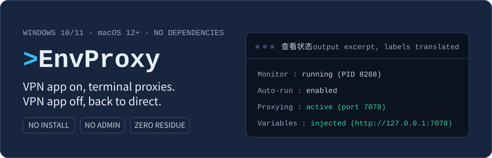
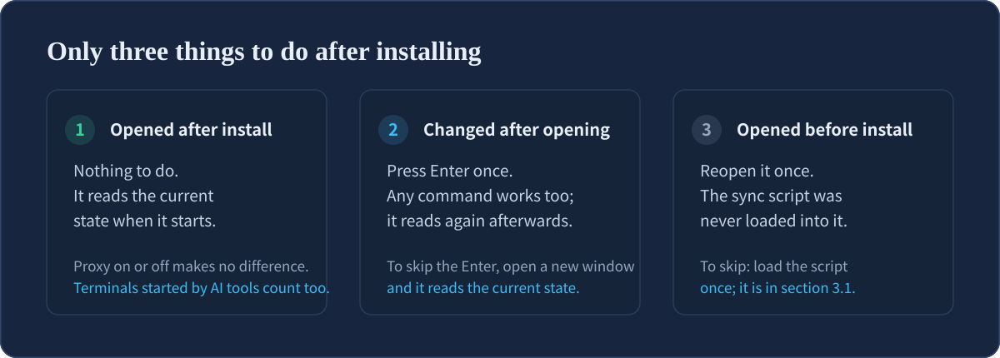
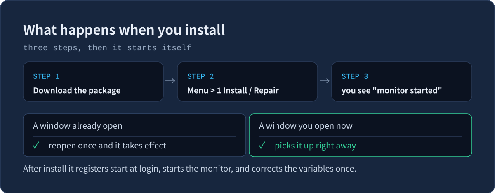
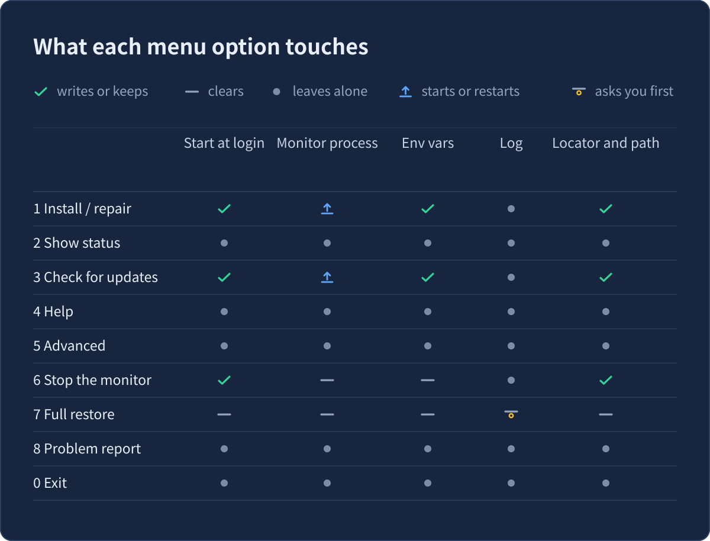
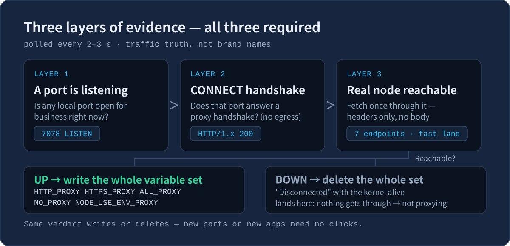
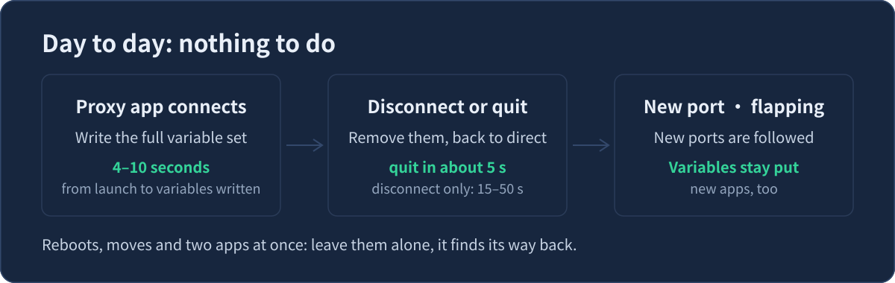
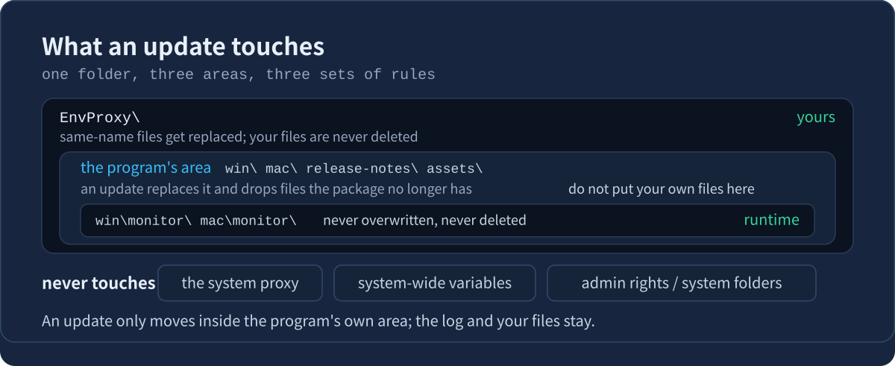
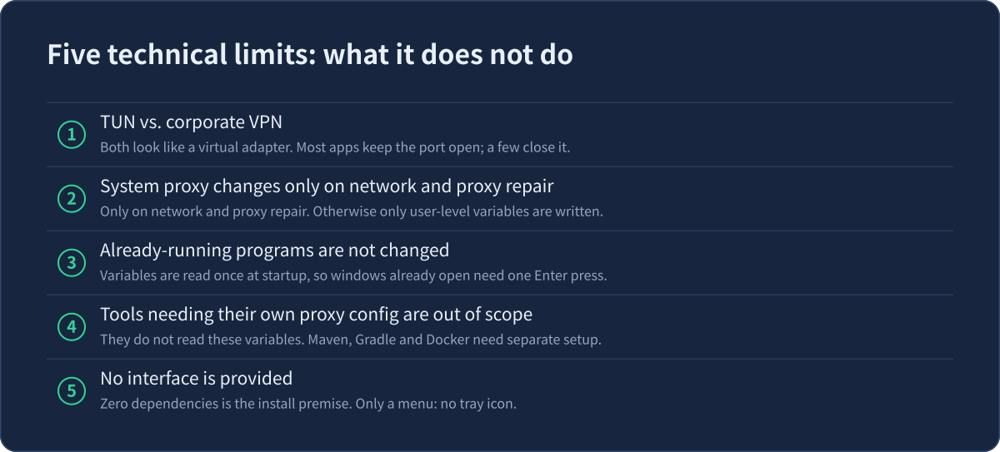
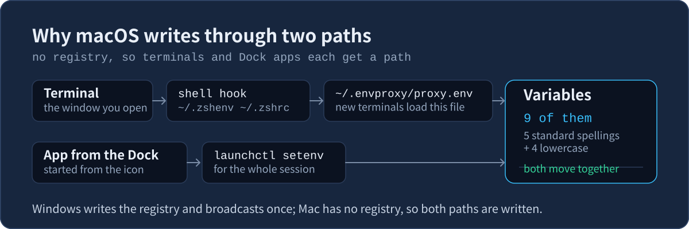
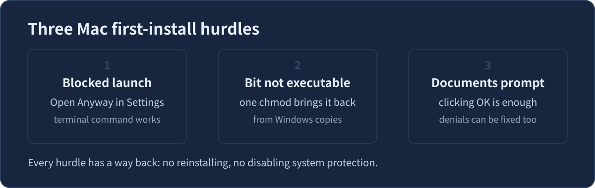

# EnvProxy — automatic proxy for your terminal

English | [简体中文](./README.md)

[](https://github.com/FiretrUCK666/envproxy/actions/workflows/check.yml)
[](https://github.com/FiretrUCK666/envproxy/releases)
[](LICENSE)
[](https://github.com/FiretrUCK666/envproxy/stargazers)



A proxy app covers your browser but not your terminal. `git`, `npm` and `curl` learn the proxy address from a set of settings called "environment variables", and without them they cannot reach the internet.

EnvProxy maintains those settings for you. While the proxy app is running it writes the proxy address in; when you quit it, it removes them. Day to day there are no commands to remember.



## Table of contents

<!-- toc:start -->

- [1. Install (3 steps, 5 minutes)](#1-install-3-steps-5-minutes)
- [2. Open the menu](#2-open-the-menu)
- [3. The nine help entries, one section each](#3-the-nine-help-entries-one-section-each)
- [4. What is inside Advanced (three modules)](#4-what-is-inside-advanced-three-modules)
- [5. Something is wrong: check in this order](#5-something-is-wrong-check-in-this-order)
- [6. How it decides whether you are behind a proxy](#6-how-it-decides-whether-you-are-behind-a-proxy)
- [7. Why it rarely breaks](#7-why-it-rarely-breaks)
- [8. Performance and traffic](#8-performance-and-traffic)
- [9. What is in the folder](#9-what-is-in-the-folder)
- [10. Copying and backing up the folder](#10-copying-and-backing-up-the-folder)
- [11. Setting it up for a friend or a new machine](#11-setting-it-up-for-a-friend-or-a-new-machine)
- [12. Technical limits (5)](#12-technical-limits-5)
- [13. macOS version](#13-macos-version)
- [14. License and feedback](#14-license-and-feedback)

<!-- toc:end -->

## 1. Install (3 steps, 5 minutes)

1. Click **[here to download the Windows package](https://github.com/FiretrUCK666/envproxy/releases/latest/download/EnvProxy-win.zip)** (Mac: [`EnvProxy-mac.tar.gz`](https://github.com/FiretrUCK666/envproxy/releases/latest/download/EnvProxy-mac.tar.gz))
2. Unzip anywhere; the folder can be renamed. Open `win` and double-click **`打开菜单.cmd`** (Mac: open `mac`, double-click **`打开菜单.command`**), pick **`1 Install / Repair`**
3. When you see the monitor started message, you are done

That is the end of it: in most cases there is nothing left to do. The three window cases (opened after installing, left open, opened before installing) are covered in [3.2](#32-what-do-i-do-after-installing).

Installing does four things: it saves your current variable values (restored on uninstall), registers start at login, adds a small sync script to your terminal's startup configuration, and starts the monitor plus corrects the variables once.

Progress is reported as steps 1–4, and each number means the same thing on both platforms: (1) start at login, (2) monitor, (3) variables, (4) terminal sync. Saving your original values happens before step 1, so it has no number of its own.



If something goes wrong, open the menu and pick **`1 Install / Repair`**. It fixes most problems, does not install a second copy, does not cut your network, and does not lose your settings.

> If the downloaded file is blocked the first time you double-click it: right-click, Properties, Unblock (or run `Unblock-File .\EnvProxy-win.zip`). Do not change your execution policy.

### Updating

Open the menu and pick **`3 Check for updates`**. It reports the latest version number and what changed, and installs only after you agree.

- **Updating does not need the proxy running**: most networks connect as they are. If it reports it cannot connect, first make sure the network itself works (open a familiar web page), then retry.
- **Checksums are verified before installing**: they are compared before installation, and nothing is installed if they do not match. A broken install is more trouble than no install. When an older release carries no checksum, or the file was just downloaded and antivirus still holds it open, this step is skipped and the install continues.
- **Only program files are replaced**: your files, logs and the run markers in `monitor\` are left alone. The monitor restarts on the new code afterwards.

## 2. Open the menu

Double-click `打开菜单.cmd` (Mac: `打开菜单.command`). It only passes the number you pick to the real program; it does not modify any file itself.

> **The menu and the program output are in Chinese.** This table gives the exact label you will see
> on screen first, then its English meaning: **`6 停止监控`** means **Stop monitoring**.
> The number is what you type; the label is what you will be looking at.

| Menu item | What it does | What it affects |
|---|---|---|
| **Everyday** | | |
| **1 Install / Repair** (`安装 / 修复`) | First time, or when in doubt | Startup, sync, vars, monitor |
| **2 Show status** (`查看状态`) | Monitor, proxy, sync, variables, version | Read-only |
| **3 Check for updates** (`检查更新`) | Shows what changed, then installs | Program files, then restart |
| **4 Help** (`帮助`) | Read it when you forget how it works | Prints text only |
| **Advanced** | | |
| **5 Advanced** (`高级功能`) | Rules / network fix / WSL | Adds an icon; fix clears dead-end settings |
| **Upkeep** | | |
| **6 Stop monitoring** (`停止监控`) | Temporary; returns at next login | Monitor + variables |
| **7 Full restore** (`一键恢复`) | Complete uninstall | Everything (log optional) |
| **Support** | | |
| **8 Problem report** (`问题反馈`) | Something is wrong | One report file |
| **Quit** | | |
| **0 Quit** (`退出`) | Closes the menu | Nothing |

The numbers run top to bottom and are grouped by how often you need them, so there is nothing to memorise.

**Pressing Enter directly means show status**, the item you look at most. The menu header shows whether the monitor is running and the current version, so you do not need to go in.


### Logs

`monitor\monitor.log` (Mac: `mac/monitor/monitor.log`) records the decisions it made. It is capped at 200KB and keeps only the most recent 200 lines once full.

Uninstalling asks whether to keep it. Keep it and this is the only file left; everything else is removed.

## 3. The nine help entries, one section each

Menu `4` opens Help: nine numbered entries, one entry answers one question, and the bottom line lists every number.

This chapter expands each one. The help screen gives you an answer you can use on the spot; this chapter gives you every command and every exception.

Each subsection stands on its own; there is no need to read them in order.

Below are the nine help entries, worded as they appear on that screen, with the matching section on the right:

| No. | One entry answers one question | In detail |
|---|---|---|
| 1 | What is this for | [3.1](#31-what-is-this-for) |
| 2 | What do I do after installing | [3.2](#32-what-do-i-do-after-installing) |
| 3 | Off the proxy, or on a corporate one | [3.3](#33-off-the-proxy-or-on-a-corporate-one) |
| 4 | Make one command skip the proxy | [3.4](#34-make-one-command-skip-the-proxy) |
| 5 | One program still cannot connect | [3.5](#35-one-program-still-cannot-connect) |
| 6 | Never send one program through it | [3.6](#36-never-send-one-program-through-it) |
| 7 | Something is wrong: check and report | [3.7](#37-something-is-wrong-check-and-report) |
| 8 | No internet after closing the app | [3.8](#38-no-internet-after-closing-the-app) |
| 9 | A tool's own proxy settings | [3.9](#39-a-tools-own-proxy-settings) |

### 3.1 What is this for

<details>
<summary>What gap it fills, and how it decides you are behind a proxy</summary>

**What gap it fills.**

The proxy app only manages your browser. `git`, `npm` and `curl` in the terminal are not its business; they read a set of settings called environment variables. That is why you can open pages in the browser while `git clone` hangs forever.

EnvProxy maintains those settings for you: written when the proxy app is up, removed when it goes down. No commands to remember, no switch to flip.

**How it knows you are behind a proxy.**

It checks every 2 to 3 seconds, and three conditions must all hold:

| Check | What must be true | What it rules out |
|---|---|---|
| 1 | Something on this machine is listening on a port | Nothing is running at all |
| 2 | That port answers the way a proxy does | Ordinary local services (web servers, dev servers) |
| 3 | It reaches outside, and one of 6 test sites fails without it | A live port with a dead node |

All three must pass before it touches anything. **It goes by none of brand, program name or port number** — those only speed up the search, they are never the evidence. Switch proxy apps, change ports: nothing needs reconfiguring.

**Why check 3 has to be that roundabout.**

Whether a given site opens directly is not a property of the site. It is a property of your machine's network plus your proxy app's routing rules, and the same site can go either way on a different network.

So the rule has to be "reachable through the proxy, and not reachable without it" — both halves, or neither counts. Drop either half and a dead proxy gets reported as working: every light on screen green, every command in the terminal failing.

The details (three-state judgement, expiry, the TUN case) are in [section 6](#6-how-it-decides-whether-you-are-behind-a-proxy).

</details>

### 3.2 What do I do after installing

<details>
<summary>Three window cases; you almost certainly fall into the first</summary>

**Most of the time: nothing at all.**

| Your situation | What happens | What you do |
|---|---|---|
| A window or program opened after installing | It read the current state when it started | Nothing |
| Left open while the proxy app switched | Holds the old state | Press Enter (cmd: reopen) |
| Opened before installing | No sync code was loaded | Run the line below, or reopen |

**To bring an old window up to date right now, load it by hand once:**

| Window | Command |
|---|---|
| PowerShell | `. $PROFILE` |
| Git Bash | `source ~/.bashrc` |
| Mac Terminal | `. ~/.envproxy/prompt-sync.sh` |
| cmd | No such command; reopen the window |

The leading `.` and the space after it are both required; the pair means "run this file in this window". It affects only the current window — every other open window needs its own turn.

If that window was opened before EnvProxy was ever installed, you will see a red "path not found" — normal, just reopen the window.

**Why an open window needs one Enter press.**

Every program reads "which proxy should I use" exactly once, at the moment it starts, and then it is fixed. Changes made later are invisible to a window that is already running.

EnvProxy picks the moment when each command finishes and your cursor comes back — you are typing commands anyway, so there is nothing extra to do.

**AI tools, editors, IDEs.**

They usually start the terminal as a new process, so they are current automatically.

Two cases need a restart of that tool: it was already running when you installed EnvProxy, or it sits in the background rather than starting on demand. If unsure, restart it once.

</details>

### 3.3 Off the proxy, or on a corporate one

<details>
<summary>Three things: always direct, a corporate proxy, and back to automatic</summary>

**One: keep this window off the proxy.**

| Window | Set this switch |
|---|---|
| PowerShell | `$env:ENVPROXY_TERM = 'off'` |
| Git Bash / Mac Terminal | `export ENVPROXY_TERM=off` |
| cmd | No such switch; see below |

This affects only the current window; other windows still follow the proxy app. It takes effect **on the next return to the prompt**; a command run on the same line still sees the old value.

**cmd has no prompt hook, so you clear the 5 variables yourself.** One at a time (a single line works too, but there must be no spaces around `&`; with a space the value becomes a space instead of empty, and the proxy still applies):

```
set HTTP_PROXY=
set HTTPS_PROXY=
set ALL_PROXY=
set NO_PROXY=
set NODE_USE_ENV_PROXY=
```

**Do not use `unset HTTP_PROXY`.** In Git Bash the hook writes lowercase names (`http_proxy` and friends); clearing the uppercase one leaves it in place, curl still goes through the proxy, and the next prompt writes it back anyway. The switch above is the real takeover.

**Confirm it took:**

| Window | Run this | What success looks like |
|---|---|---|
| PowerShell | `$env:HTTPS_PROXY` | Empty means the window is now pinned direct |
| cmd | `set HTTPS_PROXY` | Same |
| Git Bash / Mac Terminal | `echo $HTTPS_PROXY` | Same |

**Two: send this window through a corporate proxy.**

A corporate proxy and automatic following are **mutually exclusive**; pick one. **Step one hands over control, step two sets the address — the order matters.**

| Window | Step 1 | Step 2 |
|---|---|---|
| PowerShell | `$env:ENVPROXY_TERM = 'off'` | `$env:HTTPS_PROXY = 'http://your-address:port'` |
| Git Bash / Mac Terminal | `export ENVPROXY_TERM=off` | `export HTTPS_PROXY=http://your-address:port` |
| cmd | Clear those 5 variables | `set HTTPS_PROXY=http://your-address:port` |

**The cmd command that clears them (copy the whole line):**

```
set HTTP_PROXY=&set HTTPS_PROXY=&set ALL_PROXY=&set NO_PROXY=&set NODE_USE_ENV_PROXY=
```

Without handing over control first, the next change from the proxy app overwrites the address you just set.

Ask your company IT for `your-address:port`. **It is not the proxy app's port** — do not go looking there.

**Most tools (git, curl, pip, npm) are satisfied with `HTTPS_PROXY`.** If some program still does not comply, add one more line — it builds on the previous one, and you need both:

| Window | Copy this whole line |
|---|---|
| PowerShell | `$env:ALL_PROXY = 'http://your-address:port'; $env:NODE_USE_ENV_PROXY = '1'` |
| Git Bash / Mac Terminal | `export ALL_PROXY=http://your-address:port; export NODE_USE_ENV_PROXY=1` |
| cmd | `set ALL_PROXY=http://your-address:port&set NODE_USE_ENV_PROXY=1` |

**Confirm it took:**

| Window | Run this | What success looks like |
|---|---|---|
| PowerShell | `$env:HTTPS_PROXY` | It shows the corporate address you set |
| cmd | `set HTTPS_PROXY` | Same |
| Git Bash / Mac Terminal | `echo $HTTPS_PROXY` | Same |

If it shows the `127.0.0.1` port instead, step one did not take; go back and redo it.

**Three: go back to following the proxy app (undo everything above).**

| Window | Do this | What success looks like |
|---|---|---|
| PowerShell | `Remove-Item Env:ENVPROXY_TERM` | At the next prompt the address is the proxy app's again |
| Git Bash / Mac Terminal | `unset ENVPROXY_TERM` | Same |
| cmd | Reopen the window | — |

Clearing `ENVPROXY_TERM` withdraws all of it. The corporate address you set by hand will be overwritten by the proxy app — **that is correct**: it means "this window is back on automatic". The address itself is not deleted, the window just stops using it.

All of this applies only to the current window and disappears when you close it.

</details>

### 3.4 Make one command skip the proxy

<details>
<summary>The syntax for five tools, plus three traps</summary>

Every tool does it differently, and there is no universal command.

| Tool | PowerShell | cmd | Git Bash / Mac |
|---|---|---|---|
| `curl` | `curl.exe --noproxy "*" URL` | `curl --noproxy "*" URL` | `curl --noproxy '*' URL` |
| `git` | `git -c http.proxy= -c https.proxy= clone REPO` | Same | Same |
| `npm` | `npm --noproxy=registry.npmjs.org install PKG` | Same | Same |
| `wget` | Not bundled; if installed, `wget.exe --no-proxy URL` | Same | `wget --no-proxy URL` |
| `docker` | Change Docker's own settings; no single-command form | Same | Same |

Three traps, all found by testing:

- **Only PowerShell 5.1 aliases `curl` and `wget`** to `Invoke-WebRequest`; typing them there gives "parameter not found", so write `curl.exe`. **In cmd and PowerShell 7, `curl` is the real curl.exe** and either form works.
- **npm's `--noproxy` only understands host names; `*` does nothing.** It does not complain, requests still go through the proxy, and you will believe you bypassed it. Name the host.
- **`npm --no-proxy` is read as `--proxy=false`**, which is not the same as skipping the proxy. Use `--noproxy=host`.

Also: `git`'s `-c http.proxy=` must be left empty; empty means "this command does not use a proxy", any other value means "use that proxy instead". npm reads only `HTTPS_PROXY`, not `HTTP_PROXY` — EnvProxy writes both, which is why npm works normally.

These switches belong to each tool, not to EnvProxy. Without them, the tools read what EnvProxy wrote.

**Confirm it took:** run the command you just added the switch to. **If it works, the proxy was bypassed**; if it now fails, drop the switch and try again — that tells you whether the problem was the switch or the network.

</details>

### 3.5 One program still cannot connect

<details>
<summary>Why it ignores the setting, and how to give it an icon of its own</summary>

**Why it ignores the setting.**

Some programs never read the system-wide proxy; they read "which proxy should I use" once at start-up and ignore later changes. And they are usually launched from the desktop or taskbar, a layer that never sees what EnvProxy wrote.

The symptom: `git` works fine in the terminal while some GUI program cannot connect at all.

**The fix: give it an icon.**

Open the menu, pick `5 Advanced`, then `1 One program, one rule`. Choose the program (or type its path), choose where to put the icon, confirm.

It creates a new icon whose name ends in "proxy". Launch the program from that icon from then on.

**Three things to know:**

- **A program that is already running will not switch**; close it first, then use the icon.
- **Microsoft Store apps** (the kind with no standalone .exe) are not supported.
- The new icon can be pinned to the taskbar; deleting the desktop copy afterwards does not break the pin.

**After the proxy app changes ports.**

Programs launched from those icons are **unaffected** and keep working — they use a fixed entry (see below).

Only programs that read the setting once at start-up (the desktop-launched kind) stay on the old address. In a terminal, a newly opened window follows automatically; in PowerShell and Git Bash one Enter press is enough. When this happens a hint appears on screen, so you do not have to watch for it.

**What the fixed entry is for.**

Some programs copy the address you give them into their own settings and keep using it. When the proxy app changes ports they can no longer connect, and you have to go into that program's settings and fix it.

The fixed entry opens one address on this machine that never changes. Programs only know that address, and behind it the tool follows the proxy app. Icons use it automatically; there is nothing for you to do, and it runs alongside the monitor with no switch to flip.

It not working is not a problem either: the icon falls back to reading the current address and still works. To see how it is doing: menu `5` then `4` (view relay); that screen only reports.

**Done with it:** menu `5` then `3` (manage icons) shows the status and lets you delete them one by one.

The full description of this module (how the two platforms differ, the automatic adaptation for Chromium-based programs) is in [4.1](#41-give-one-program-its-own-rule).

</details>

### 3.6 Never send one program through it

<details>
<summary>Banking, government, intranet tools: they need "always direct"</summary>

**Why anyone needs this.**

Some programs break when they go through a proxy. Banking, government sites and company intranets are the usual cases: behind a proxy they refuse to log in, or get too slow to use. What they need is "always direct", even while everything else is proxied.

**The fix: give it an always-direct icon.**

Open the menu, pick `5 Advanced`, then `1 One program, one rule`, and choose the "always direct" rule. It creates a new icon whose name ends in "direct". Launching from that icon never uses a proxy.

**One program can have both** — one icon ending in "proxy" and one ending in "direct", independent of each other, with your original program untouched.

**How that works.**

When you double-click the icon, the proxy settings are **removed from that program's environment** before it starts. What it sees is exactly what it would see without this tool installed — not bypassed, genuinely absent.

Child processes it starts see the same, so the whole chain is clean.

**Two things to note:**

- **A program that is already running is unaffected**; close it, then use the icon.
- **The icon does not depend on the proxy app**: it opens the program normally even when the proxy app is off or not installed at all.

</details>

### 3.7 Something is wrong: check and report

<details>
<summary>Three checks, two common misunderstandings, how to file a report, and the switches</summary>

**Check one: look at the proxy variable in the failing window.**

| Window | Run this | What it means |
|---|---|---|
| PowerShell | `$env:HTTPS_PROXY` | An address means it is set; empty means it is not |
| cmd | `set HTTPS_PROXY` | Same |
| Git Bash / Mac Terminal | `echo $HTTPS_PROXY` | Same |

If it is empty, reopen the window first (see [3.2](#32-what-do-i-do-after-installing)).

**Check two: read the top line of the menu.**

If it says "not running", pick `1 Install / Repair`. That line also shows the current version, so you never need to go in.

**Check three: two common misunderstandings.**

- **npm reads only `HTTPS_PROXY`, never `HTTP_PROXY`.** If you cleared it yourself, npm stops working. EnvProxy writes both, which is why npm normally works.
- **"Proxy app" shows an address but "proxy variables" is empty** means the proxy app is running and EnvProxy has been stopped. Nothing is broken; pick `1` to restore.

**Match your symptom to a row.**

The table in [section 5](#5-something-is-wrong-check-in-this-order) lists the common symptoms and what to do about each, one per line.

**Still failing: file a report.**

Menu `8 Report`. It asks you four questions, adds the facts about this machine, saves a file and copies the path. You do not hunt for logs or type commands.

Then paste the file's contents on the project page (that is the only place issues are collected): https://github.com/FiretrUCK666/envproxy/issues

**To remove it completely.**

Menu `7 Uninstall`. It asks whether to keep the logs.

**Using it without the menu (scripts, remote sessions):**

| Task | Windows | Mac |
|---|---|---|
| Install / repair | `-Install` | `install` |
| Show status | `-Status` | `status` |
| Check for updates | `-Update` | `update` |
| Help | `-Help` | `help` |
| Advanced | `-Advanced` | `advanced` |
| Stop the monitor | `-Stop` | `stop` |
| Uninstall | `-Uninstall` | `uninstall` |
| Report a problem | `-Report` | `report` |
| Open the menu | `-Menu` | `menu` |
| Self-test (diagnostics) | — | `self-test` |
| Strip a broken marker from the profile | `-RepairProfile` | `repair-profile` |
| Status as one JSON line (for scripts) | `-Status -Json` | `status --json` |

Change into the program folder (`win` or `mac`) first; skipping that gives "file not found".

```
cd win
powershell -ExecutionPolicy Bypass -File envproxy.ps1 -Status
```

```
cd mac
bash envproxy.sh status
```

**Write parameters in full; abbreviations are rejected.** `-Instal` with a letter missing is refused — deliberately, because a typo would otherwise perform a real install.

`-Yes` (Mac: `--yes`) goes with check-for-updates and uninstall and means do not ask. For uninstall it is also the **only** way to remove the tool where no question can be asked (scripts, remote sessions).

`-Json` (Mac: `--json`) goes only with show status: one machine-readable JSON line for scripts, status bars and scripted rollouts. The fields are fixed (`schema` / `state` / `port` / `proxy` / `monitor` / `issues` and so on) and all ASCII; `state` has three values, and `unknown` means "this round could not read the port", not "there is no proxy".

</details>

### 3.8 No internet after closing the app

<details>
<summary>Work out which kind of "no internet" this is, then decide what to touch</summary>

**Work out which kind it is.**

| Symptom | Whose problem | Where to go |
|---|---|---|
| Only the browser fails, others fine | The browser proxy points at nothing | "Fix it yourself" below |
| Only one tool (`git`, `npm`) fails | That tool's own config file | "How to fix it yourself" below |
| Nothing works at all | The network itself; unrelated to this tool | Check the cable, Wi-Fi, router first |

**The most common cause: the proxy app did not exit cleanly.**

Most proxy apps remove their system settings on a normal exit. But when one is **killed** — a hard shutdown, power loss, End Task, a crash — it never gets the chance.

The setting remains, so the browser and the tools keep knocking on a program that no longer exists, and even domestic sites fail. **The network is not down; the signpost points the wrong way.**

**How to fix it yourself.**

Open the menu, pick `5 Advanced`, then `2 Network and proxy repair`. It looks at three places: the system proxy settings, the config files of terminal tools (`git config`, `~/.npmrc` and the like), and name resolution.

Anything fixable is confirmed with you first, and the original is saved before it changes. Afterwards, close and reopen both the browser and the failing tool.

**What it will not touch.**

- A corporate or school proxy is left byte for byte alone.
- Anything managed by administrator policy is left alone; changing it would just be reverted.
- A port that is still alive (you are using it) is left alone.
- It only repairs "points at this machine, and that program is gone".

**If it repaired the wrong thing.**

Open that screen again and press `r` to undo the most recent repair.

**What it cannot see.**

It reads settings, not whether the network works. An unplugged cable, an unjoined Wi-Fi or a dead router will also report "nothing wrong".

The full description is in [4.2](#42-network-and-proxy-repair).

</details>

### 3.9 A tool's own proxy settings

<details>
<summary>Which four tools need filling in, where the wording is, and what a stale port does</summary>

**Most tools need nothing.**

`git`, `npm`, `curl`, `pip`, `cargo`, `wget`, `Bun`, `Go` and `Deno` read the environment variables only. Once this tool sets them, those tools follow; you do not edit any config file.

**These four need filling in, and the wording lives in Advanced.**

They ignore the variables and read the copy inside their own settings:

| Tool | Where the ready-made wording is |
|---|---|
| Maven | menu `5` → "Maven / Gradle / SSH" |
| Gradle | same page |
| SSH | same page (the fix when `git@github.com` cannot connect) |
| Docker | menu `5` → "Docker behind a proxy" |

Those two pages are complete and ready to copy (including how to write `~/.docker/config.json`), so this section does not repeat them — the same thing written in two places will disagree sooner or later.

**What a stale port does.**

That tool can never connect, and the error does not mention this tool — so you go looking at the network.

Menu `5 Advanced` → `5 Network and proxy repair` reads all of those places and fixes what it can (an undo point is recorded first; `r` on that screen restores it). For the exact rules it follows, see [4.2](#42-network-and-proxy-repair).

</details>
## 4. What is inside Advanced (three modules)

Menu `5` is where these live. It holds three unrelated things, each solving one concrete annoyance.

Each subsection stands on its own; there is no need to read them in order.

**Jump straight to what you need:**

| What you want to do | Section |
|---|---|
| One program should use the proxy, or not | [4.1](#41-give-one-program-its-own-rule) |
| Pages or terminal tools fail | [4.2](#42-network-and-proxy-repair) |
| Want WSL / Docker too, or Maven / Gradle / SSH | [4.3](#43-places-this-tool-cannot-reach) |

### 4.1 Give one program its own rule

<details>
<summary>Build an icon that sends one program through the proxy, or keeps it off (the original program is untouched)</summary>

**Where the problem comes from.**

This setting is all-or-nothing: it defines one proxy for the whole machine, and every program gets the same one. That leaves two situations awkward:

- Some programs read environment variables only at the moment they start and never look again. The environment Explorer hands them may have been fixed at login, so later proxy changes never reach them. The symptom: `git` works fine in the terminal, but some GUI program cannot connect at all.
- The opposite case: you do **not** want a particular program to use the proxy (online banking, an intranet tool), yet the machine-wide setting drags it along.

**How it helps.**

It builds an icon for that program. Double-clicking it prepares the environment first (setting what should be set, clearing what should be cleared), then hands control to the real program. Two rules to pick from:

| Rule | What happens on double-click |
|---|---|
| Use the proxy | The program starts with the current proxy, following your proxy app |
| Always direct | The program never uses a proxy, even while everything else does |

**One program can have both.**

The two icons do not fight each other: `WeChat (proxy)` and `WeChat (direct)` are independent icons, each minding its own business, and your original WeChat is untouched. Remove them under "Manage" when you no longer want them.

**Why the address never needs changing.**

A proxy app's local port changes: switch apps, a random port on restart, or the port is taken and the app moves on. When that happens, some programs keep the old address and stop connecting — and you have to fix it in their own settings.

This tool opens a **fixed entry** on your machine (an address that never changes). Proxy icons only know that address, and behind it the tool follows the proxy app. So changing ports are none of your business, and you never rebuild an icon.

**Four things worth knowing:**

- **It runs alongside the background program.** No switch to turn on or off. On Windows, menu `5` then `4` (view relay) shows how it is doing; that screen only reports and changes nothing. macOS needs no such layer and has no "view relay" item under `5`.
- **It not working is not a problem.** A proxy icon falls back to reading the current address and still works. You only lose the "address never changes" part.
- **Icons you already made need no rebuild** — every launch reads the current state again.
- **Chromium-based programs are adapted automatically (Windows only).** Chrome, Edge, VS Code and Discord ignore environment variables and only honour a launch flag. You answer no questions: the tool recognises them itself and adds one line to the confirmation screen saying the program needs the flag and it has been added. The macOS build does no such adaptation; use the system proxy for those programs.

**The two platforms do it differently.**

Windows builds an ordinary shortcut, macOS builds a small standalone app wrapper (`MyApp (proxy).app`). **What they share is that neither touches the original program** — modifying it on macOS breaks its code signature and the system refuses to open it.

</details>

### 4.2 Network and proxy repair

<details>
<summary>Repair four leftovers: the system proxy, terminal config files, DNS, and SOCKS-only ports</summary>

**Where the problem comes from.**

A proxy app removes its system proxy setting when it closes normally. But when it is **killed** — a hard shutdown, power loss, End Task, or a crash — it never gets the chance.

The system still says "send browser traffic to `127.0.0.1:7078`", but nothing is listening there any more. Every time the browser goes online it knocks on a door that no longer exists, so **even domestic sites fail**.

**The same fault shows up in three more places**, and any of them can keep you offline:

- **Config files of terminal tools.** Plenty of people have run `git config --global http.proxy …` from an online tutorial, or written an address into `~/.npmrc`. Those settings **outrank environment variables** — this tool can manage the variables perfectly and still lose. The symptom: the browser is fine and only `git clone` or `npm install` keeps failing.
- **Name resolution (DNS).** Some proxy apps change the system DNS addresses and never change them back on exit. Both Windows and macOS are checked.
- **SOCKS-only ports.** Some clients open a SOCKS port and nothing else; this tool, like most terminal tools, speaks HTTP proxy, so it cannot use that port. The screen names it and tells you how to turn on the HTTP or mixed port in the client.

This screen looks at all four and lists the conclusions in the order network, browser, terminal tools.

**What it looks like when this is the problem.**

The environment variables this tool manages are fine, so you feel "the network obviously works, just not this one thing".

**How it repairs.**

It turns off only the switch that is wrong and leaves every other byte alone:

| Situation | What it does |
|---|---|
| Loopback address, port already gone | Turns that setting off, or deletes the line |
| Not a loopback address (company, school) | Leaves it alone |
| Port still alive (you are using it) | Leaves it alone |
| Managed by administrator policy | Leaves it alone |
| Cannot tell | Leaves it alone |
| Name resolution broken | Warns only, changes nothing (see below) |

It saves the original first, so you can put it back (press `r` on that screen; it undoes the **last** repair).

**Why DNS is only reported, never changed.**

Changing it back automatically would require knowing which DNS your router will hand out once you switch to automatic — and that answer does not exist before the change. Guessing wrong swaps a working address for a broken one, which is worse than the original fault. So this item explains what it found and leaves the one click in system settings to you.

**On Windows it also points out one thing you would never find yourself.**

If you set DNS for "all networks" and also for one particular Wi-Fi, the system only uses one of them and the other silently does nothing. Nothing on screen tells you that; this screen does.

**Where it stops working.**

This matters more than everything above, because it tells you where to look next.

It looks at four places only: the proxy setting the browser uses, terminal tool config files (including Maven, Gradle, NuGet, Conda and SSH), the name-resolution addresses, and whether this machine has a SOCKS-only port. If it says nothing is wrong, that does not mean your network is fine — only that these four are clean.

If the network still fails, the cause may be elsewhere: a virtual adapter (TUN), the routing table, firewall rules, or an adapter that never got an address. It cannot see any of those, and will not touch them.

**It looks at settings, not at whether the network works.** So an unplugged cable, an unjoined Wi-Fi or a dead router will also report "nothing wrong" — what it checks is whether something points the wrong way, not whether the road itself is open.

</details>

### 4.3 Places this tool cannot reach

<details>
<summary>WSL, Docker and Maven / Gradle / SSH: three places with their own settings, with ready-made versions</summary>

**This item only explains; it changes nothing of yours.**

It covers three places: another system (WSL), containers (Docker), and programs that copy the address into their own config (Maven / Gradle / SSH). None of them read the variables this tool sets, and getting them wrong stops them from starting — so this tool gives you the wording and keeps its hands off.

**The short version:** your computer has more than one room.

```
Your Windows      your own room, the one this tool manages
WSL               the next room, a real Linux
Docker            one more room, where Docker Desktop lives
```

Each room **manages its own network settings**. The note you stick on your own door (environment variables) is invisible to the next room.

Maven, Gradle and SSH are not rooms — they are locked cabinets. They copy the address inside and only ever read that copy.

**So who decides:**

| Who | Who decides whether it uses the proxy |
|---|---|
| `git` / `npm` / `curl` | This tool (they read the note on your door) |
| Browsers / desktop apps | Your proxy app (they only read the system proxy) |
| Things inside WSL | WSL's own settings |
| Things inside Docker | Docker's own settings |
| Maven / Gradle / SSH | The line inside their own config |

**One: WSL (menu `5` → "WSL behind a proxy", Windows only)**

The right way is to let it read Windows' notice board directly — two lines in `C:\Users\<you>\.wslconfig` (Windows 11 22H2 or newer):

```
[wsl2]
networkingMode=mirrored
autoProxy=true
```

Save it, run `wsl --shutdown` once in PowerShell, and WSL follows the Windows proxy from then on.

**The wrong way is copying the note across**: it says "the address in my room", so the next room looks it up and finds itself, looping forever. That is the mistake most online guides make.

**Two: Docker (menu `5` → "Docker behind a proxy", both platforms)**

Slow pulls need Docker Desktop's own settings: `Settings → Resources → Proxies`, filled with the local proxy port (Windows: the fixed entry `127.0.0.1:17099`; Mac: the current port).

A program inside a container needs it passed in separately — host variables do not go in by themselves: `docker run -e HTTP_PROXY=http://host.docker.internal:17099 image`.

To set it once and forget it, edit `~/.docker/config.json` (create it if missing) and add this block:

```json
{
  "proxies": { "default": {
      "httpProxy": "http://host.docker.internal:17099",
      "httpsProxy": "http://host.docker.internal:17099",
      "noProxy": "localhost,127.0.0.1" } }
}
```

If the file already holds something else (login details, for instance), add only the `proxies` block rather than replacing the file. It covers containers and builds but not `docker pull` — that is the first layer above.

Note that editing `daemon.json` does nothing on Docker Desktop — it does not read that file.

**Three: Maven / Gradle / SSH (menu `5` → "Maven / Gradle / SSH", both platforms)**

These three ignore the variables and read the address in their own config file. The menu has all three ready to copy:

| Program | What to fill in |
|---|---|
| Maven | `127.0.0.1:17099` inside `<proxy>` in `~/.m2/settings.xml` |
| Gradle | `systemProp...Port=17099` in `~/.gradle/gradle.properties` |
| SSH | `ProxyCommand` in `~/.ssh/config`, one of the two ways below |

**That SSH case (`git@github.com:xxx/yyy.git` cannot connect) has two fixes; pick one.**

First, have git rewrite it to the equivalent https address — one command, undoable any time:

```
git config --global url.https://github.com/.insteadOf git@github.com:
```

To undo:

```
git config --global --unset url.https://github.com/.insteadOf
```

Second, let SSH hand it to the proxy. Add these two lines to `~/.ssh/config`:

```
Host github.com
  ProxyCommand connect -H 127.0.0.1:17099 %h %p
```

On a Mac, replace the second line with `ProxyCommand nc -X connect -x 127.0.0.1:port %h %p` — `connect` ships only with Git for Windows, while `nc` comes with the system.

On Windows, `17099` is this machine's fixed entry: the address never changes and follows the proxy app in the background, so you fill it in once. Menu `5` → `4 View the relay` says whether it is running.

The Mac version has no such layer (see [13.1](#131-difference-from-the-windows-version)): everything above uses the current port and changes once when the proxy port moves; for `ProxyCommand` use `nc -X connect -x 127.0.0.1:port %h %p`. You do not have to hunt for it — `4.2 Network and proxy repair` points at the line with the stale port and repoints it for you.

</details>

## 5. Something is wrong: check in this order

**Work through the list in order, finishing one step before starting the next.**

| What you see | Most likely cause | What to do |
|---|---|---|
| "Unrecognized switch" / "argument" | A typo, or an abbreviation | Write parameters in full |
| Proxy still not used | Window opened before installing | Open a new window, or see 3.2 |
| Still failing after that | The monitor is not running | Menu, pick 1 (Install / Repair) |
| "Missing program files" | Folder not copied in full, or deleted | Re-download and unzip over it |
| Variables come back after removal | Node is unstable | Expected. If it persists, switch nodes |
| Variables linger after disconnect | "Disconnect" leaves the core running | Expected. Quit the app |
| Sync "installed but cannot run" | Execution policy blocks the profile | See the section below |
| Only `git` / `npm` fail | A proxy is hard-coded in their config | Menu 5 → network and proxy repair |
| Only Maven / Gradle / SSH fail | They read only their own config | Menu 5 → network and proxy repair (3.9) |
| All of the above tried | — | Pick 2, screenshot, then pick 1 |

**If "Terminal sync" says "installed but cannot run"**

PowerShell does not run profile files by default, and terminal sync depends on exactly that. Run this once in PowerShell:

```powershell
Set-ExecutionPolicy RemoteSigned -Scope CurrentUser
```

`RemoteSigned` means locally written scripts run, while anything downloaded must be signed. It is looser than the default `Restricted` and safer than `Unrestricted`, which is the usual choice for daily use. Reopen a window afterwards.

If it still fails, the policy is being enforced by Group Policy (common on work or school machines); only an administrator can change that. The status page tells you which case you are in.

> Do not confuse this with the note in section 1: "do not change your execution policy" refers to the downloaded package being blocked, which you fix by unblocking the file or running `Unblock-File`, not by touching the policy. This section is about the profile itself failing to run, which is a different thing.

> Most problems are solved by **picking 1** in the menu. It does not install a second copy, does not cut your network, and does not lose your own settings.

## 6. How it decides whether you are behind a proxy

It checks every 2 to 3 seconds (2 while proxying, 3 while direct), but **it does not trust a port just because it exists**. Three conditions must hold:



1. **A port is listening** — some program on this machine opened a proxy port
2. **It really is a proxy** — a `CONNECT` handshake must answer `HTTP/1.x 200`. This rules out development servers and ordinary web servers
3. **It really reaches the internet** — the port is used to reach **6 different endpoints** (a handful of well-known test URLs), and **any one** returning the right answer is enough. But that alone is not enough: on your machine that URL must **not** give the right answer without the proxy (unreachable, timed out, or hijacked to a login page all count as "not giving it"). If it opens just fine directly too, whatever it answers proves nothing about the proxy. **One exception**: if your proxy client captures all traffic (TUN mode), all six URLs open directly, the tool cannot tell good from bad, and it falls back to the old rule (any reply counts as working) and says so in the log

All three must hold before any variable is written. A web server on your machine is never mistaken for a proxy.

It does not rely on brands, process names or port numbers — those only speed up scanning; the decision always goes through these three.



**Deciding "disconnected" is far more cautious than deciding "connected"**:

- One failed probe is **not** a disconnect; it takes 10 seconds of continuous failure and at least 3 probes
- A single success counts as connected immediately

Removing your variables by mistake costs more than waiting a little. After a conclusion it keeps watching for another 1 minute, so a wrong call corrects itself.

| Action | Takes effect in |
|---|---|
| Starting the proxy app | about 6-10 seconds |
| Quitting the proxy app entirely | about 8 seconds |
| Disconnecting only, without quitting | about 15–50 seconds |
| Reconnecting after a drop | about 10–25 seconds |

**Which variables it writes** (the whole set goes in and comes out together):

| Variable | Value | Purpose |
|---|---|---|
| `HTTP_PROXY` | `http://127.0.0.1:port` | Proxy for http:// requests |
| `HTTPS_PROXY` | `http://127.0.0.1:port` | Proxy for https:// requests |
| `ALL_PROXY` | `http://127.0.0.1:port` | Fallback for protocols the others do not cover |
| `NO_PROXY` | `localhost,127.0.0.1,::1,…` | Local and intranet addresses bypass it |
| `NODE_USE_ENV_PROXY` | `1` | Makes newer Node tools read the proxy from the environment |

Windows gets 5, macOS gets 9 (the same 5, plus a lowercase spelling of the 3 address entries and of the exception list `NO_PROXY`; `NODE_USE_ENV_PROXY` is a switch, so it has no lowercase form). Windows variable names are case-insensitive, so a lowercase entry only overwrites the same one; macOS treats each case separately and some tools read only lowercase.

<details>
<summary>Why these settings are what they are (does not affect usage, expand to read)</summary>

- Proxy values always use `http://`, never `socks5://`. The local proxy port answers both protocols, some tools accept only `http://`, and unifying gives the widest compatibility with no loss of function. Tools such as `dsh` warn and skip when they see a SOCKS value.
- Why Windows gets only one spelling: the two spellings are the same variable there, and a duplicate makes .NET hosts fail while building their table with `An item with the same key has already been added`, affecting everything running in that terminal window.
- IPv6 addresses inside `NO_PROXY` must be written as bare `::1`. Written as `[::1]`, httpx treats it as an ordinary domain, builds an invalid pattern, and every request afterwards fails with `InvalidURL`. Brackets are URL literal syntax, in the wrong position here.
- The full value is `localhost,127.0.0.1,::1,.local,.lan,.internal,169.254.169.254`. The first three are local addresses, the middle three are intranet-only suffixes (never public domain names), and the last is the cloud metadata address: those three suffixes are never public domain names, and sending them into a tunnel is always wrong. **No CIDR ranges**: curl, Python and Node each parse `NO_PROXY` differently, so a range is usually ignored and only makes you think the intranet is covered. Add your own corporate suffix by hand, for example `.corp.example.com`.
- Your own `NO_PROXY` entries are never removed, only added to. Uninstalling reclaims only what this tool wrote.
- If another program corrupts the variables (overwrites, clears, or drops an entry), nothing needs doing: the monitor re-checks the whole table every 30 rounds and writes back only what is missing.
- The tools below do not read those 5 variables and need separate configuration. This is not a defect in this tool:

| Tool | Where to configure it |
|---|---|
| Maven | `<proxies>` in `settings.xml` |
| Gradle | `systemProp.http(s).proxyHost/Port` in `gradle.properties` |
| JDK native HttpClient | JVM system properties (or `java.net.useSystemProxies` to use the system proxy) |
| Docker Desktop `docker pull` | Docker Desktop's own settings; it ignores the proxy in `daemon.json` |
| SSH (`git@github.com` addresses) | `ProxyCommand` in `~/.ssh/config` |

Conversely, these tools read **only** the environment variables — set them and you never edit those tools' own config: `git`, `npm` / `pnpm` / Yarn / `Bun`, `curl`, `wget`, `pip` / `uv` / Poetry / Conda, `cargo` / `rustup`, `Go`, `Deno`, `dotnet`, Homebrew, Composer.

- `NODE_USE_ENV_PROXY` only affects newer Node: `node:http(s)` needs 22.21 / 24.5 or later, and `fetch()` needs 22.21 / 24.0 or later. Older versions ignore it, which is expected.

</details>

## 7. Why it rarely breaks

The rule is: **when unsure, do nothing.**

- **Cannot read it, do not act**: if the port list cannot be read, it does not treat that as "no proxy" and delete your variables. It keeps the previous state.
- **Only our own values are cleared**: values you changed, corporate proxies, other ports — none are touched. With no ownership record it changes nothing.
- **Backup before editing**: `$PROFILE` and the Mac rc files get a `.envproxy.bak` copy first. If the write fails, nothing changes at all.
- **Writes keep files intact**: content goes to a temporary file and then replaces the original. A power cut or a forced stop leaves the original complete.
- **Re-installing is harmless**: when everything is already right it does not touch your settings.
- **Uninstalling checks each item**: everything is read back, and any residue is reported as "incomplete" rather than claimed as success.

## 8. Performance and traffic

- **Almost no overhead once stable**: each port is probed at most once every 15 seconds, reading only response headers, under 1KB each time.
- **Shorter intervals while gathering evidence**: when failures appear but stay below the threshold it probes every 5 seconds. After the conclusion flips it keeps watching for another 60 seconds at that rate (so it does not flip straight back), then returns to 15 seconds.
- **No residue after uninstalling**: variables, start at login, the locator script and the sync block are all removed, leaving only the log if you kept it.
- **Delay at the prompt is imperceptible**: before each prompt it reads the local state once (PowerShell reads the registry, Git Bash reads a small state file, Mac reads `proxy.env`) and starts no external process at all.

## 9. What is in the folder

Unzipping gives roughly this. The folder can be renamed; each package contains only its own platform, so the Windows package has no `mac\` and vice versa.

```
EnvProxy\
  win\                   Windows version
    打开菜单.cmd         the only file you double-click on Windows
    envproxy.ps1         the program
    locator.ps1          source for the login locator (generated into %LOCALAPPDATA%\EnvProxy\launcher.ps1)
    lib\                 program library (leave it alone)
    monitor\             created at runtime, holds the log
  mac\                   Mac version, same layout
    打开菜单.command       the only file you double-click on a Mac
    envproxy.sh          the program
    locator.sh           source for the login locator (counterpart of win's locator.ps1)
    prompt-sync.sh       the terminal sync script (zsh/bash)
    test-mac-pure.sh     self-test script (used by self-test; ships with the package)
    lib\  monitor\        program library; created at runtime, holds the log
  README.md  README.en.md  Chinese and English docs
  LICENSE  VERSION         license and version
  release-notes\          what changed per release (shown by Check for updates)
  assets\readme\          images used by the README
```

The two sides line up one to one. Only two files are Mac-only: `prompt-sync.sh` and `test-mac-pure.sh` (the Windows terminal sync script is generated by the installer, so it is not in the folder). The `assets` folder holds the pictures the two READMEs use; you can ignore it.

Three areas with different rules:

- **Program files**: `win\`, `mac\`, `release-notes\`, `assets\`. Updates overwrite these — **do not put your own files there**.
- **Repo only, not in the package**: `tests\`, `.github\`, `.gitattributes`.
- **Runtime folder**: `monitor\`. Logs and run markers, **never overwritten, never deleted**.
- **Top level**: only files of the same name are overwritten, **your own things are never deleted**.

Day to day you only open `win\` (or `mac\`).

### Where the installer writes things

<details>
<summary>What it writes outside this folder (registry, config files, run logs), and what uninstall clears</summary>

All of it is **outside** this folder, so an update that overwrites the program files never touches them:

| Where | What | What it is for |
|---|---|---|
| `%LOCALAPPDATA%\EnvProxy\` | `launcher.ps1` | locator; the login item uses it to find the program |
| | `terminal.env` | the mirror file Git Bash reads: current state and proxy address |
| | `launchers\` | startup scripts for the proxy-aware shortcuts (only exists once you use menu 5) |
| | `relay.port` | the fixed-entry port; shortcuts read it on every launch |
| `HKCU\Environment` | those 5 proxy variables | where the terminal actually picks up the proxy |
| `HKCU\Software\EnvProxy` | `ScriptPath` + `Owned`/`Backup` | where it is; what we wrote; yours |
| `HKCU\...\Run` | one start-up entry | launches the background program when you log in |
| Your PowerShell profile | one block marked `EnvProxy` | syncs on every return to the prompt |
| Your Git Bash `~/.bashrc` | one block, same markers | Git Bash reads the mirror on every prompt |
| `~\.envproxy\` | `prompt-sync.sh` | what Git Bash reads on every prompt |
| `win\monitor\` | `monitor.log` | the decisions it made (black box) |
| | `monitor.pid` | the process id of the background program |
| | `monitor.beat` | heartbeat: process id plus start time |
| | `version.cache` | cached version, written by the background program |
| | `state.snapshot` | state snapshot written by the background program; the status page only reads it |
| | `doctor.journal` | settings from before each repair, so the last one can be undone. Keeps 5 |
| | `doctor.bak` | older restore point, only on upgraded machines. Still read; gone after one undo |
| | `stopped.intent` | the record that you stopped it on purpose |
| | `stop.flag` | temporary stop signal, deleted after use |
| | `update.inprogress` | written while program files are being replaced |
| | `notify.last` | the state last warned about; keeps the same change from being reported twice |
| | `report-*.txt` | the report written by "Problem report"; open it yourself before sending it on |

The items in `win\monitor\` are local runtime state. Deleting them is harmless (the background program recreates them) and does not touch the program files.

Uninstalling removes all of the above, keeping only the `monitor.log` you chose to keep and any `report-*.txt` you generated (those are yours to send on, so they are not deleted by default). Only an explicit "delete the logs too" wipes the whole `monitor` folder, reports included.

`~\.envproxy\` contains **exactly one file, `prompt-sync.sh`**. Anything else appearing there means something other than this tool wrote it — uninstall names each one and reports it, but does not delete it for you (it may be yours).



</details>

## 10. Copying and backing up the folder

**It can be copied, renamed and moved.** One thing to know: **once the original location is renamed or moved, the running monitor can no longer find its own program.** It exits by itself and clears the proxy variables, so no stale setting is left behind.

Two ways to bring it back:

- **Wait for the next login**: the locator script finds the new location and takes over.
- **Bring it back now**: double-click Install / Repair once.

The search covers two areas:

- **Desktop, Documents, Downloads, OneDrive, `.config`**: **six levels** down
- **The root of each non-system drive**: **four levels** down (the system drive's root is skipped, so it does not walk the whole disk)

That is why `C:\Projects\EnvProxy` is not found but `D:\Projects\EnvProxy` is. Move it outside those areas and you have to double-click Install once.

A copied backup **is never mistaken for the live one**, since log activity decides which is running, so backups can stay in place.

## 11. Setting it up for a friend or a new machine

1. Get the package onto the new machine, either way: click **[Windows download](https://github.com/FiretrUCK666/envproxy/releases/latest/download/EnvProxy-win.zip)**, or copy the whole unzipped folder over (USB drive, cloud storage, or an archive all work)
2. Double-click `win\打开菜单.cmd` and pick `1 Install / Repair`
3. Done. No administrator rights are needed, and nothing else has to be installed

> Windows users can stop here. Each platform has its own package: Mac users download the Mac package, and an existing folder that contains `mac\` works as it is.

> **Before you hand the whole folder to someone else, delete the `win\monitor\` folder.**
> It holds the run records this machine generated for itself (log, process id, state snapshot),
> including your timestamps and ports. Deleting it changes nothing: a new machine rebuilds it on first run.

## 12. Technical limits (5)



| Limit | Reason | Effect |
|---|---|---|
| **TUN vs. corporate VPN** | Both are virtual adapters | Most apps keep the port open; a few close it |
| **Only that one repair screen edits them** | Editing elsewhere breaks browsers | Only a dead loopback port |
| **Running programs are not changed** | Read once at startup | Open windows need one Enter |
| **Tools with their own proxy config** | They do not read these | Maven, Gradle, Docker: section 6 |
| **No interface** | Zero dependencies is the premise | Only a menu: no tray, no window |

One thing worth stating plainly about TUN: **most apps keep their local proxy port open in TUN mode**, so this tool detects them and keeps working, and you do nothing. **A few apps close that port.** Then there is nothing to detect. That is not a defect: it is how those apps work, and in that mode the app itself already carries all traffic, so whether terminal tools need a proxy is up to that app.

**Several copies open at once is fine.** Two windows on the same folder, or one copy on D: and another on E: — all of them can be open.

They edit the same settings (your environment variables, start-at-login, the system proxy, the icons on your Desktop), so this tool makes them **queue**: only one actually acts at any moment. The other says plainly that another install is running and that nothing was changed, then changes nothing.

The background monitor works the same way: ten open menus still produce **one** monitor (the extras exit by themselves), so you never get ten monitors fighting over your environment variables.
Why it does not try to recognise TUN and special-case it: a TUN adapter and a corporate VPN adapter look the same. A wrong call there would declare a live proxy dead and remove your only proxy path. The two mistakes do not cost the same, so it does nothing.

Mac adds one: **the `launchctl` environment is cleared at login and reboot**, so the monitor writes it again every 30 rounds and it returns by itself after a restart.

## 13. macOS version

### 13.1 Difference from the Windows version

<details>
<summary>Where it writes, why macOS needs no fixed entry, and which shells are supported</summary>

Windows writes the registry and broadcasts a change notification; Mac writes `~/.envproxy/proxy.env` and calls `launchctl setenv`. Both paths are updated together, so the behaviour you see is the same.

**That is why Mac needs no "fixed entry"** (the thing described in 4.1): `launchctl setenv` reaches programs the system launches afterwards, so a program sees the current address the moment it starts — nothing stashes an old one. Windows is the other case: a program started from the desktop or Start menu inherits the environment fixed at login, which is why an unchanging address is needed there.

On the terminal side, the Mac default shell is `zsh` (since macOS 10.15) and `bash` 3.2 is still shipped.

**Both are supported**: the installer drops one line into `.zshenv`/`.zshrc` and into `.bash_profile`/`.bashrc`, so either shell follows along.

**`fish` is not supported**, and the honest reason is that we have not written that implementation yet — not that fish cannot do it. fish has its own mechanism (`conf.d` auto-loading plus the `fish_prompt` event); we simply do not hook it. If you use fish, pin the window to the proxy value you want (see 3.2).



</details>

### 13.2 Install (3 steps)

<details>
<summary>How to install, what it needs, minimum macOS</summary>

1. Put the Mac package (`EnvProxy-mac.tar.gz`) anywhere on the Mac, or copy the whole folder that contains `mac\` (USB drive, AirDrop, or an archive all work)
2. Open `mac` and double-click `打开菜单.command`, then pick `1 Install / Repair`
3. Once you see the monitor started message, you are done

No Homebrew, Python or Node is needed, no `sudo`, and the `zsh` that ships with macOS 12 and later is enough. (Mac only: download [`EnvProxy-mac.tar.gz`](https://github.com/FiretrUCK666/envproxy/releases/latest/download/EnvProxy-mac.tar.gz).)

</details>

### 13.3 Menu (same as Windows)

<details>
<summary>Numbering matches, but from 4 onwards the two mean different things</summary>

The behaviour and what each item affects are the same as Windows, and so are the numbers (`0` through `8` are the same on both machines). Pressing Enter directly means show status.

**`5 Advanced` has 6 items on Mac and 8 on Windows.** The first 3 share the same name on both (make a proxied
icon, make a direct icon, manage what you made). **From item 4 onward the meanings diverge** — Windows item 4 is
"view relay" (read only, changes nothing) while Mac item 4 is "network and proxy repair" (it changes system settings).
So do not match items across platforms by number; match by name.

Mac lacks these 2: **view relay** (Windows uses a fixed entry to survive a changing proxy port; Mac solves that
differently, see section 4) and **WSL behind a proxy** (WSL is a Windows thing). Both sides do have **Docker behind
a proxy** and **Maven / Gradle / SSH to fill in**: those two pages only explain and change nothing; Windows fills in
the fixed entry 17099 there, Mac the current port.

</details>

### 13.4 What is in the `mac` folder

<details>
<summary>Only two files are Mac-only</summary>

See the folder structure in section 9. Two files are Mac-only with no Windows counterpart: `prompt-sync.sh` (the terminal sync script used by zsh and bash) and `test-mac-pure.sh` (the self-test script).

The locator has a source file on each platform — `locator.sh` on Mac, `win\locator.ps1` on Windows. The installer uses it to generate the copy that actually runs at login, in a fixed location (Windows: `%LOCALAPPDATA%\EnvProxy\launcher.ps1`).

</details>

### 13.5 Three problems you may hit on first install on a Mac

<details>
<summary>Will not open, permission denied, shows not running</summary>



The three are unrelated; read only the one you hit.

**1. Double-clicking does nothing, or you see "cannot be opened"**

macOS tagged the download as coming from the internet.

- Right-click it, then choose **Open** (do not double-click)
- Or run this in a terminal: `xattr -d com.apple.quarantine 打开菜单.command`

**2. You see "Permission denied"**

The script is not executable.

Run this in a terminal: `chmod +x 打开菜单.command`

**3. It installed, but the status says it is not running**

Two possible causes. After fixing either one, open the menu and pick **1 安装 / 修复** (Install / Repair) again.

- **The background item was blocked**: System Settings, General, Login Items & Extensions, allow it to run
- **The "access your Documents folder" prompt was denied**: System Settings, Privacy & Security, Files and Folders

</details>

### 13.6 What the installer adds

<details>
<summary>Where it writes what, and what each of the three menu actions touches</summary>

Installing writes files to three places. **None of them is the folder you downloaded.**

| Where | Files | What they are for |
|---|---|---|
| `~/.envproxy/` | `locator.sh` | the locator script (tells start-at-login where the program is) |
| | `prompt-sync.sh` | the terminal sync script, referenced by one line in the rc files |
| | `path.conf` | records where the project folder currently is |
| | `proxy.env` | the environment variables for the terminal path and the current state |
| | `owned.env` | the values we wrote, so clearing removes only those |
| | `prev.env` | the original values saved at install time, restored on uninstall |
| | `monitor.stdout.log` | what the background program prints (look here when login start-up misbehaves) |
| | `monitor.stderr.log` | errors the background program reports |
| | `apps/` | app wrappers are built here, then copied to the Desktop (only exists once you use menu 5) |
| | `locks/monitor.lock` | single-instance lock, so two copies never run at once |
| | `locks/op.lock` | one install/uninstall/stop/update at a time |
| | `shortcut-dirs.txt` | folders you picked by typing a path, so those icons stay findable |
| `~/Library/LaunchAgents/` | one `*.plist` | the start-at-login item that launches it when you log in |
| `mac/monitor/` inside the project folder | `monitor.log` | the decisions it made (black box) |
| | `monitor.pid` | the process id of the background program |
| | `version.cache` | cached version, written by the background program |
| | `state.snapshot` | verdict the background program writes every round; the status page only reads it |
| | `doctor.journal` | settings from before each repair, so the last one can be undone. Keeps 5 |
| | `doctor.bak` | older restore point, only on upgraded machines. Still read; gone after one undo |
| | `report-*.txt` | reports built by "Problem report"; open one before sending it |
| | `stopped.intent` | the record that you stopped it on purpose |
| | `stop.flag` | temporary stop signal, deleted after use |
| | `update.inprogress` | written while program files are being replaced |
| | `notify.last` | the state last warned about; keeps the same change from being reported twice |

These locks live here rather than in the project folder because they must cover **every** copy: two windows on the same folder, or one copy on D: and another on E:, all queue on the same lock. Keep them in the project folder and each copy would take its own lock, which is no lock at all.

Your shell config files (`~/.zshrc`, `~/.bashrc` and the like) also gain one small block, marked `EnvProxy` at both ends; removing that block turns off auto-follow for that terminal.

The items in `mac/monitor/` are local runtime state. Deleting them is harmless (the background program recreates them) and does not touch the program files.

**`proxy.env`, `owned.env` and `prev.env` are macOS-only**: Windows never writes them and does not recognise them. The Windows `~\.envproxy\` holds only `prompt-sync.sh`.

**The project folder can be moved anywhere**: it is located again at the next login, and a backup folder is never picked up by mistake. Uninstalling removes all of the above, keeping only the `monitor.log` you chose to keep and any `report-*.txt` you generated (those are yours to send on, so they are not deleted by default). Only an explicit "delete the logs too" wipes the whole `monitor` folder, reports included.

#### What each button actually removes

The three actions differ a lot in force. Read before clicking:

| What you click | Deletes | Keeps |
|---|---|---|
| `6 Stop monitoring` | the process and its pid file | every other file |
| `1 Install / repair` | nothing; overwrites our own files | your config and logs |
| `7 Full restore` | all we wrote | the `monitor.log` you kept |

What each one means in practice:

- **Stop monitoring** switches nothing automatically until the next login, which brings it back. To have it back now, click `1`.
- **Install / repair** loads the latest code and repairs a broken start-at-login item.
- **Full restore** returns the machine to the never-installed state, with no reboot needed. Anything you put in `~/.envproxy/` yourself is left alone.


One rule applies to all three: `~/.envproxy/` is only removed when it is empty. If you keep something of your own there (notes, say), the folder survives uninstalling - only our files are gone.

**Uninstalling is the only irreversible action**, so it asks first. When it cannot ask (a pipe, a script) it **will not decide for you**: it refuses and requires `--yes`.

</details>

### 13.7 Setting it up for a friend or a new Mac

<details>
<summary>Copy it over, double-click, pick 1</summary>

Copy the whole folder over, open `mac`, double-click `打开菜单.command`, pick `1 Install / Repair`, and you are done.

</details>

## 14. License and feedback

MIT license, free to use and modify.

Report problems at **[GitHub Issues](https://github.com/FiretrUCK666/envproxy/issues)**. Including these saves a lot of back and forth:

- A screenshot of `2 Show status` from the menu
- The last 20 lines of `monitor\monitor.log` (Mac: `mac/monitor/monitor.log`)
- Your operating system version, and the name of the proxy app you use