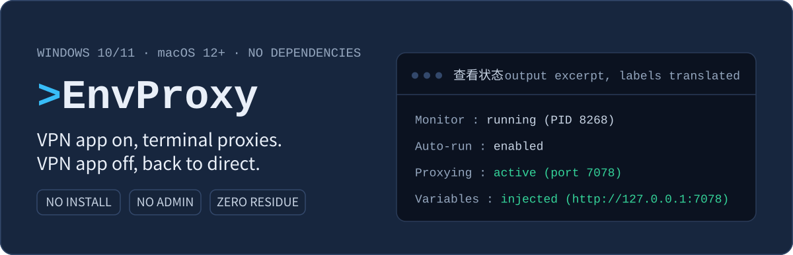
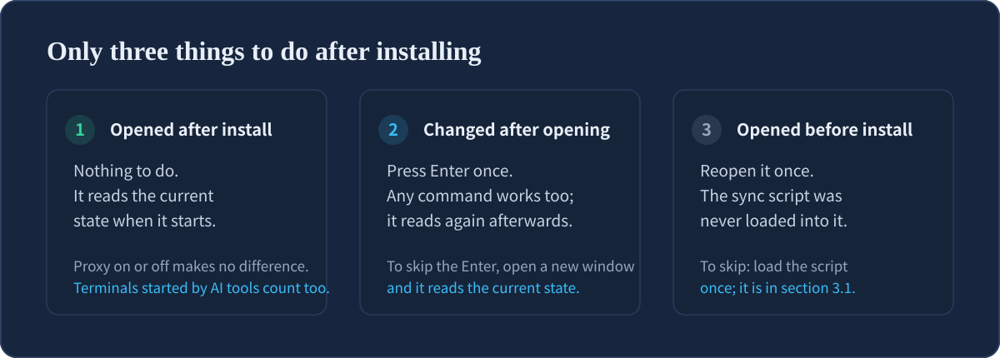
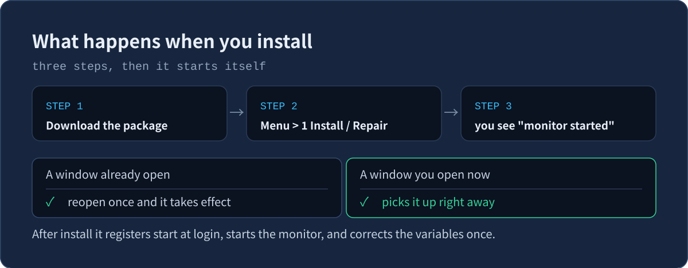
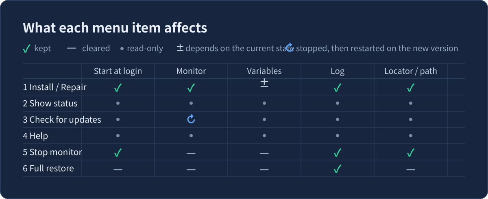
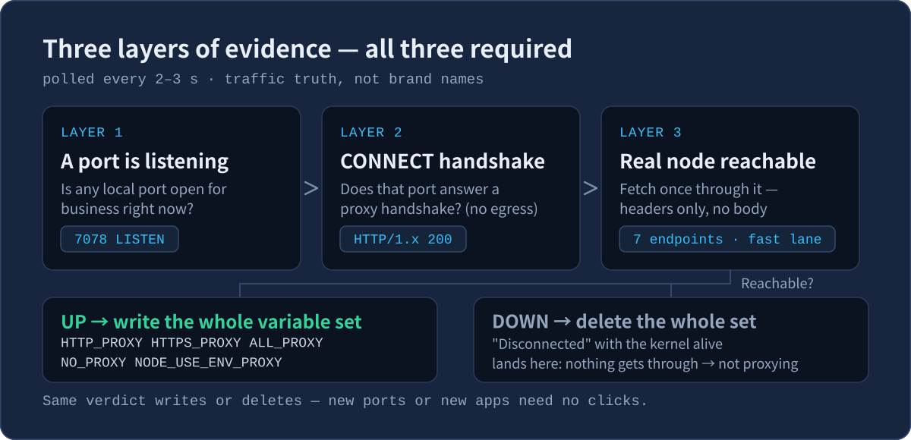
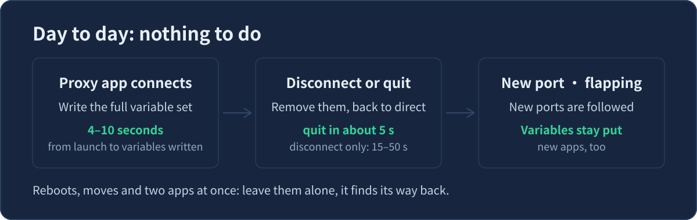
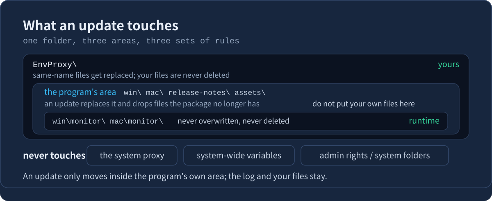
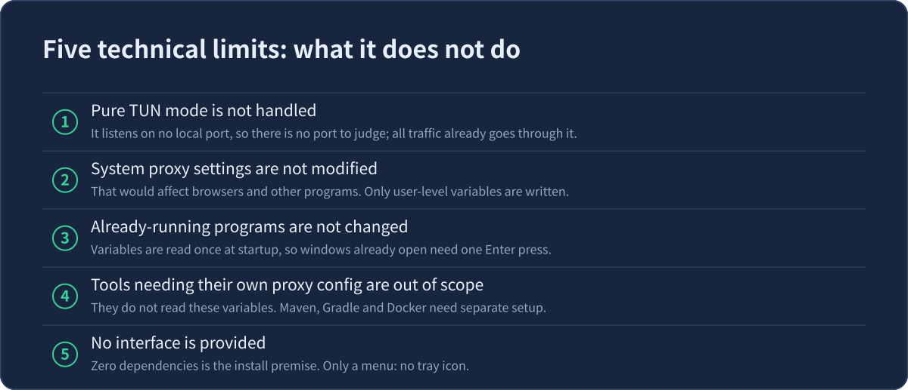
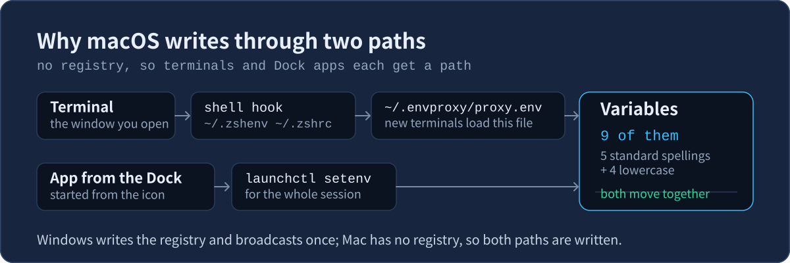
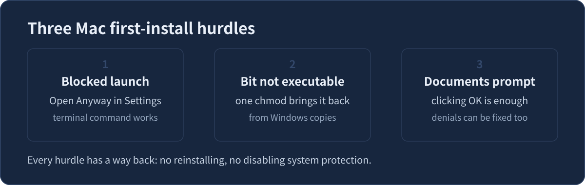

# EnvProxy — automatic proxy for your terminal

English | [简体中文](./README.md)

[](https://github.com/FiretrUCK666/envproxy/actions/workflows/check.yml)
[](https://github.com/FiretrUCK666/envproxy/releases)
[](LICENSE)
[](https://github.com/FiretrUCK666/envproxy/stargazers)



A proxy app covers your browser but not your terminal. `git`, `npm` and `curl` learn the proxy address from a set of settings called "environment variables", and without them they cannot reach the internet.

EnvProxy maintains those settings for you. While the proxy app is running it writes the proxy address in; when you quit it, it removes them. Day to day there are no commands to remember.



## Table of contents

<!-- toc:start -->

- [0. What happens after installing](#0-what-happens-after-installing)
- [1. Install (3 steps, 5 minutes)](#1-install-3-steps-5-minutes)
- [2. Open the menu](#2-open-the-menu)
- [3. Everyday commands on one page](#3-everyday-commands-on-one-page)
- [4. Something is wrong: check in this order](#4-something-is-wrong-check-in-this-order)
- [5. How it decides whether you are behind a proxy](#5-how-it-decides-whether-you-are-behind-a-proxy)
- [6. Why it rarely breaks](#6-why-it-rarely-breaks)
- [7. Performance and traffic](#7-performance-and-traffic)
- [8. What is in the folder](#8-what-is-in-the-folder)
- [9. Copying and backing up the folder](#9-copying-and-backing-up-the-folder)
- [10. Setting it up for a friend or a new machine](#10-setting-it-up-for-a-friend-or-a-new-machine)
- [11. Technical limits (5)](#11-technical-limits-5)
- [12. macOS version](#12-macos-version)
- [13. License and feedback](#13-license-and-feedback)

<!-- toc:end -->

## 0. What happens after installing

Almost always nothing. Of the three cases below, only the first needs nothing from you; the other two cost at most reopening one window.

| Your situation | What happens | What you do |
|---|---|---|
| **Opened after installing** | It reads the state at startup | **Nothing** |
| **Kept open, proxy changed later** | It still holds the old state | Press Enter (cmd must be reopened) |
| **Opened before installing** | The sync code was never loaded | Open a new window, or load it as in 3.1 |

### Why an open window needs one Enter press

Each program reads the environment variables once, at startup, and keeps that copy. Changing them later in the system does not reach a window that is already running.

So new windows are always right, and old ones need to read again. EnvProxy reads at the moment a command finishes and the cursor comes back, which happens all the time anyway.

### AI tools, editors, IDEs

They usually open a terminal as a new process, so they are correct automatically.

Two need a restart: it was already open before you installed EnvProxy, or it runs in the background rather than on demand. If unsure, restart it once.

## 1. Install (3 steps, 5 minutes)

1. Click **[here to download the Windows package](https://github.com/FiretrUCK666/envproxy/releases/latest/download/EnvProxy-win.zip)** (Mac: [`EnvProxy-mac.tar.gz`](https://github.com/FiretrUCK666/envproxy/releases/latest/download/EnvProxy-mac.tar.gz))
2. Unzip anywhere; the folder can be renamed. Open `win` and double-click **`打开菜单.cmd`** (Mac: open `mac`, double-click **`打开菜单.command`**), pick **`1 Install / Repair`**
3. When you see the monitor started message, you are done

Installing does four things: it saves your current variable values (restored on uninstall), registers start at login, adds a small sync script to your terminal's startup configuration, and starts the monitor plus corrects the variables once.

Progress is reported as steps 1–4, and each number means the same thing on both platforms: (1) start at login, (2) monitor, (3) variables, (4) terminal sync. Saving your original values happens before step 1, so it has no number of its own.



If something goes wrong, open the menu and pick **`1 Install / Repair`**. It fixes most problems, does not install a second copy, does not cut your network, and does not lose your settings.

> If the downloaded file is blocked the first time you double-click it: right-click, Properties, Unblock (or run `Unblock-File .\EnvProxy-win.zip`). Do not change your execution policy.

### Updating

Open the menu and pick **`3 Check for updates`**. It reports the latest version number and what changed, and installs only after you agree.

- **Updating does not need the proxy running**: most networks connect as they are. If it reports it cannot connect, first make sure the network itself works (open a familiar web page), then retry.
- **Checksums are verified before installing**: they are compared before installation, and nothing is installed if they do not match. A broken install is more trouble than no install. When an older release carries no checksum, or the file was just downloaded and antivirus still holds it open, this step is skipped and the install continues.
- **Only program files are replaced**: your files, logs and the run markers in `monitor\` are left alone. The monitor restarts on the new code afterwards.

## 2. Open the menu

Double-click `打开菜单.cmd` (Mac: `打开菜单.command`). It only passes the number you pick to the real program; it does not modify any file itself.

> **The menu and the program output are in Chinese.** This table gives the exact label you will see
> on screen first, then its English meaning: **`6 停止监控`** means **Stop monitoring**.
> The number is what you type; the label is what you will be looking at.

| Menu item | What it does | What it affects |
|---|---|---|
| **Everyday** | | |
| **1 Install / Repair** (`安装 / 修复`) | First time, or when in doubt | Startup, sync, vars, monitor |
| **2 Show status** (`查看状态`) | Monitor, proxy, sync, variables, version | Read-only |
| **3 Check for updates** (`检查更新`) | Shows what changed, then installs | Program files, then restart |
| **4 Help** (`帮助`) | Read it when you forget how it works | Prints text only |
| **Advanced** | | |
| **5 Advanced** (`高级功能`) | Shortcut, rescue | Adds one icon; rescue edits the proxy only |
| **Upkeep** | | |
| **6 Stop monitoring** (`停止监控`) | Temporary; returns at next login | Monitor + variables |
| **7 Full restore** (`一键恢复`) | Complete uninstall | Everything (log optional) |
| **Support** | | |
| **8 Problem report** (`问题反馈`) | Something is wrong | One report file |
| **Quit** | | |
| **0 Quit** (`退出`) | Closes the menu | Nothing |

The numbers run top to bottom and are grouped by how often you need them, so there is nothing to memorise.

**Pressing Enter directly means show status**, the item you look at most. The menu header shows whether the monitor is running and the current version, so you do not need to go in.

The menu and help use only two actions: **type a number** to do that thing; **press Enter** to go back — in the main menu that means show status, in help it means go back one level. There are no other keys to remember.

Pick `4` for help: one entry answers one question, chosen by what you are stuck on.

| No. | One entry answers one question |
|---|---|
| 1 | What is this for |
| 2 | What do I do after installing |
| 3 | Keep this window off the proxy / use a corporate proxy |
| 4 | Make one command skip the proxy |
| 5 | One program still cannot reach blocked sites |
| 6 | Something is wrong: how to check, how to report |
| 7 | No internet after closing the proxy app |

Once inside, the bottom line lists every number, with the one you are reading in brackets.



### Logs

`monitor\monitor.log` (Mac: `mac/monitor/monitor.log`) records the decisions it made. It is capped at 200KB and keeps only the most recent 200 lines once full.

Uninstalling asks whether to keep it. Keep it and this is the only file left; everything else is removed.

## 3. Everyday commands on one page

**You do not normally need this section.** The proxy app switching on and off is all it takes; the terminal follows without any command. Read on only when you want to manage one specific window, or want to confirm the install really took.

Each subsection stands on its own; there is no need to read them in order.

**Jump straight to what you need:**

| What you want to do | Section |
|---|---|
| A window is stuck on old values | [3.1](#31-a-window-you-already-have-open-needs-one-enter-press) |
| Keep this window direct | [3.2](#32-pin-this-window-to-a-direct-connection--go-back-to-automatic) |
| Use a corporate proxy | [3.3](#33-send-this-window-through-a-corporate-proxy) |
| Skip the proxy for one command | [3.4](#34-make-one-command-skip-the-proxy) |
| Confirm it is installed | [3.5](#35-how-to-confirm-it-really-took) |
| Use switches, not the menu | [3.6](#36-use-it-without-the-menu-scripts-remote-sessions) |

First, work out which terminal you are in. The four take different commands:

| Prompt looks like | What you are using | How to open it |
|---|---|---|
| `PS C:\...>` | PowerShell (ships with Windows) | Start menu, search PowerShell |
| `C:\...>` | cmd (Command Prompt, ships with Windows) | Start menu, search Command Prompt |
| `name@host MINGW64 ~ $` | Git Bash (a bash shell **on Windows**) | Start menu, search Git Bash |
| `name@host ~ %` | Mac Terminal (zsh by default) | Launchpad, search Terminal |

Three things that trip people up:

- **Git Bash is a Windows thing.** It comes with Git for Windows; there is no such name on a Mac. It and the Mac Terminal both use bash-style syntax, which is why the sections below often cover them together.
- **The Mac Terminal is not bash by default, it is zsh**, so the prompt ends with `%` rather than `$`. The syntax is the same as bash, so the commands below work as written.
- Windows Terminal is only the window that hosts a shell: what you open inside it (PowerShell, cmd or Git Bash) is your choice. It is not a shell itself.

**Follows automatically**: PowerShell, Git Bash, and the Mac Terminal (zsh and bash both work). **Does not follow**: cmd (it has no "run something on every prompt" mechanism, so reopen the window) and fish (we have not written that implementation yet, see 12.1).

### 3.1 A window you already have open needs one Enter press

> **A cmd window is the exception: pressing Enter does nothing, you have to reopen it.**
>
> cmd has no "run this on every prompt" mechanism, so it follows nothing at all.
> PowerShell, Git Bash and the Mac Terminal all catch up when you press Enter; cmd does not.
> If you work in cmd, reopen the window once after installing, and again each time the proxy app switches.

**For every other terminal:**

EnvProxy follows the proxy app: connect it and the terminal uses the proxy; disconnect it and the terminal goes direct again. **A newly opened window is always current.**

A window that was already open does not change on its own. Every program reads the environment once, at the moment it starts; after that it cannot see later changes. To update it, **press Enter in that window** (or run any command).

| Your window | What state it holds | What to do |
|---|---|---|
| Opened after installing | Already current | Nothing |
| Kept open while the proxy app was switched | The old state | Press Enter once |
| Opened before installing EnvProxy | The sync code was never loaded | Open a new window |


**A cmd window can only be reopened.** Pressing Enter does nothing there: cmd has no "run this before every prompt" mechanism.

If you would rather not reopen and not press Enter, load it by hand once:

| Window | Command |
|---|---|
| PowerShell | `. $PROFILE` |
| Git Bash | `source ~/.bashrc` |
| Mac Terminal | `. ~/.envproxy/prompt-sync.sh` |

The leading `.` and the space after it are both required; it means "run this file in this window". It affects only this window, so other open windows each need their own. If EnvProxy was never installed from this window, you may see a red "cannot find path" error: that is expected, just open a new window.

**Confirm it took:**

| Window | Type this | What success looks like |
|---|---|---|
| PowerShell | `$env:HTTPS_PROXY` | A value means it caught up; empty means still direct |
| cmd | `set HTTPS_PROXY` | Same as above |
| Git Bash / Mac Terminal | `echo $HTTPS_PROXY` | Same as above |

If the proxy app is running and you see nothing, this window has not caught up yet: press Enter once more.

### 3.2 Pin this window to a direct connection / go back to automatic

**Keep this one window off the proxy.** Only this window is affected; the others still follow the proxy app.

| Window | Set this switch |
|---|---|
| PowerShell | `$env:ENVPROXY_TERM = 'off'` |
| Git Bash / Mac Terminal | `export ENVPROXY_TERM=off` |
| cmd | No such switch; see below |

A variable set on a command line takes effect at the **next prompt**, not on that same line.

**cmd has no prompt hook, so clear the five variables yourself.** One per line (a single line also works,
but leave no spaces around `&`: a space makes the value a single space, and the proxy keeps working):

```
set HTTP_PROXY=
set HTTPS_PROXY=
set ALL_PROXY=
set NO_PROXY=
set NODE_USE_ENV_PROXY=
```

**Do not use `unset HTTP_PROXY`.** In Git Bash the hook writes the lower-case spellings (`http_proxy` and friends);
unsetting the upper-case one leaves them behind, curl still honours them, and the next prompt writes them back.
The switch above is the only real takeover.

**Confirm it took:**

| Window | Type this | What success looks like |
|---|---|---|
| PowerShell | `$env:HTTPS_PROXY` | Empty means it is pinned to direct |
| cmd | `set HTTPS_PROXY` | Same as above |
| Git Bash / Mac Terminal | `echo $HTTPS_PROXY` | Same as above |

**Going back to following the proxy app:**

| Window | Do this | What success looks like |
|---|---|---|
| PowerShell | `Remove-Item Env:ENVPROXY_TERM` | At the next prompt `$env:HTTPS_PROXY` has a value |
| Git Bash / Mac Terminal | `unset ENVPROXY_TERM` | At the next prompt `echo $HTTPS_PROXY` has a value |
| cmd | Reopen the window | — |

Still empty while the proxy app is running means the monitor is not running: pick 1 (Install / repair) in the menu.

These changes only live in that window. Close it and they are gone.

### 3.3 Send this window through a corporate proxy

A corporate proxy and auto-follow are **mutually exclusive**; pick one.

**Step 1: take over. Step 2: set the address. The order matters.**

| Window | Step 1 | Step 2 |
|---|---|---|
| PowerShell | `$env:ENVPROXY_TERM = 'off'` | `$env:HTTPS_PROXY = 'http://your-host:port'` |
| Git Bash / Mac Terminal | `export ENVPROXY_TERM=off` | `export HTTPS_PROXY=http://your-host:port` |
| cmd | Clear those 5 variables (full line below) | `set HTTPS_PROXY=http://your-host:port` |

**The cmd clearing command (copy this whole line):**

```
set HTTP_PROXY=&set HTTPS_PROXY=&set ALL_PROXY=&set NO_PROXY=&set NODE_USE_ENV_PROXY=
```

Skip the takeover and the next change the proxy app makes overwrites the address you just set.

Replace `your-host:port` with what your company gave you — ask IT. This is **not** the proxy app's port.

**Confirm it took:**

| Window | Type this | What success looks like |
|---|---|---|
| PowerShell | `$env:HTTPS_PROXY` | Your corporate address means it took |
| cmd | `set HTTPS_PROXY` | Same as above |
| Git Bash / Mac Terminal | `echo $HTTPS_PROXY` | Same as above |

Seeing the `127.0.0.1` address instead means step 1 did not take: go back and redo it.

**Some programs ignore that one; add one more line**

Most tools (git, curl, pip, npm) are fine with `HTTPS_PROXY`.
The rest need `ALL_PROXY` — **copy the whole line below**, it complements the line above; you need both.

| Window | Copy this whole line |
|---|---|
| PowerShell | `$env:ALL_PROXY = 'http://your-host:port'; $env:NODE_USE_ENV_PROXY = '1'` |
| Git Bash / Mac Terminal | `export ALL_PROXY=http://your-host:port; export NODE_USE_ENV_PROXY=1` |
| cmd | `set ALL_PROXY=http://your-host:port&set NODE_USE_ENV_PROXY=1` |

**Confirm the extra one took:**

| Window | Type this | What success looks like |
|---|---|---|
| PowerShell | `$env:ALL_PROXY` | A value means it took |
| cmd | `set ALL_PROXY` | Same as above |
| Git Bash / Mac Terminal | `echo $ALL_PROXY` | Same as above |

**Going back to following the proxy app (undoes everything above)**

| Window | Do this | What success looks like |
|---|---|---|
| PowerShell | `Remove-Item Env:ENVPROXY_TERM` | At the next prompt the address is the proxy app's again |
| Git Bash / Mac Terminal | `unset ENVPROXY_TERM` | At the next prompt the address is the proxy app's again |
| cmd | Reopen the window | — |

After that, the corporate address you set is overwritten by the proxy app's — **that is correct**,
it means the window is back on auto. Your address was not deleted; this window just stops using it.

### 3.4 Make one command skip the proxy

Tools differ, and there is no single universal command.

| Tool | PowerShell | cmd | Git Bash / Mac |
|---|---|---|---|
| `curl` | `curl.exe --noproxy "*" URL` | `curl --noproxy "*" URL` | `curl --noproxy '*' URL` |
| `git` | `git -c http.proxy= -c https.proxy= clone REPO` | same | same |
| `npm` | `npm --noproxy=registry.npmjs.org install PKG` | same | same |
| `wget` | not bundled; if installed, `wget.exe --no-proxy URL` | same | `wget --no-proxy URL` |
| `docker` | change Docker's own settings; no per-command flag | same | same |

Three traps, all measured:

- **Only in PowerShell 5.1 are `curl` and `wget` aliases** pointing at `Invoke-WebRequest`, so typing them there fails with "parameter not found" and you must write `curl.exe`. **In cmd and in PowerShell 7, `curl` is the real curl.exe**, so the plain form works.
- **npm's `--noproxy` accepts domains only; `*` does nothing.** It does not complain, requests still go through the proxy, and you think you bypassed it. Use a real domain.
- **`npm --no-proxy` is read as `--proxy=false`**, which is not the same as "skip the proxy". Use `--noproxy=domain`.

Also: `git`'s `-c http.proxy=` must be left empty — empty means "this command skips the proxy", any other value means "use that proxy instead". npm reads only `HTTPS_PROXY`, not `HTTP_PROXY`; EnvProxy writes both, so npm works, but if you set only `HTTP_PROXY` yourself npm will not be proxied.

These flags belong to each tool, not to EnvProxy. Without them, the tools read the variables EnvProxy wrote.

**Confirm it took:** run the same command you just added the flag to. **If it works, the proxy really was bypassed.** If it fails instead, drop the flag and try again, which tells you whether the flag or the network was at fault.

### 3.5 How to confirm it really took

Pick **2 Check status** in the menu and look at the "terminal sync" line:

| Shown | Meaning | What to do |
|---|---|---|
| Active | Normal | Nothing |
| Installed but cannot run | Execution policy blocks it | Follow that hint (section 4) |
| Markers are unpaired | Something left half a marker | Delete that lone marker line, then pick 1 |
| No sync block in the profile | Never installed, or cleaned away | Run **1 Install / repair** |
| Cannot read the profile path | Rare; this run cannot tell | Look again shortly; if it stays, run 1 |

### 3.6 Use it without the menu (scripts, remote sessions)

The menu is for double-clicking. When you write a script, or connect remotely with no graphical desktop, use the command-line parameters. The first eight rows below match the eight menu actions one to one; the next row (`-Menu`) simply opens the menu itself; the last two rows (`self-test`, `-RepairProfile`) have no menu entry, as they exist for troubleshooting.

| Goal | Windows | Mac |
|---|---|---|
| Install / repair | `-Install` | `install` |
| Show status | `-Status` | `status` |
| Check for updates | `-Update` | `update` |
| Help | `-Help` | `help` |
| Advanced | `-Advanced` | `advanced` |
| Stop monitoring | `-Stop` | `stop` |
| Full restore | `-Uninstall` | `uninstall` |
| Problem report | `-Report` | `report` |
| Open the menu | `-Menu` | `menu` |
| Self-check (troubleshooting) | — | `self-test` |
| Repair a broken marker in your profile | `-RepairProfile` | `repair-profile` |

The order matches the menu: four everyday items, then the advanced one, then the two upkeep ones, then the support one. The last two rows are troubleshooting helpers: `self-test` (Mac only) runs an internal check inside a throwaway sandbox and touches neither your profile nor your environment variables; `-RepairProfile` removes a lone marker line left in a profile file (it backs the file up first).

`-Purge` (Mac: `--purge`) pairs with full restore only and means delete the log too. `-Yes` (Mac: `--yes`) pairs with check-for-updates and full restore: it means stop asking. For restore it is also the only way to uninstall where nothing can ask (scripts, remote sessions), since that command refuses to run without an answer.

Go into the folder that holds the program first. **Skipping this gives "file not found"**, because the program lives under `win\` and `mac\`.

Windows (cmd or PowerShell):

```
cd win
powershell -ExecutionPolicy Bypass -File envproxy.ps1 -Status
```

macOS (Terminal):

```
cd mac
bash envproxy.sh status
```

**Spell the switch out; abbreviations are rejected.** `-Instal` missing one letter is refused on purpose — otherwise a typo would turn into a real install.

**Confirm it took:** the output of that `-Status` (Mac: `status`) command is the confirmation. It is the same content as picking 2 in the menu — **if it prints, the command-line path works**.
### 3.7 Why proxy-aware shortcuts never need a new address

A proxy app's local port changes now and then: you switch apps, it picks a random port on restart, or the port is taken and the app moves on to the next one. When that happens, some programs keep the old address you gave them and stop connecting — and you have to go into their own settings and fix it.

This tool opens a **fixed entry** on your machine (an address that never changes). The shortcuts only know that address, and behind it the tool follows the proxy app. So you never deal with a changing port, and you never rebuild a shortcut.

Three things worth knowing:

- **It runs alongside the background program.** No switch to turn on or off. Menu 5 then 3 shows how it is doing (that screen only reports; it changes nothing).
- **It not working is not a problem.** The shortcut falls back to reading the current address and still works. You only lose the "address never changes" part.
- **Shortcuts you already made need no rebuild** — every launch reads the current state again.

This exists on Windows only. Mac does not need it; see section 12.1 for why.

## 4. Something is wrong: check in this order

**Work through the list in order, finishing one step before starting the next.**

| What you see | Most likely cause | What to do |
|---|---|---|
| "Unrecognized switch" / "argument" | A typo, or an abbreviation | Write parameters in full |
| Proxy still not used | Window opened before installing | Open a new window, or see 3.1 |
| Still failing after that | The monitor is not running | Menu, pick 1 (Install / Repair) |
| "Missing program files" | Folder not copied in full, or deleted | Re-download and unzip over it |
| Variables come back after removal | Node is unstable | Expected. If it persists, switch nodes |
| Variables linger after disconnect | "Disconnect" leaves the core running | Expected. Quit the app |
| Sync "installed but cannot run" | Execution policy blocks the profile | See the section below |
| All of the above tried | — | Pick 2, screenshot, then pick 1 |

**If "Terminal sync" says "installed but cannot run"**

PowerShell does not run profile files by default, and terminal sync depends on exactly that. Run this once in PowerShell:

```powershell
Set-ExecutionPolicy RemoteSigned -Scope CurrentUser
```

`RemoteSigned` means locally written scripts run, while anything downloaded must be signed. It is looser than the default `Restricted` and safer than `Unrestricted`, which is the usual choice for daily use. Reopen a window afterwards.

If it still fails, the policy is being enforced by Group Policy (common on work or school machines); only an administrator can change that. The status page tells you which case you are in.

> Do not confuse this with the note in section 2: "do not change your execution policy" refers to the downloaded package being blocked, which you fix by unblocking the file or running `Unblock-File`, not by touching the policy. This section is about the profile itself failing to run, which is a different thing.

> Most problems are solved by **picking 1** in the menu. It does not install a second copy, does not cut your network, and does not lose your own settings.

## 5. How it decides whether you are behind a proxy

It checks every 2 to 3 seconds (2 while proxying, 3 while direct), but **it does not trust a port just because it exists**. Three conditions must hold:



1. **A port is listening** — some program on this machine opened a proxy port
2. **It really is a proxy** — a `CONNECT` handshake must answer `HTTP/1.x 200`. This rules out development servers and ordinary web servers
3. **It really reaches the internet** — the port is used to reach **6 different endpoints**, and **any one** returning a real response is enough

All three must hold before any variable is written. A web server on your machine is never mistaken for a proxy.

It does not rely on brands, process names or port numbers — those only speed up scanning; the decision always goes through these three.



**Deciding "disconnected" is far more cautious than deciding "connected"**:

- One failed probe is **not** a disconnect; it takes 10 seconds of continuous failure and at least 3 probes
- A single success counts as connected immediately

Removing your variables by mistake costs more than waiting a little. After a conclusion it keeps watching for another 1 minute, so a wrong call corrects itself.

| Action | Takes effect in |
|---|---|
| Starting the proxy app | about 6-10 seconds |
| Quitting the proxy app entirely | about 8 seconds |
| Disconnecting only, without quitting | about 15–50 seconds |
| Reconnecting after a drop | about 10–25 seconds |

**Which variables it writes** (the whole set goes in and comes out together):

| Variable | Value | Purpose |
|---|---|---|
| `HTTP_PROXY` | `http://127.0.0.1:port` | Proxy for http:// requests |
| `HTTPS_PROXY` | `http://127.0.0.1:port` | Proxy for https:// requests |
| `ALL_PROXY` | `http://127.0.0.1:port` | Fallback for protocols the others do not cover |
| `NO_PROXY` | `localhost,127.0.0.1,::1` | Local addresses bypass the proxy |
| `NODE_USE_ENV_PROXY` | `1` | Makes newer Node tools read the proxy from the environment |

Windows gets 5, macOS gets 9 (the same 5, plus a lowercase spelling of the 3 address entries and of the exception list `NO_PROXY`; `NODE_USE_ENV_PROXY` is a switch, so it has no lowercase form). Windows variable names are case-insensitive, so a lowercase entry only overwrites the same one; macOS treats each case separately and some tools read only lowercase.

<details>
<summary>Why these settings are what they are (does not affect usage, expand to read)</summary>

- Proxy values always use `http://`, never `socks5://`. The local proxy port answers both protocols, some tools accept only `http://`, and unifying gives the widest compatibility with no loss of function. Tools such as `dsh` warn and skip when they see a SOCKS value.
- Why Windows gets only one spelling: the two spellings are the same variable there, and a duplicate makes .NET hosts fail while building their table with `An item with the same key has already been added`, affecting everything running in that terminal window.
- IPv6 addresses inside `NO_PROXY` must be written as bare `::1`. Written as `[::1]`, httpx treats it as an ordinary domain, builds an invalid pattern, and every request afterwards fails with `InvalidURL`. Brackets are URL literal syntax, in the wrong position here.
- Your own `NO_PROXY` entries are never removed, only added to. Uninstalling reclaims only what this tool wrote.
- If another program corrupts the variables (overwrites, clears, or drops an entry), nothing needs doing: the monitor re-checks the whole table every 30 rounds and writes back only what is missing.
- The tools below do not read those 5 variables and need separate configuration. This is not a defect in this tool:

| Tool | Where to configure it |
|---|---|
| Maven | `<proxies>` in `settings.xml` |
| Gradle | `systemProp.http(s).proxyHost/Port` in `gradle.properties` |
| JDK native HttpClient | JVM system properties (or `java.net.useSystemProxies` to use the system proxy) |
| Docker Desktop `docker pull` | Docker Desktop's own settings; it ignores the proxy in `daemon.json` |

- `NODE_USE_ENV_PROXY` only affects newer Node: `node:http(s)` needs 22.21 / 24.5 or later, and `fetch()` needs 22.21 / 24.0 or later. Older versions ignore it, which is expected.

</details>

## 6. Why it rarely breaks

The rule is: **when unsure, do nothing.**

- **Cannot read it, do not act**: if the port list cannot be read, it does not treat that as "no proxy" and delete your variables. It keeps the previous state.
- **Only our own values are cleared**: values you changed, corporate proxies, other ports — none are touched. With no ownership record it changes nothing.
- **Backup before editing**: `$PROFILE` and the Mac rc files get a `.envproxy.bak` copy first. If the write fails, nothing changes at all.
- **Writes keep files intact**: content goes to a temporary file and then replaces the original. A power cut or a forced stop leaves the original complete.
- **Re-installing is harmless**: when everything is already right it does not touch your settings.
- **Uninstalling checks each item**: everything is read back, and any residue is reported as "incomplete" rather than claimed as success.

## 7. Performance and traffic

- **Almost no overhead once stable**: each port is probed at most once every 15 seconds, reading only response headers, under 1KB each time.
- **Shorter intervals while gathering evidence**: when failures appear but stay below the threshold it probes every 5 seconds. After the conclusion flips it keeps watching for another 60 seconds at that rate (so it does not flip straight back), then returns to 15 seconds.
- **No residue after uninstalling**: variables, start at login, the locator script and the sync block are all removed, leaving only the log if you kept it.
- **Delay at the prompt is imperceptible**: before each prompt it reads the local state once (PowerShell reads the registry, Git Bash reads a small state file, Mac reads `proxy.env`) and starts no external process at all.

## 8. What is in the folder

Unzipping gives roughly this. The folder can be renamed; each package contains only its own platform, so the Windows package has no `mac\` and vice versa.

```
EnvProxy\
  win\                   Windows version
    打开菜单.cmd         the only file you double-click on Windows
    envproxy.ps1         the program
    locator.ps1          source for the login locator (generated into %LOCALAPPDATA%\EnvProxy\launcher.ps1)
    lib\                 program library (leave it alone)
    monitor\             created at runtime, holds the log
  mac\                   Mac version, same layout
    打开菜单.command       the only file you double-click on a Mac
    envproxy.sh          the program
    locator.sh           source for the login locator (counterpart of win's locator.ps1)
    prompt-sync.sh       the terminal sync script (zsh/bash)
    test-mac-pure.sh     self-test script (used by self-test; ships with the package)
    lib\  monitor\        program library; created at runtime, holds the log
  README.md  README.en.md  Chinese and English docs
  LICENSE  VERSION         license and version
  release-notes\          what changed per release (shown by Check for updates)
  assets\readme\          images used by the README
```

The two sides line up one to one. Only two files are Mac-only: `prompt-sync.sh` and `test-mac-pure.sh` (the Windows terminal sync script is generated by the installer, so it is not in the folder).

Three areas with different rules:

- **Program files**: `win\`, `mac\`, `release-notes\`, `assets\`. Updates overwrite these — **do not put your own files there**.
- **Runtime folder**: `monitor\`. Logs and run markers, **never overwritten, never deleted**.
- **Top level**: only files of the same name are overwritten, **your own things are never deleted**.

Day to day you only open `win\` (or `mac\`).

### Where the installer writes things

All of it is **outside** this folder, so an update that overwrites the program files never touches them:

| Where | What | What it is for |
|---|---|---|
| `%LOCALAPPDATA%\EnvProxy\` | `launcher.ps1` | locator; the login item uses it to find the program |
| | `terminal.env` | the mirror file Git Bash reads: current state and proxy address |
| | `launchers\` | startup scripts for the proxy-aware shortcuts (only exists once you use menu 5) |
| | `relay.port` | the fixed-entry port; shortcuts read it on every launch |
| `HKCU\Environment` | those 5 proxy variables | where the terminal actually picks up the proxy |
| `HKCU\Software\EnvProxy` | `ScriptPath` + `Owned`/`Backup` | where it is; what we wrote; yours |
| `HKCU\...\Run` | one start-up entry | launches the background program when you log in |
| Your PowerShell profile | one block marked `EnvProxy` | syncs on every return to the prompt |
| Your Git Bash `~/.bashrc` | one block, same markers | Git Bash reads the mirror on every prompt |
| `~\.envproxy\` | `prompt-sync.sh` | what Git Bash reads on every prompt |
| `win\monitor\` | `monitor.log` | the decisions it made (black box) |
| | `monitor.pid` | the process id of the background program |
| | `monitor.beat` | heartbeat: process id plus start time |
| | `version.cache` | cached version, written by the background program |
| | `state.snapshot` | state snapshot written by the background program; the status page only reads it |
| | `doctor.bak` | proxy setting before rescue changed it, so it can be restored |
| | `stopped.intent` | the record that you stopped it on purpose |
| | `stop.flag` | temporary stop signal, deleted after use |
| | `update.inprogress` | written while program files are being replaced |
| | `notify.last` | the state last warned about; keeps the same change from being reported twice |
| | `report-*.txt` | the report written by "Problem report"; open it yourself before sending it on |

The items in `win\monitor\` are local runtime state. Deleting them is harmless (the background program recreates them) and does not touch the program files.

Uninstalling removes all of the above, keeping only the `monitor.log` you chose to keep and any `report-*.txt` you generated (those are yours to send on, so they are not deleted by default). Only an explicit "delete the logs too" wipes the whole `monitor` folder, reports included.

`~\.envproxy\` contains **exactly one file, `prompt-sync.sh`**. Anything else appearing there means something other than this tool wrote it — uninstall names each one and reports it, but does not delete it for you (it may be yours).



## 9. Copying and backing up the folder

**It can be copied, renamed and moved.** One thing to know: **once the original location is renamed or moved, the running monitor can no longer find its own program.** It exits by itself and clears the proxy variables, so no stale setting is left behind.

Two ways to bring it back:

- **Wait for the next login**: the locator script finds the new location and takes over.
- **Bring it back now**: double-click Install / Repair once.

The search covers two areas:

- **Desktop, Documents, Downloads, OneDrive, `.config`**: **six levels** down
- **The root of each non-system drive**: **four levels** down (the system drive's root is skipped, so it does not walk the whole disk)

That is why `C:\Projects\EnvProxy` is not found but `D:\Projects\EnvProxy` is. Move it outside those areas and you have to double-click Install once.

A copied backup **is never mistaken for the live one**, since log activity decides which is running, so backups can stay in place.

## 10. Setting it up for a friend or a new machine

1. Get the package onto the new machine, either way: click **[Windows download](https://github.com/FiretrUCK666/envproxy/releases/latest/download/EnvProxy-win.zip)**, or copy the whole unzipped folder over (USB drive, cloud storage, or an archive all work)
2. Double-click `win\打开菜单.cmd` and pick `1 Install / Repair`
3. Done. No administrator rights are needed, and nothing else has to be installed

> Windows users can stop here. Each platform has its own package: Mac users download the Mac package, and an existing folder that contains `mac\` works as it is.

## 11. Technical limits (5)



| Limit | Reason | Effect |
|---|---|---|
| **TUN vs. corporate VPN** | Both are virtual adapters | Most apps keep the port open; a few close it |
| **System proxy is not modified** | It would affect browsers | Only user-level variables |
| **Running programs are not changed** | Read once at startup | Open windows need one Enter |
| **Tools with their own proxy config** | They do not read these | Maven, Gradle, Docker: section 5 |
| **No interface** | Zero dependencies is the premise | Only a menu: no tray, no window |

One thing worth stating plainly about TUN: **most apps keep their local proxy port open in TUN mode**, so this tool detects them and keeps working, and you do nothing. **A few apps close that port.** Then there is nothing to detect. That is not a defect: it is how those apps work, and in that mode the app itself already carries all traffic, so whether terminal tools need a proxy is up to that app.

Why it does not try to recognise TUN and special-case it: a TUN adapter and a corporate VPN adapter look the same. A wrong call there would declare a live proxy dead and remove your only proxy path. The two mistakes do not cost the same, so it does nothing.

Mac adds one: **the `launchctl` environment is cleared at login and reboot**, so the monitor writes it again every 30 rounds and it returns by itself after a restart.

## 12. macOS version

### 12.1 Difference from the Windows version

Windows writes the registry and broadcasts a change notification; Mac writes `~/.envproxy/proxy.env` and calls `launchctl setenv`. Both paths are updated together, so the behaviour you see is the same.

**That is why Mac needs no "fixed entry"** (the thing section 3.7 describes for Windows): `launchctl setenv` reaches programs the system launches afterwards, so a program sees the current address the moment it starts — nothing stashes an old one. Windows is the other case: a program started from the desktop or Start menu inherits the environment fixed at login, which is why an unchanging address is needed there.

On the terminal side, the Mac default shell is `zsh` (since macOS 10.15) and `bash` 3.2 is still shipped.

**Both are supported**: the installer drops one line into `.zshenv`/`.zshrc` and into `.bash_profile`/`.bashrc`, so either shell follows along.

**`fish` is not supported**, and the honest reason is that we have not written that implementation yet — not that fish cannot do it. fish has its own mechanism (`conf.d` auto-loading plus the `fish_prompt` event); we simply do not hook it. If you use fish, pin the window to the proxy value you want (see 3.2).



### 12.2 Install (3 steps)

1. Put the Mac package (`EnvProxy-mac.tar.gz`) anywhere on the Mac, or copy the whole folder that contains `mac\` (USB drive, AirDrop, or an archive all work)
2. Open `mac` and double-click `打开菜单.command`, then pick `1 Install / Repair`
3. Once you see the monitor started message, you are done

No Homebrew, Python or Node is needed, no `sudo`, and the `zsh` that ships with macOS 12 and later is enough. (Mac only: download [`EnvProxy-mac.tar.gz`](https://github.com/FiretrUCK666/envproxy/releases/latest/download/EnvProxy-mac.tar.gz).)

### 12.3 Menu (same as Windows)

The behaviour and what each item affects are the same as Windows, and so are the numbers (`0` through `8` are the same on both machines). `5 Advanced` exists on both platforms, but holds different things: Windows has "shortcut that goes through the proxy", "manage shortcuts", "view relay" and "network rescue"; Mac has only "network rescue" because programs launched from the Dock already see the proxy and need no launcher. Pressing Enter directly means show status.

### 12.4 What is in the `mac` folder

See the folder structure in section 8. Two files are Mac-only with no Windows counterpart: `prompt-sync.sh` (the terminal sync script used by zsh and bash) and `test-mac-pure.sh` (the self-test script).

The locator has a source file on each platform — `locator.sh` on Mac, `win\locator.ps1` on Windows. The installer uses it to generate the copy that actually runs at login, in a fixed location (Windows: `%LOCALAPPDATA%\EnvProxy\launcher.ps1`).

### 12.5 Three problems you may hit on first install on a Mac



The three are unrelated; read only the one you hit.

**1. Double-clicking does nothing, or you see "cannot be opened"**

macOS tagged the download as coming from the internet.

- Right-click it, then choose **Open** (do not double-click)
- Or run this in a terminal: `xattr -d com.apple.quarantine 打开菜单.command`

**2. You see "Permission denied"**

The script is not executable.

Run this in a terminal: `chmod +x 打开菜单.command`

**3. It installed, but the status says it is not running**

Two possible causes. After fixing either one, open the menu and pick **1 安装 / 修复** (Install / Repair) again.

- **The background item was blocked**: System Settings, General, Login Items & Extensions, allow it to run
- **The "access your Documents folder" prompt was denied**: System Settings, Privacy & Security, Files and Folders

### 12.6 What the installer adds

Installing writes files to three places. **None of them is the folder you downloaded.**

| Where | Files | What they are for |
|---|---|---|
| `~/.envproxy/` | `locator.sh` | the locator script (tells start-at-login where the program is) |
| | `prompt-sync.sh` | the terminal sync script, referenced by one line in the rc files |
| | `path.conf` | records where the project folder currently is |
| | `proxy.env` | the environment variables for the terminal path and the current state |
| | `owned.env` | the values we wrote, so clearing removes only those |
| | `prev.env` | the original values saved at install time, restored on uninstall |
| | `monitor.stdout.log` | what the background program prints (look here when login start-up misbehaves) |
| | `monitor.stderr.log` | errors the background program reports |
| `~/Library/LaunchAgents/` | one `*.plist` | the start-at-login item that launches it when you log in |
| `mac/monitor/` inside the project folder | `monitor.log` | the decisions it made (black box) |
| | `monitor.pid` | the process id of the background program |
| | `version.cache` | cached version, written by the background program |
| | `state.snapshot` | verdict the background program writes every round; the status page only reads it |
| | `doctor.bak` | proxy setting before rescue changed it, so it can be restored |
| | `report-*.txt` | reports built by "Problem report"; open one before sending it |
| | `stopped.intent` | the record that you stopped it on purpose |
| | `stop.flag` | temporary stop signal, deleted after use |
| | `update.inprogress` | written while program files are being replaced |
| | `notify.last` | the state last warned about; keeps the same change from being reported twice |
| | `.lock` | single-instance lock, so two copies never run at once |
| | `.op.lock` | one install/uninstall/stop/update at a time |

Your shell config files (`~/.zshrc`, `~/.bashrc` and the like) also gain one small block, marked `EnvProxy` at both ends; removing that block turns off auto-follow for that terminal.

The items in `mac/monitor/` are local runtime state. Deleting them is harmless (the background program recreates them) and does not touch the program files.

**`proxy.env`, `owned.env` and `prev.env` are macOS-only**: Windows never writes them and does not recognise them. The Windows `~\.envproxy\` holds only `prompt-sync.sh`.

**The project folder can be moved anywhere**: it is located again at the next login, and a backup folder is never picked up by mistake. Uninstalling removes all of the above, keeping only the `monitor.log` you chose to keep and any `report-*.txt` you generated (those are yours to send on, so they are not deleted by default). Only an explicit "delete the logs too" wipes the whole `monitor` folder, reports included.

#### What each button actually removes

The three actions differ a lot in force. Read before clicking:

| What you click | Deletes | Keeps |
|---|---|---|
| `6 Stop monitoring` | the process and its pid file | every other file |
| `1 Install / repair` | nothing; overwrites our own files | your config and logs |
| `7 Full restore` | all we wrote | the `monitor.log` you kept |

What each one means in practice:

- **Stop monitoring** switches nothing automatically until the next login, which brings it back. To have it back now, click `1`.
- **Install / repair** loads the latest code and repairs a broken start-at-login item.
- **Full restore** returns the machine to the never-installed state, with no reboot needed. Anything you put in `~/.envproxy/` yourself is left alone.


One rule applies to all three: `~/.envproxy/` is only removed when it is empty. If you keep something of your own there (notes, say), the folder survives uninstalling - only our files are gone.

**Uninstalling is the only irreversible action**, so it asks first. When it cannot ask (a pipe, a script) it **will not decide for you**: it refuses and requires `--yes`.

### 12.7 Setting it up for a friend or a new Mac

Copy the whole folder over, open `mac`, double-click `打开菜单.command`, pick `1 Install / Repair`, and you are done.

## 13. License and feedback

MIT license, free to use and modify.

Report problems at **[GitHub Issues](https://github.com/FiretrUCK666/envproxy/issues)**. Including these saves a lot of back and forth:

- A screenshot of `2 Show status` from the menu
- The last 20 lines of `monitor\monitor.log` (Mac: `mac/monitor/monitor.log`)
- Your operating system version, and the name of the proxy app you use
