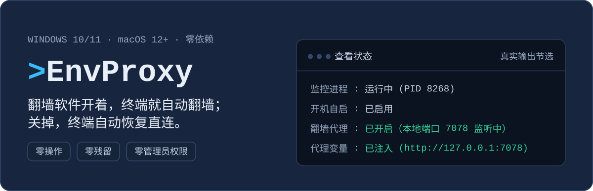
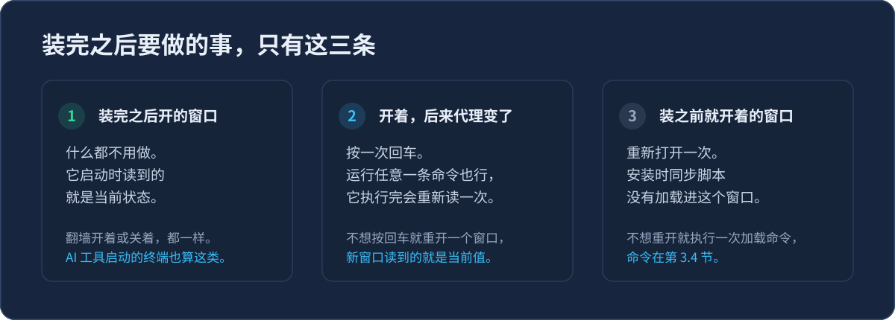
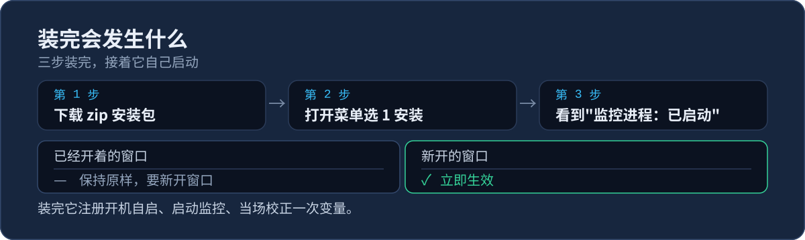
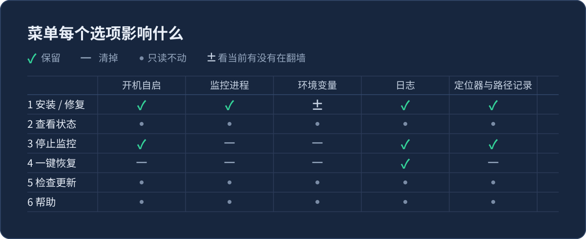
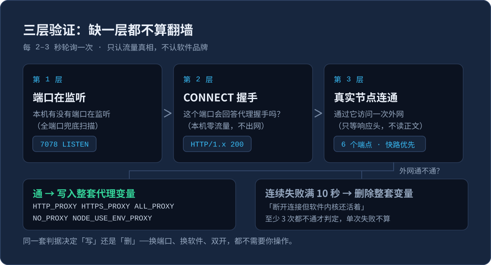
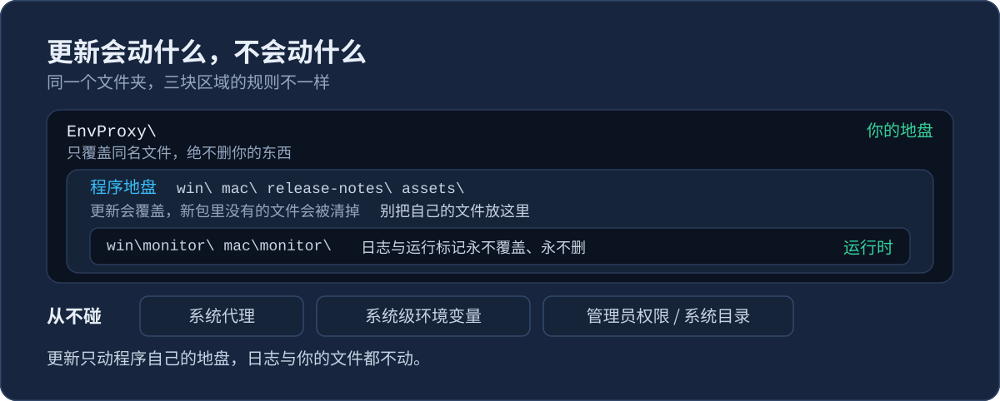
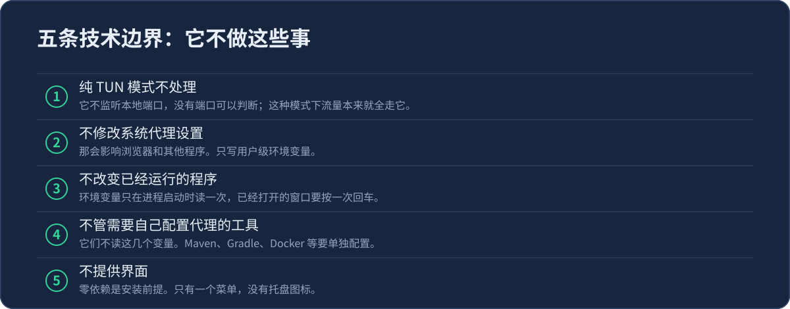
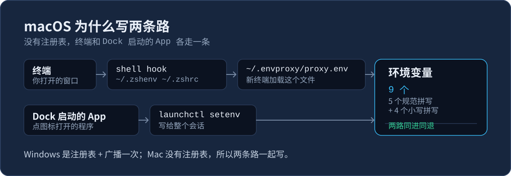

# EnvProxy — 终端自动翻墙（环境变量代理）

简体中文 | [English](./README.en.md)

[](https://github.com/FiretrUCK666/envproxy/actions/workflows/check.yml)
[](https://github.com/FiretrUCK666/envproxy/releases)
[](LICENSE)
[](https://github.com/FiretrUCK666/envproxy/stargazers)



翻墙软件只管浏览器，不管终端。`git`、`npm`、`curl` 这类工具靠一组叫「环境变量」的设置知道代理的地址，才连得上外面。

EnvProxy 自动维护这组设置。翻墙软件开着，它把代理地址写进去；关掉，它删掉。日常不需要记任何命令。



## 目录

<!-- toc:start -->

- [0. 装完之后会发生什么](#0-装完之后会发生什么)
- [1. 安装（3 步，5 分钟）](#1-安装3-步5-分钟)
- [2. 打开菜单](#2-打开菜单)
- [3. 常用操作一页纸](#3-常用操作一页纸)
- [4. 出问题了按这个顺序查](#4-出问题了按这个顺序查)
- [5. 它是怎么判断在不在翻墙的](#5-它是怎么判断在不在翻墙的)
- [6. 为什么它不容易出错](#6-为什么它不容易出错)
- [7. 性能与流量](#7-性能与流量)
- [8. 文件夹里都有什么](#8-文件夹里都有什么)
- [9. 关于复制备份文件夹](#9-关于复制备份文件夹)
- [10. 给朋友/新电脑部署](#10-给朋友新电脑部署)
- [11. 技术边界（5 条）](#11-技术边界5-条)
- [12. macOS 版](#12-macos-版)
- [13. 许可证与问题反馈](#13-许可证与问题反馈)
<!-- toc:end -->

## 0. 装完之后会发生什么

装完之后绝大多数情况都不用管。下面三种情况里，只有第一种什么都不用做，另外两种最多就是重开一个窗口。

| 你的情况 | 会发生什么 | 需要做什么 |
|---|---|---|
| **装完之后新开的窗口或程序** | 启动时读到的就是当前状态 | **什么都不用做** |
| **窗口一直开着，后来代理又变了** | 窗口里还是旧状态 | 按一次回车（cmd 窗口只能重开） |
| **装之前就开着的窗口** | 同步代码还没装进去 | 重开一个，或见 3.1 |

### 为什么开着的窗口要按一次回车

每个程序只在启动那一刻读一次环境变量，读完就固定了。之后系统里改了，已经在运行的窗口不会跟着变。

所以新窗口自动是对的，老窗口得让它重读一次。EnvProxy 挑的时机是每次命令执行完、屏幕重新出现光标的时候——你本来就在一直敲命令，不用专门做什么。

### AI 工具、编辑器、IDE

它们开终端一般是新开一个进程，所以自动就是对的。

两种要重启那个工具：装 EnvProxy 之前就开着的；或者它是常驻后台、不随用随开的。拿不准就重启一次。

## 1. 安装（3 步，5 分钟）

1. 点 **[这里下载 Windows 版安装包](https://github.com/FiretrUCK666/envproxy/releases/latest/download/EnvProxy-win.zip)**（Mac 版点 [`EnvProxy-mac.tar.gz`](https://github.com/FiretrUCK666/envproxy/releases/latest/download/EnvProxy-mac.tar.gz)）
2. 解压到任意位置，文件夹可以改名。进 `win` 双击 **`打开菜单.cmd`**（Mac 进 `mac` 双击 **`打开菜单.command`**），选 **`1 安装 / 修复`**
3. 看到「监控进程：已启动」就好了

安装会做四件事：把你原来的变量值存一份（卸载时还原）、设置开机自启、往终端配置里加一段同步代码、启动监控并按当前状态校正一次变量。

屏幕上按 1–4 报进度，两端编号含义相同：1 开机自启、2 监控、3 变量、4 终端同步。「存原值」那一步在编号开始之前就做完了，不占一行。



出问题就打开菜单选 **`1 安装 / 修复`**。它能修好大部分问题，重复运行不会多装一份，不会中断网络，也不会丢失你的设置。

> 从网上下载的包第一次双击如果被拦截：右键文件 → 属性 → 解除锁定（或运行 `Unblock-File .\EnvProxy-win.zip`），不要修改执行策略。

### 更新

打开菜单选 **`3 检查更新`**：先说明最新版本号和这一版改了什么，同意之后才安装。

- **升级不需要开翻墙软件**：多数网络本来就能连。如果提示连不上，把翻墙软件开关一次再试。
- **安装前核对校验值**：下载完成后先核对，对不上就不安装。装坏了比不装更麻烦。老版本发布的文件没有附带校验值，或者文件刚下完被杀软锁住读不出来时，会跳过这一步继续安装。
- **只替换程序文件**：你的文件、日志、`monitor\` 里的运行标记都不会被改动。安装完成后监控用新代码重启。

## 2. 打开菜单

双击 `打开菜单.cmd`（Mac 是 `打开菜单.command`）。它只负责把选择的编号转给真正的程序执行，自己不改动任何文件。

菜单按使用频率分三组，编号从上往下连续，不用记：

| 菜单项 | 做什么 | 影响哪些部分 |
|---|---|---|
| **日常** | | |
| **1 安装 / 修复** | 第一次用选它；觉得不对劲也选它 | 开机启动 + 终端同步脚本 + 环境变量 + 后台监控 |
| **2 查看状态** | 监控、代理、终端同步、环境变量、版本 | 只读取，不改动 |
| **3 检查更新** | 先说明改了什么，同意才安装 | 只替换程序文件，然后重启监控（用新代码） |
| **4 帮助** | 忘记怎么用就看它 | 只打印文字，不改动 |
| **进阶** | | |
| **7 高级功能**（仅 Windows） | 给某个程序建走代理的快捷方式 | 在桌面或开始菜单新增一个图标，不动原有图标 |
| **维护** | | |
| **5 停止监控** | 临时停用，下次登录会恢复 | 监控进程 + 环境变量 |
| **6 一键恢复** | 完全卸载，回到安装之前 | 全部清除（日志可选保留） |
| **退出** | | |
| **0 退出** | 关闭菜单 | 无 |

**直接按回车等于查看状态**，这是最常看的一项。菜单顶部会显示监控是否在运行、当前版本号，不需要进去看。

菜单和帮助里的操作只有两种：**输编号**做那件事；**直接回车**是往回走——在主菜单里等于查看状态，在帮助里等于退回上一级。不用记别的键。

选 `4` 进帮助，按你遇到的问题挑：

| 编号 | 一条回答一个问题 |
|---|---|
| 1 | 这是干什么用的 |
| 2 | 装完之后要我做什么 |
| 3 | 这个窗口固定直连 / 恢复自动 |
| 4 | 这个窗口走公司代理 |
| 5 | 我要让某条命令不走代理 |
| 6 | 菜单每一项是干什么的 |
| 7 | 装了还是连不上网 / 状态不对 |
| 8 | 还是不行 / 想删掉它 |
| 9 | 某个程序不跟着走代理 |

进去以后底部会列出全部编号，你在哪一条一眼就看得到。



### 日志

`monitor\monitor.log`（Mac 是 `mac/monitor/monitor.log`）记录它做过的判断。上限 200KB，写满之后只保留最近 200 行。

卸载时会询问是否保留，选择保留就只留这一份，其余全部清除。

## 3. 常用操作一页纸

**平时不用读这一节。** 翻墙软件一开一关，终端自己就跟着切，不用敲任何命令。只有想单独管某个窗口、或者想确认到底装没装上，才往下看。

每一小节都能单独看，不用按顺序读。

**你现在想干什么，直接跳过去：**

| 你想做什么 | 看哪节 |
|---|---|
| 窗口里的变量是旧的，要它跟上 | [3.1](#31-已经开着的窗口敲一下回车就更新) |
| 想让这个窗口一直不走代理 | [3.2](#32-固定直连--恢复自动) |
| 想让这个窗口走公司代理 | [3.3](#33-让这个窗口走公司代理) |
| 只有某一条命令想直连 | [3.4](#34-让某一条命令不走代理) |
| 想知道到底装没装上 | [3.5](#35-怎么确认它真的装上了) |
| 不想开菜单，要命令行开关 | [3.6](#36-不开菜单也能用写脚本远程连接) |

先认一下你在用哪个终端。四种写法不一样，命令也不一样：

| 提示符长这样 | 你用的是 | 怎么打开 |
|---|---|---|
| `PS C:\...>` | PowerShell（Windows 自带） | 开始菜单搜 PowerShell |
| `C:\...>` | cmd（命令提示符，Windows 自带） | 开始菜单搜「命令提示符」 |
| `名字@主机 MINGW64 ~ $` | Git Bash（**Windows 上的** bash） | 开始菜单搜 Git Bash |
| `名字@主机 ~ %` | Mac 的「终端」（默认是 zsh） | 启动台搜「终端」 |

三个容易搞混的地方：

- **Git Bash 是 Windows 的东西**，装 Git for Windows 时一起装的，Mac 上没有这个名字。它和 Mac 的终端都用 bash 那套写法，所以下面经常合在一起讲。
- **Mac 的「终端」默认不是 bash 是 zsh**，提示符结尾是 `%` 而不是 `$`。写法和 bash 一样，按下面的命令敲就行。
- Windows Terminal 只是「装终端窗口的壳」，里面开的是 PowerShell、cmd 还是 Git Bash 由你选——它本身不是一种终端。

**会自动跟随的**：PowerShell、Git Bash、Mac 终端（zsh 和 bash 都行）。**不会跟随的**：cmd（它没有「每次回到提示符跑一段命令」这个机制，只能重开窗口）和 fish（我们还没写 fish 那一份实现，见 12.1）。

### 3.1 已经开着的窗口，敲一下回车就更新

> **cmd 窗口是例外：敲回车没用，只能重开。**
>
> cmd 没有「每次回到提示符跑一小段命令」这个机制，所以它**不跟随任何变化**。
> PowerShell、Git Bash、Mac 终端都能靠敲回车跟上，cmd 不能。
> 如果你的活都在 cmd 里，装完之后请把窗口重开一次；以后翻墙软件一开关，也要再重开一次。

**其余的终端，按这个来：**

EnvProxy 跟着翻墙软件走：软件连上，终端就用代理；软件断开，终端就恢复直连。**新开的窗口永远是最新的。**

已经开着的窗口不会自己变——每个程序只在启动那一刻读一次环境变量，之后系统再改它也看不见。让它更新只要**在那个窗口里敲一下回车**（或者随便跑一条命令）。

| 你的窗口 | 现在是什么状态 | 要做什么 |
|---|---|---|
| 装完之后打开的 | 已经是最新的 | 不用管 |
| 一直开着，中途翻墙软件开关过 | 还是旧状态 | 敲一下回车 |
| 装 EnvProxy 之前就打开的 | 从来没装过同步代码 | 重开一个窗口 |

**不想重开、也不想敲回车，可以手动加载一次：**

| 窗口 | 命令 |
|---|---|
| PowerShell | `. $PROFILE` |
| Git Bash | `source ~/.bashrc` |
| Mac 终端 | `. ~/.envproxy/prompt-sync.sh` |

开头的 `.` 和它后面的空格都不能少，意思是「在这个窗口里执行这个文件」。只影响当前这个窗口，别的已开窗口要各自来一次。如果这个窗口从来没装过 EnvProxy，会看到「找不到路径」的红字——正常，重开一个窗口就行。

**确认生效了：**

| 窗口 | 敲这条 | 看到什么算成功 |
|---|---|---|
| PowerShell | `$env:HTTPS_PROXY` | 有值就是跟上了；空的说明还停在直连 |
| cmd | `set HTTPS_PROXY` | 同上 |
| Git Bash / Mac 终端 | `echo $HTTPS_PROXY` | 同上 |

翻墙软件开着却看到空，说明这个窗口还没跟上——再敲一次回车。

### 3.2 固定直连 / 恢复自动

**让这个窗口固定直连**

想让**这一个窗口**不走代理，就在它里面设一个开关。

**PowerShell**

```
$env:ENVPROXY_TERM = 'off'
```

**Git Bash / Mac 终端**

```
export ENVPROXY_TERM=off
```

设上之后，下一次回到提示符时代理变量就会被清掉，之后一直直连（同一条命令行里接着跑的那条命令用的还是旧值）。

**cmd 没有这个开关**（它不支持钩子），只能自己把 5 个变量清掉。一行一条：

```
set HTTP_PROXY=
set HTTPS_PROXY=
set ALL_PROXY=
set NO_PROXY=
set NODE_USE_ENV_PROXY=
```

写成一行也行：

```
set HTTP_PROXY=&set HTTPS_PROXY=&set ALL_PROXY=&set NO_PROXY=&set NODE_USE_ENV_PROXY=
```

`&` 两边不要留空格。留了的话，变量值是一个空格而不是空，代理照样生效。

**别用 `unset HTTP_PROXY ...`**：钩子往 Git Bash 里写的是小写拼写（`http_proxy` 等），
unset 大写的那个清不掉小写的，Git Bash 里的 curl 认小写，照样走代理。
而且下一个提示符会把它们重新写回来。用上面的开关才是真接管。

**确认生效了：**

| 窗口 | 敲这条 | 看到什么算成功 |
|---|---|---|
| PowerShell | `$env:HTTPS_PROXY` | 空的就是已固定直连 |
| cmd | `set HTTPS_PROXY` | 同上 |
| Git Bash / Mac 终端 | `echo $HTTPS_PROXY` | 同上 |

敲完要等下一次回到提示符才清掉，别在同一条命令行里接着查。

---

**要改回来（重新跟着翻墙软件走）**

| 窗口 | 命令 |
|---|---|
| PowerShell | `Remove-Item Env:ENVPROXY_TERM` |
| Git Bash / Mac 终端 | `unset ENVPROXY_TERM` |
| cmd | 重开一个窗口 |

这些改动只在这个窗口有效，窗口一关就没了。

**确认生效了：**

| 窗口 | 敲这条 | 看到什么算成功 |
|---|---|---|
| PowerShell | `$env:HTTPS_PROXY` | 有值就是重新跟上了 |
| cmd | `set HTTPS_PROXY` | 同上 |
| Git Bash / Mac 终端 | `echo $HTTPS_PROXY` | 同上 |

翻墙软件开着却还是空，说明监控没在跑——菜单选 1（安装 / 修复）。

### 3.3 让这个窗口走公司代理

两步，**顺序不能反**：先按 3.2 固定直连，再设地址。不停掉自动跟随，翻墙软件一有变化就会覆盖你刚设的地址。

下面的 `你的地址:端口` 换成公司给你的——问 IT 要，通常会给一份代理设置说明。这里**不是**翻墙软件那个端口，别去那儿找。

**PowerShell**：

```
$env:HTTPS_PROXY = 'http://你的地址:端口'
```

**cmd**：

```
set HTTPS_PROXY=http://你的地址:端口
```

**Git Bash / Mac**：

```
export HTTPS_PROXY=http://你的地址:端口
```

你自己设的值不会被删——只要和我们写入的不一样，公司代理、抓包工具、别的端口都原样留着。

**确认生效了：**

| 窗口 | 敲这条 | 看到什么算成功 |
|---|---|---|
| PowerShell | `$env:HTTPS_PROXY` | 是你设的公司地址就对了 |
| cmd | `set HTTPS_PROXY` | 同上 |
| Git Bash / Mac 终端 | `echo $HTTPS_PROXY` | 同上 |

拿到的是翻墙软件那个端口，说明第 3.2 步的固定直连没做成，回上去重做一遍。

### 3.4 让某一条命令不走代理

不同工具写法不一样，也没有通用的一条命令。

| 工具 | PowerShell | cmd | Git Bash / Mac |
|---|---|---|---|
| `curl` | `curl.exe --noproxy "*" 网址` | `curl --noproxy "*" 网址` | `curl --noproxy '*' 网址` |
| `git` | `git -c http.proxy= -c https.proxy= clone 仓库地址` | 同左 | 同左 |
| `npm` | `npm --noproxy=registry.npmjs.org install 包名` | 同左 | 同左 |
| `wget` | 不自带；装过才有 `wget.exe --no-proxy 网址` | 同左 | `wget --no-proxy 网址` |
| `docker` | 改 Docker 自己的设置，没有单条命令的写法 | 同左 | 同左 |

三个坑，都是实测出来的：

- **只有 PowerShell 5.1 里 `curl` 和 `wget` 是别名**，指向 `Invoke-WebRequest`，直接敲会报「参数找不到」，所以那里要写 `curl.exe`。**cmd 和 PowerShell 7 里 `curl` 就是真的 curl.exe**，正常写就行。
- **npm 的 `--noproxy` 只认域名，写 `*` 没用**。它不报错，请求照样走代理，你会以为绕过了。要写具体域名。
- **`npm --no-proxy` 会被当成 `--proxy=false`**，和「不走代理」不是一回事。用 `--noproxy=域名`。

另外：`git` 的 `-c http.proxy=` 后面必须留空，留空是「这条命令不用代理」，写别的值就是「改用那个代理」。npm 只认 `HTTPS_PROXY`，不认 `HTTP_PROXY`——EnvProxy 两个都写，所以 npm 能正常走。

这些参数都是各工具自己的，不是 EnvProxy 提供的。不加这些参数时，它们读的才是 EnvProxy 写入的变量。

**确认生效了：** 跑一下你刚加过参数的那条命令。**能通就说明绕过了代理**；如果反而连不上，把加的参数去掉再试一次，就能分清是参数问题还是网络问题。
### 3.5 怎么确认它真的装上了

菜单选 **2 查看状态**，看「终端同步」那一行：

| 显示 | 意思 | 怎么办 |
|---|---|---|
| 已生效 | 正常 | 什么都不用做 |
| 装了但跑不起来 | 执行策略不让 PowerShell 跑配置文件 | 按提示改一次（见第 4 节） |
| 配置文件里的标记不成对 | 被别的工具改过，只剩半截标记 | 按状态页给的行号，删掉那行孤立标记，再选 1 |
| 配置文件里没有同步块 | 从没装上，或者被清理过 | 重跑一次「1 安装 / 修复」 |
| 这一轮读不到配置文件路径 | 极少见，这一轮判断不了 | 过几秒再看；一直在就选 1 重跑一次 |

### 3.6 不开菜单也能用（写脚本、远程连接）

菜单适合双击着用。写脚本、或者通过远程连接上来没有图形界面时，用命令行参数。前七行与菜单里的七项一一对应；再下一行 `-Menu` 就是直接打开菜单本身；最后两行（`self-test`、`-RepairProfile`）菜单里没有，它们是排查问题用的。

| 想做的事 | Windows | Mac |
|---|---|---|
| 安装 / 修复 | `-Install` | `install` |
| 查看状态 | `-Status` | `status` |
| 检查更新 | `-Update` | `update` |
| 帮助 | `-Help` | `help` |
| 高级功能（仅 Windows） | `-Advanced` | — |
| 停止监控 | `-Stop` | `stop` |
| 一键恢复 | `-Uninstall` | `uninstall` |
| 打开菜单 | `-Menu` | `menu` |
| 自检（排查用） | — | `self-test` |
| 修配置文件里的残缺标记 | `-RepairProfile` | `repair-profile` |

顺序和菜单里一样：先是日常四项，再是进阶一项，然后是维护两项。最后一行是 Mac 独有的排查命令：它在一个临时沙箱里跑一遍内部检查，不碰你的配置文件和环境变量。

`-Purge`（Mac 是 `--purge`）只配一键恢复用，表示连日志一起删。`-Yes`（Mac 是 `--yes`）配检查更新和一键恢复用，表示不再问。恢复时它还是**唯一**能在没法提问的环境里卸载的办法（脚本、远程会话），因为那个命令问不到人时会拒绝执行。

先进入程序所在的目录，再敲命令。**不做这一步会报「找不到文件」**，因为程序在 `win\` 和 `mac\` 里。

Windows（cmd 或 PowerShell 都行）：

```
cd win
powershell -ExecutionPolicy Bypass -File envproxy.ps1 -Status
```

macOS（终端）：

```
cd mac
bash envproxy.sh status
```

**参数必须写全，不支持缩写**。`-Instal` 少一个字母会被拒绝——这是故意的，否则敲错一个字母就变成真安装。

**确认生效了：** 就是上面 `-Status`（Mac 是 `status`）那条的输出。它和菜单选 2 是同一份内容——**能打出来，就说明命令行这条路是通的**。

## 4. 出问题了按这个顺序查

**按顺序排查，上一步试完再往下走。**

| 你看到的 | 最可能的原因 | 怎么办 |
|---|---|---|
| 提示「无法识别的开关」或「无法识别的参数」 | 参数打错，或者用了缩写 | 参数必须写全，不支持缩写 |
| 终端还是不能翻墙 | 这个窗口是安装之前打开的 | 重开一个窗口，或照 3.1 手动加载一次 |
| 重开窗口后还是不能翻墙 | 监控没有在运行 | 打开菜单选 1（安装 / 修复） |
| 提示「缺少程序文件」 | 文件夹没完整复制过来，或文件被删 | 到 Releases 重新下载后覆盖 |
| 变量删掉之后又出现 | 节点不稳定，监控按实际写入 | 正常。持续这样说明节点质量差 |
| 断开后变量迟迟不删 | 「断开」没真断（内核还在跑） | 正常。想立刻停就退出软件 |
| 「终端同步」显示「装了但跑不起来」 | 执行策略不让 PowerShell 跑配置文件 | 见下面那段 |
| 上面都试过还不行 | — | 选 2 截图状态，再选 1 修复一次 |

**如果状态里「终端同步」显示「装了但跑不起来」**

PowerShell 默认不允许运行配置文件，而终端同步靠的正是配置文件。在 PowerShell 里执行一次：

```powershell
Set-ExecutionPolicy RemoteSigned -Scope CurrentUser
```

`RemoteSigned` 的意思是：本机自己写的脚本可以跑，从网上下载的必须带签名。它比默认的 `Restricted` 松，比 `Unrestricted` 安全，是日常使用的常规选择。改完重开一个窗口。

改完还是不行，说明是组策略强制下发的（公司或学校的电脑常见），那种情况只能找管理员。状态页会说明是哪一种。

> 注意区分：第 2 节说的"不要修改执行策略"指的是**解压出来的包被拦截**那种情况——那种情况用右键解除锁定或 `Unblock-File`，不需要动执行策略。这里说的是配置文件本身跑不起来，是另一件事。

> 大部分问题都可以用菜单的 **选 1** 解决。它不会重复安装，不会中断网络，也不会丢失你自己的设置。

## 5. 它是怎么判断在不在翻墙的

每 2 到 3 秒检查一次（翻墙时 2 秒，直连时 3 秒），但**不会看到端口就认定**。要同时满足三条：



1. **有端口在监听** —— 本机有程序开了代理端口
2. **它确实是代理** —— 发一次 `CONNECT` 握手，必须回 `HTTP/1.x 200`。这一步排除开发服务器和普通网页服务
3. **它确实连得通外面** —— 通过这个端口访问 **6 个不同的端点**，**任意一个**真拿到响应就算通过

三条全过才写入变量。所以本机开着个网页服务不会被误判。

它不认品牌、不认进程名、不认端口号——那些只用来加快扫描，判断永远走这三条。


**判「断开」比判「连上」谨慎得多**：

- 一次探测失败**不算**断开，要连续失败满 10 秒、至少 3 次才动手删变量
- 只要成功一次就立刻认作连上

因为误删变量的代价大，多等一会儿的代价小。下完结论后还会多盯 1 分钟，判错了能自己改回来。

| 操作 | 生效时间 |
|---|---|
| 打开翻墙软件 | 约 6–10 秒 |
| 完全退出翻墙软件 | 约 8 秒 |
| 只断开、没退出 | 约 15–50 秒 |
| 断线后重新连上 | 约 10–25 秒 |

**写入哪些变量**（翻墙时整套写，断开时整套删）：

| 变量 | 写入值 | 作用 |
|---|---|---|
| `HTTP_PROXY` | `http://127.0.0.1:端口` | http:// 请求的代理 |
| `HTTPS_PROXY` | `http://127.0.0.1:端口` | https:// 请求的代理 |
| `ALL_PROXY` | `http://127.0.0.1:端口` | 兜底，其他变量没覆盖的协议用它 |
| `NO_PROXY` | `localhost,127.0.0.1,::1` | 本机地址不走代理 |
| `NODE_USE_ENV_PROXY` | `1` | 让新版 Node 工具也读环境变量里的代理 |

Windows 写 5 个，macOS 写 9 个（同样 5 个，再加一份小写拼写）。Windows 变量名不区分大小写，写小写只会覆盖自己；macOS 区分大小写，有的工具只认小写。

<details>
<summary>这些设置为什么这样定（不影响使用，可以展开看）</summary>

- 代理值统一用 `http://`，不用 `socks5://`。本地代理端口两种协议都应答，部分工具只接受 `http://`，统一之后兼容面最大，没有损失。`dsh` 这类工具遇到 SOCKS 会警告并跳过。
- Windows 不写两种拼写：两种拼写在那里是同一个变量，重复项会让 .NET 系宿主建表时报 `An item with the same key has already been added`，那个窗口里跑的所有程序都受影响。
- `NO_PROXY` 里的 IPv6 要裸写 `::1`。写成 `[::1]` 会被 httpx 当成普通域名，之后每次请求都报 `InvalidURL`。方括号是 URL 的写法，放错了位置。
- 你自己的 `NO_PROXY` 条目不会被删，只做补充；卸载时也只回收我们写入的值。
- 变量被别的程序改坏了不用管：监控每 30 轮核对整张表，缺了就补回来。
- 下面这些工具不读上面那 5 个变量，要单独配（不是本工具的问题）：

| 工具 | 配置位置 |
|---|---|
| Maven | `settings.xml` 的 `<proxies>` |
| Gradle | `gradle.properties` 的 `systemProp.http(s).proxyHost/Port` |
| JDK 原生 HttpClient | JVM 系统属性（或 `java.net.useSystemProxies`） |
| Docker Desktop 的 `docker pull` | Docker Desktop 自己的设置（它忽略 `daemon.json` 里的代理） |

- `NODE_USE_ENV_PROXY` 只对新版 Node 生效：`node:http(s)` 要 22.21 / 24.5 以上，`fetch()` 要 22.21 / 24.0 以上。低版本设了没用，这是正常的。

</details>

## 6. 为什么它不容易出错

原则是：**拿不准的时候不动**。

- **读不出来就不动**：端口列表读不出来时，它不会当成「没有代理」去删你的变量，而是沿用上一次的状态。
- **只清自己写下的值**：你改过的手设值、公司代理、别的端口，一个都不动。没有归属记录时干脆不动。
- **改配置前先备份**：Windows 的 `$PROFILE`、Mac 的 rc 文件，改写前都留一份 `.envproxy.bak`。写不进去就一字不改。
- **写文件保证完整**：先写临时文件再整体替换。中途断电或被杀，原文件还是完整的。
- **重复装无害**：已经装对了就不动你的设置，再跑一次也没问题。
- **卸载后会复查**：逐项读回确认，有残留就报「未完成」，不会假装成功。

## 7. 性能与流量

- **稳定后开销很小**：判断稳定之后，每个端口最多每 15 秒探测一次，只读取响应头，不读正文，每次不到 1KB。
- **收集证据时缩短间隔**：出现失败但还没达到阈值时，改成 5 秒一次；结论刚翻转之后再快盯 60 秒（防止刚判完就反复翻），之后才回到 15 秒。
- **卸载后不留残留**：环境变量、开机启动、定位脚本、终端同步脚本块全部清除，只保留你选择留下的日志。
- **终端提示符感觉不到延迟**：每次显示提示符之前，只读一次本地状态（PowerShell 读注册表，Git Bash 读一个状态镜像文件，Mac 读 `proxy.env`），全程不启动任何外部进程。

## 8. 文件夹里都有什么

解压之后大体是这样。文件夹名可以改；每个包只有自己平台的目录，Windows 包里没有 `mac\`，反过来也一样。

```
EnvProxy\
  win\                     Windows 版
    打开菜单.cmd           Windows 上唯一需要双击的文件
    envproxy.ps1           主程序
    locator.ps1            定位脚本的源文件（安装时据它生成 %LOCALAPPDATA%\EnvProxy\launcher.ps1）
    lib\                   程序库（不用管）
    monitor\               运行时自动生成，放日志
  mac\                     Mac 版，结构一样
    打开菜单.command       Mac 上唯一需要双击的文件
    envproxy.sh            主程序
    locator.sh             定位脚本的源文件（对应 win 侧的 locator.ps1）
    prompt-sync.sh         终端同步脚本（给 zsh/bash 用）
    test-mac-pure.sh       自检脚本（self-test 用，随包发，不影响正常运行）
    lib\  monitor\         程序库；运行时自动生成，放日志
  README.md  README.en.md  中英文说明
  LICENSE  VERSION         许可证、版本号
  release-notes\          每版改了什么（选「检查更新」时显示）
  assets\readme\          README 的配图
```

两边一一对应，只有两个文件是 Mac 独有的：`prompt-sync.sh` 和 `test-mac-pure.sh`（Windows 的终端同步脚本由安装程序生成，不在文件夹里）。

分成三块，规矩不一样：

- **程序文件**：`win\`、`mac\`、`release-notes\`、`assets\`。更新会覆盖，**别往里放你自己的文件**。
- **运行时目录**：`monitor\`。日志和运行标记，**永不覆盖、永不删除**。
- **最外层**：只覆盖同名文件，**绝不删你的东西**。

日常你只需要打开 `win\`（Mac 上是 `mac\`）。

### 安装之后，它往哪儿写了东西

都在这个文件夹**之外**，所以更新覆盖程序文件时碰不到它们：

| 位置 | 里面是什么 | 干什么的 |
|---|---|---|
| `%LOCALAPPDATA%\EnvProxy\` | `launcher.ps1` | 定位脚本，登录时用它找到程序 |
| | `terminal.env` | 给 Git Bash 看的镜像文件：当前状态和代理地址 |
| | `launchers\` | 走代理的快捷方式用的启动脚本（菜单选 7 建了才会有） |
| `HKCU\Environment` | 那 5 个代理变量 | 真正让终端走代理的地方 |
| `HKCU\Software\EnvProxy` | `ScriptPath` 值 + `Owned`、`Backup` 两键 | 程序在哪；我们写过什么；你的原值 |
| `HKCU\...\Run` | 一条启动项 | 登录时自动把后台程序拉起来 |
| PowerShell 的配置文件 | 一小段（首尾有 `EnvProxy` 标记） | 每次回到提示符时同步一次 |
| `Git Bash 的 ~/.bashrc` | 一小段（同样的标记） | Git Bash 每次回到提示符读镜像文件 |
| `~\.envproxy\` | `prompt-sync.sh` | Git Bash 每次回到提示符要读的那个脚本，`.bashrc` 里那行指向它 |
| `win\monitor\` | `monitor.log` | 它做过的判断（黑匣子，排查问题时看它） |
| | `monitor.pid` | 后台程序的进程号 |
| | `monitor.beat` | 心跳：进程号 + 它的启动时刻。判后台还活着没，光看进程号不够——号会被系统回收后重用 |
| | `version.cache` | 版本号缓存，后台程序定期刷新。状态页只读它，所以**查看状态永远不联网** |
| | `stopped.intent` | "是使用者自己点的停止"这条意图。没有它，崩溃和被停手事后分不出来 |
| | `stop.flag` | 跨位置停止用的临时信号，用后即删 |
| | `update.inprogress` | 覆盖程序文件时的进行中标记，正常结束会删掉；中途断电留下它就是证据 |
| | `notify.last` | 上次提示过“代理变了”时的状态。同一件事只提示一次，靠它记住 |

`win\monitor\` 里那几项都是本机运行时状态，删掉也没关系（后台程序会重新建），不影响程序文件。

卸载时上面这些全部清除，只保留你选择留下的 `monitor.log`。

`~\.envproxy\` 里**只会有 `prompt-sync.sh` 这一个文件**。别的东西出现在那里，说明有本工具之外的东西写过它——卸载时会逐个点名报出来，但不会替你删（可能是你自己放的）。



## 9. 关于复制备份文件夹

**可以复制、改名、搬走。** 但要知道：**原位置一改名或一搬走，正在跑的监控就找不到自己的程序了**，它会自己退出并清掉代理变量（免得留下过期的设置）。

所以改名或搬家之后，让它回来有两种办法：

- **等下次登录**：定位脚本会找到新位置并接管。
- **立刻回来**：双击一次「安装 / 修复」。想省事就用这条。

搜索范围分两块：

- **桌面、文档、下载、OneDrive、`.config`**：向下 6 层
- **其他磁盘的根目录**：向下 4 层（系统盘根不搜，免得全盘遍历）

所以 `C:\Projects\EnvProxy` 找不到，`D:\Projects\EnvProxy` 反而能找到。挪出这个范围，就得双击一次「安装」重新接管。

复制出来的备份**不会被误认成正主**（按日志活跃度判断哪份在跑），所以备份可以一直留着。

## 10. 给朋友/新电脑部署

1. 把包弄到新机器上，两种都行：点 **[Windows 版下载](https://github.com/FiretrUCK666/envproxy/releases/latest/download/EnvProxy-win.zip)**，或者把整个文件夹拷过去（U 盘、网盘、压缩包都可以）
2. 双击 `win\打开菜单.cmd`，选 `1 安装 / 修复`
3. 好了。不需要管理员权限，不需要装别的东西

> Windows 用户到这就完事了。两个平台各有各的包：Mac 用户下载 Mac 版，或者直接用包含 `mac\` 的整个文件夹。

## 11. 技术边界（5 条）



| 边界 | 原因 | 影响 |
|---|---|---|
| **纯 TUN 模式不处理** | 不在本机开端口，没有端口可判断 | 流量本来就全经过它，不需要额外设置 |
| **不修改系统代理设置** | 那会影响浏览器和其他程序 | 只写用户级环境变量，随时可在系统设置里确认 |
| **不改变已运行的程序** | 环境变量只在启动时读一次 | 已开窗口要按一次回车（见第 0 节） |
| **不管要自己配代理的工具** | 它们不读这几个变量 | Maven、Gradle、Docker 见第 5 节折叠表 |
| **不提供界面** | 零依赖是安装前提 | 只有一个菜单，没有托盘图标，没有窗口 |

纯 TUN 模式为什么真的不能碰：它和企业 VPN 无法区分，判断错了会删掉你唯一的代理路径，所以宁可不动。

Mac 侧多一条：**`launchctl` 的环境变量在登录和重启时清空**，所以监控每 30 轮核对一次，发现缺了就补回来（齐的时候不写）。

## 12. macOS 版

### 12.1 与 Windows 版的区别

Windows 写注册表并广播通知，Mac 写 `~/.envproxy/proxy.env` 并调用 `launchctl setenv`。两条路径同时更新，看到的行为一致。

终端这边，Mac 的默认 shell 是 `zsh`（macOS 10.15 起），系统里也留着 `bash` 3.2。

**两个都支持**：安装时往 `.zshenv`/`.zshrc` 和 `.bash_profile`/`.bashrc` 里各放一行，用哪种 shell 都会跟上。

**`fish` 不支持**：这是「我们还没写那一份实现」，不是它做不到——fish 有自己的配置机制（`conf.d` 自动加载 + `fish_prompt` 事件），只是我们没接。用 fish 的话，把窗口固定成你要的代理值即可（见 3.2）。



### 12.2 安装（3 步）

1. 把 Mac 包（`EnvProxy-mac.tar.gz`）放到 Mac 上任意位置（或者把包含 `mac\` 的整个文件夹复制过去：U 盘、隔空投送、压缩包都可以）
2. 进入 `mac` 双击 `打开菜单.command`，选 `1 安装 / 修复`
3. 看到「监控进程：已启动」就装好了

不需要 Homebrew、Python、Node，不需要 `sudo`，macOS 12 及以上自带的 `zsh` 就够。（只要 Mac 版：下载 [`EnvProxy-mac.tar.gz`](https://github.com/FiretrUCK666/envproxy/releases/latest/download/EnvProxy-mac.tar.gz)。）

### 12.3 菜单（与 Windows 一致）

菜单编号、行为、影响范围与 Windows 完全一致（包含 `4 帮助`、`0 退出`）。直接按回车等于查看状态。

### 12.4 `mac` 文件夹里都有什么

见第 8 节的文件夹结构。Windows 没有对应物的、Mac 独有的文件有两个：`prompt-sync.sh`（终端同步脚本，给 zsh/bash 用）和 `test-mac-pure.sh`（自检脚本）。

定位脚本两端各有一份源文件——Mac 是 `locator.sh`，Windows 是 `win\locator.ps1`。安装时据它生成真正会被登录拉起的那一份，放在固定位置（Windows 是 `%LOCALAPPDATA%\EnvProxy\launcher.ps1`）。

### 12.5 Mac 上首次安装可能遇到的三个问题


三个问题彼此无关，遇到哪个看哪个。

**一、双击没有反应，或提示「无法打开」**

下载的文件被系统打上了「来自网络」的标记。

- 右键点它 → **打开**（不要双击）
- 或者在终端里执行：`xattr -d com.apple.quarantine 打开菜单.command`

**二、提示「权限不够」**

脚本没有执行权限。

在终端里执行：`chmod +x 打开菜单.command`

**三、安装完成，但状态显示「未运行」**

可能有两个原因，改完都再打开菜单选 **1 安装 / 修复** 一次：

- **后台项目被拦住了**：系统设置 → 通用 → 登录项与扩展，允许它运行
- **刚才那个「能不能访问文稿」点了不允许**：系统设置 → 隐私与安全性 → 文件与文件夹

### 12.6 安装后多出哪些东西

安装会往三个地方写文件，**都不是你下载的那个文件夹**：

| 位置 | 里面的文件 | 干什么的 |
|---|---|---|
| `~/.envproxy/` | `locator.sh` | 定位脚本（告诉开机自启去哪儿找程序） |
| | `prompt-sync.sh` | 终端同步脚本，rc 文件里只写一行引用它 |
| | `path.conf` | 记录项目文件夹现在在哪 |
| | `proxy.env` | 终端这一路的环境变量和当前状态 |
| | `owned.env` | 记录我们写入过的值，清除时只清这些（代理一次都没开过时不会有这份） |
| | `prev.env` | 安装时保存的原始值，卸载时用来还原 |
| | `monitor.stdout.log` | 后台程序平时打印的东西（排查登录启动的问题看它） |
| | `monitor.stderr.log` | 后台程序报的错 |
| `~/Library/LaunchAgents/` | 一个 `*.plist` | 开机自启项，登录时把后台程序拉起来 |
| 项目文件夹的 `mac/monitor/` | `monitor.log` | 它做过的判断（黑匣子） |
| | `monitor.pid` | 后台程序的进程号 |
| | `version.cache` | 版本号缓存，后台程序定期刷新。状态页只读它，所以**查看状态永远不联网** |
| | `stopped.intent` | "是使用者自己点的停止"这条意图。没有它，崩溃和被停手事后分不出来 |
| | `stop.flag` | 跨位置停止用的临时信号，用后即删 |
| | `update.inprogress` | 覆盖程序文件时的进行中标记，正常结束会删掉；中途断电留下它就是证据 |
| | `.lock` | 后台程序的单实例锁，防止同时跑两份 |
| | `.op.lock` | 安装/卸载/停止/更新共用的操作锁，同一时刻只允许一个在跑 |

`~/.zshrc`、`~/.bashrc` 这类配置文件里也会多出一小段（首尾都有 `EnvProxy` 标记），删掉那一段等于关掉那个终端的自动跟随。

`mac/monitor/` 里那几项都是本机运行时状态，删掉也没关系（后台程序会重新建），不影响程序文件。

**`proxy.env`、`owned.env`、`prev.env` 这三个是 macOS 独有的**：Windows 侧从不写它们、也不认识它们。Windows 的 `~\.envproxy\` 里只有 `prompt-sync.sh`。

**项目文件夹可以随便搬**：下次登录会自动重新定位，备份文件夹不会被误选。卸载时上面这些全部清除，只保留你选择留下的 `monitor.log`。

#### 点不同的按钮，分别会动到哪些东西

三个动作的力度完全不同，看清楚再点：

| 你点的是 | 会删掉什么 | 会保留什么 |
|---|---|---|
| `5 停止监控` | 只删进程本身和它的 pid 文件 | 所有文件原地不动 |
| `1 安装 / 修复` | 不删任何东西，只覆盖自己的文件 | 你的配置、日志、变量 |
| `6 一键恢复` | 我们写的全部：小脚本、开机自启、rc 里那段、代理变量 | 你选择保留的 `monitor.log` |

三个动作各自的实际影响：

- **停止监控**：这次登录不再自动切代理。下次登录自动恢复，或者现在选 `1`。
- **安装 / 修复**：加载最新代码，顺带修好被破坏的开机自启。
- **一键恢复**：回到没装过的状态，不用重启。你在 `~/.envproxy/` 里自己放的东西一个都不动。


三个都要注意的同一条：`~/.envproxy/` 这个文件夹**只在空了才删**。你在里面放了别的东西（比如自己的笔记），卸载后文件夹还在，只是我们的文件没了。

**卸载是唯一不可逆的动作**，所以它会先问你一句。没法问的时候（管道、脚本里）它**不会替你做决定**，会直接拒绝，要求加 `--yes` 才执行。

### 12.7 给朋友/新 Mac 部署

把整个文件夹复制过去，进入 `mac` 双击 `打开菜单.command`，选 `1 安装 / 修复`，完成。

## 13. 许可证与问题反馈

MIT 许可证，可以自由使用和修改。

遇到问题请到 **[GitHub Issues](https://github.com/FiretrUCK666/envproxy/issues)** 反馈。附上这几项可以省很多来回：

- 打开菜单选 `2 查看状态` 的截图
- `monitor\monitor.log` 最后 20 行（Mac 是 `mac/monitor/monitor.log`）
- 你的系统版本，以及使用的翻墙软件名称
