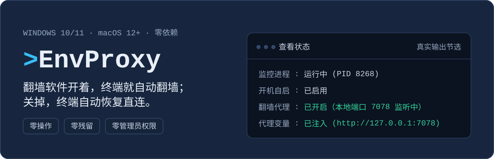
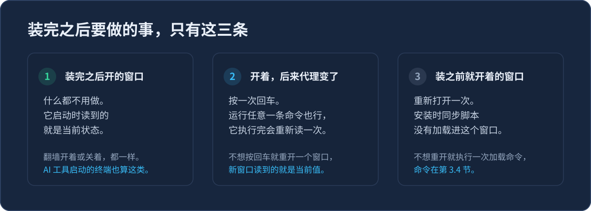
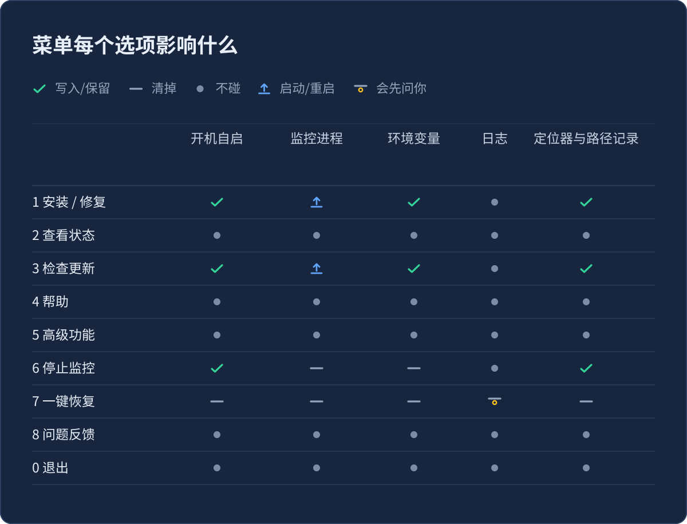
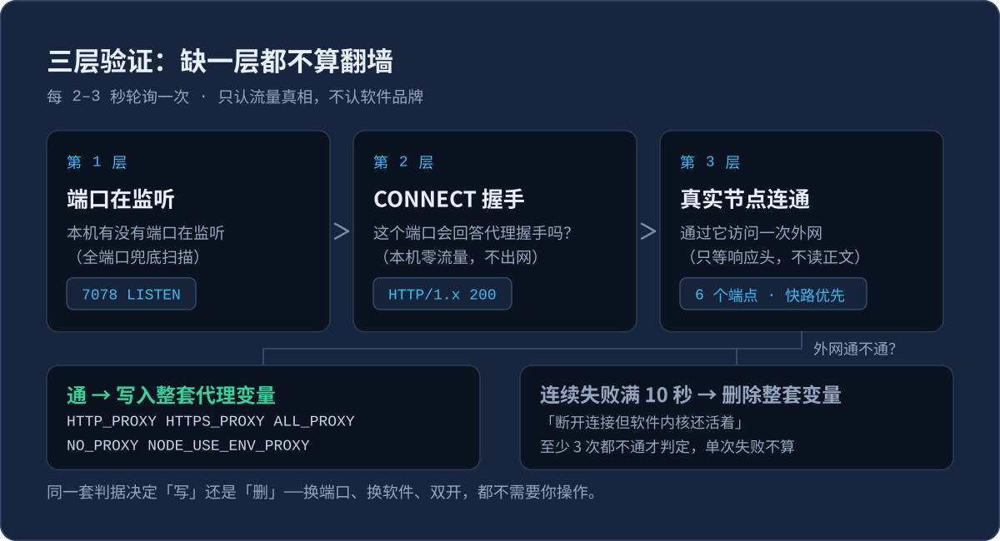
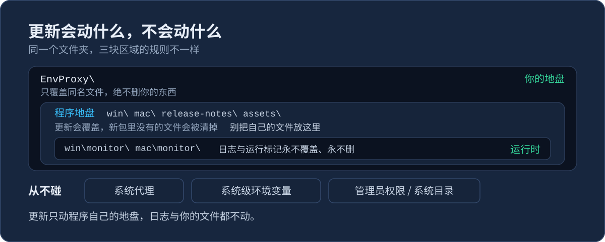
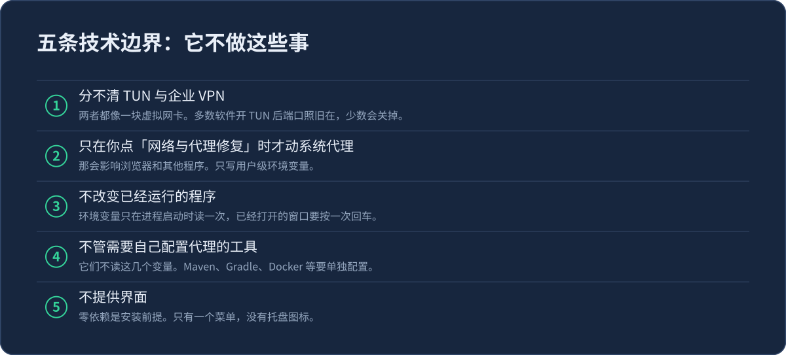
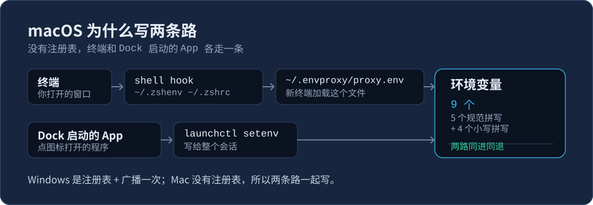

# EnvProxy — 终端自动翻墙（环境变量代理）

简体中文 | [English](./README.en.md)

[](https://github.com/FiretrUCK666/envproxy/actions/workflows/check.yml)
[](https://github.com/FiretrUCK666/envproxy/releases)
[](LICENSE)
[](https://github.com/FiretrUCK666/envproxy/stargazers)



翻墙软件只管浏览器，不管终端。`git`、`npm`、`curl` 这类工具靠一组叫「环境变量」的设置知道代理的地址，才连得上外面。

EnvProxy 自动维护这组设置。翻墙软件开着，它把代理地址写进去；关掉，它删掉。日常不需要记任何命令。



## 目录

<!-- toc:start -->

- [1. 安装（3 步，5 分钟）](#1-安装3-步5-分钟)
- [2. 打开菜单](#2-打开菜单)
- [3. 帮助里的 8 条，一条一节](#3-帮助里的-8-条一条一节)
- [4. 高级功能里有什么（三个模块）](#4-高级功能里有什么三个模块)
- [5. 出问题了按这个顺序查](#5-出问题了按这个顺序查)
- [6. 它是怎么判断在不在翻墙的](#6-它是怎么判断在不在翻墙的)
- [7. 为什么它不容易出错](#7-为什么它不容易出错)
- [8. 性能与流量](#8-性能与流量)
- [9. 文件夹里都有什么](#9-文件夹里都有什么)
- [10. 关于复制备份文件夹](#10-关于复制备份文件夹)
- [11. 给朋友/新电脑部署](#11-给朋友新电脑部署)
- [12. 技术边界（5 条）](#12-技术边界5-条)
- [13. macOS 版](#13-macos-版)
- [14. 许可证与问题反馈](#14-许可证与问题反馈)
<!-- toc:end -->

## 1. 安装（3 步，5 分钟）

1. 点 **[这里下载 Windows 版安装包](https://github.com/FiretrUCK666/envproxy/releases/latest/download/EnvProxy-win.zip)**（Mac 版点 [`EnvProxy-mac.tar.gz`](https://github.com/FiretrUCK666/envproxy/releases/latest/download/EnvProxy-mac.tar.gz)）
2. 解压到任意位置，文件夹可以改名。进 `win` 双击 **`打开菜单.cmd`**（Mac 进 `mac` 双击 **`打开菜单.command`**），选 **`1 安装 / 修复`**
3. 看到「监控进程：已启动」就好了

装完就完事了，绝大多数情况什么都不用做。三种窗口情况（新开的、一直开着的、装之前就开着的）怎么处理，见 [3.2](#32-装完之后要我做什么)。

安装会做四件事：把你原来的变量值存一份（卸载时还原）、设置开机自启、往终端配置里加一段同步代码、启动监控并按当前状态校正一次变量。

屏幕上按 1–4 报进度，两端编号含义相同：1 开机自启、2 监控、3 变量、4 终端同步。「存原值」那一步在编号开始之前就做完了，不占一行。


出问题就打开菜单选 **`1 安装 / 修复`**。它能修好大部分问题，重复运行不会多装一份，不会中断网络，也不会丢失你的设置。

> 从网上下载的包第一次双击如果被拦截：右键文件 → 属性 → 解除锁定（或运行 `Unblock-File .\EnvProxy-win.zip`），不要修改执行策略。

### 更新

打开菜单选 **`3 检查更新`**：先说明最新版本号和这一版改了什么，同意之后才安装。

- **升级不需要开翻墙软件**：多数网络本来就能连。如果提示连不上，先确认能正常上网（打开常用的网页试一试），再重试一次。
- **安装前核对校验值**：下载完成后先核对，对不上就不安装。装坏了比不装更麻烦。老版本发布的文件没有附带校验值，或者文件刚下完被杀软锁住读不出来时，会跳过这一步继续安装。
- **只替换程序文件**：你的文件、日志、`monitor\` 里的运行标记都不会被改动。安装完成后监控用新代码重启。

## 2. 打开菜单

双击 `打开菜单.cmd`（Mac 是 `打开菜单.command`）。它只负责把选择的编号转给真正的程序执行，自己不改动任何文件。

菜单按使用频率分组，编号从上往下连续，不用记：

| 菜单项 | 做什么 | 影响哪些部分 |
|---|---|---|
| **日常** | | |
| **1 安装 / 修复** | 第一次用选它；觉得不对劲也选它 | 开机启动 + 终端同步脚本 + 环境变量 + 后台监控 |
| **2 查看状态** | 监控、代理、终端同步、环境变量、版本 | 只读取，不改动 |
| **3 检查更新** | 先说明改了什么，同意才安装 | 只替换程序文件，然后重启监控（用新代码） |
| **4 帮助** | 忘记怎么用就看它 | 只打印文字，不改动 |
| **进阶** | | |
| **5 高级功能** | 定规矩 / 网络与代理修复 / WSL | 只加图标；修复只关掉死设置，改前先备份 |
| **维护** | | |
| **6 停止监控** | 临时停用，下次登录会恢复 | 监控进程 + 环境变量 |
| **7 一键恢复** | 完全卸载，回到安装之前 | 全部清除（日志可选保留） |
| **支持** | | |
| **8 问题反馈** | 出问题了，一键生成一份报告 | 在 monitor 目录下写一个报告文件，不改动别处 |
| **退出** | | |
| **0 退出** | 关闭菜单 | 无 |

**直接按回车等于查看状态**，这是最常看的一项。菜单顶部会显示监控是否在运行、当前版本号，不需要进去看。


### 日志

`monitor\monitor.log`（Mac 是 `mac/monitor/monitor.log`）记录它做过的判断。上限 200KB，写满之后只保留最近 200 行。

卸载时会询问是否保留，选择保留就只留这一份，其余全部清除。

## 3. 帮助里的 8 条，一条一节

菜单选 `4` 进的就是「帮助」：8 条编号回答，一条回答一个问题，底部会列出全部编号。

这一章把每一条展开。帮助页给你当场能用的答案，这里给你全部命令和例外。

每一小节都能单独看，不用按顺序读。

**你现在想干什么，直接跳过去：**

| 你想做什么 | 看哪节 |
|---|---|
| 先弄清它到底在干什么 | [3.1](#31-这是干什么用的) |
| 刚装完，不知道该不该动手 | [3.2](#32-装完之后要我做什么) |
| 这个窗口不要翻墙，或者要走公司代理 | [3.3](#33-这个窗口不要翻墙--用公司的代理) |
| 某一条命令想直连 | [3.4](#34-某条命令不想翻墙) |
| 某个程序还是翻不了墙 | [3.5](#35-某个程序还是翻不了墙) |
| 反过来，某个程序不要翻墙 | [3.6](#36-反过来不想让某个程序翻墙) |
| 出问题了，怎么查、怎么报 | [3.7](#37-出问题了怎么查怎么报) |
| 关了翻墙软件反而上不了网 | [3.8](#38-上不了网关了翻墙软件之后) |

### 3.1 这是干什么用的

<details>
<summary>它补的是哪一段，凭什么判断你现在在翻墙</summary>

**它补的是哪一段。**

翻墙软件只管浏览器。终端里的 `git`、`npm`、`curl` 不归它管，它们只认一组叫「环境变量」的设置。所以会出现「浏览器能开网页，`git clone` 却一直卡住」。

EnvProxy 自动维护那组设置：翻墙软件开着就写进去，关掉就删掉。你不用记命令，也不用每次手动开关。

**它怎么知道你现在在翻墙。**

每 2 到 3 秒看一次，要同时满足三条才算：

| 第几条 | 要满足什么 | 排除掉什么 |
|---|---|---|
| 1 | 本机确实有程序开着一个端口在等连接 | 根本没在跑 |
| 2 | 那个端口确实按代理的规矩回应 | 本机普通服务（网页服务、开发服务器） |
| 3 | 经它真的连得到外面：试 6 个常用网址，要有一个是「不靠它就打不开」的 | 端口活着但节点已经死了 |

三条全过才动手。**它不认品牌、不认程序名、不认端口号**——那些只用来加快查找，从不作为判据。所以换翻墙软件、换端口，都不需要改任何设置。

**第 3 条为什么这么绕。**

「这个网址能不能直连打开」不是网址自己的属性，是「你这台机器的网络 + 翻墙软件的分流规则」共同决定的。同一个网址换个网络，答案可以反过来。

所以判据必须是「经代理拿得到、直连拿不到」，缺一不可。缺了就会把一条已经死掉的代理说成正在翻墙——屏幕全绿，终端里每条命令都失败。

细节（三态判断、有效期、开了 TUN 的情况）见 [第 6 节](#6-它是怎么判断在不在翻墙的)。

</details>

### 3.2 装完之后要我做什么

<details>
<summary>三种窗口情况，多半你属于第一种</summary>

**绝大多数情况：什么都不用做。**

| 你的情况 | 会发生什么 | 需要做什么 |
|---|---|---|
| 装完之后新开的窗口或程序 | 启动时读到的就是当前状态 | 什么都不用做 |
| 窗口一直开着，后来翻墙软件又开了或关了 | 窗口里还是旧状态 | 按一次回车（cmd 窗口只能重开） |
| 装之前就开着的窗口 | 同步代码还没装进去 | 敲下面那一行，或者重开窗口 |

**想让老窗口立刻跟上，手动加载一次：**

| 窗口 | 命令 |
|---|---|
| PowerShell | `. $PROFILE` |
| Git Bash | `source ~/.bashrc` |
| Mac 终端 | `. ~/.envproxy/prompt-sync.sh` |
| cmd | 没有这条命令，只能重开窗口 |

开头的 `.` 和它后面的空格都不能少，意思是「在这个窗口里执行这个文件」。只影响当前这个窗口，别的已开窗口要各自来一次。

如果这个窗口从来没装过 EnvProxy，会看到「找不到路径」的红字——正常，重开一个窗口就行。

**为什么开着的窗口要按一次回车。**

每个程序只在启动那一刻读一次「该走哪个代理」，读完就固定了。之后系统里再改，已经在跑的窗口看不见。

EnvProxy 挑的时机是每次命令跑完、屏幕重新出现光标的时候——你本来就在一直敲命令，所以不用专门做什么。

**AI 工具、编辑器、IDE。**

它们开终端一般是新开一个进程，所以自动就是对的。

两种要重启那个工具：装 EnvProxy 之前就开着的；或者它是常驻后台、不随用随开的。拿不准就重启一次。

</details>

### 3.3 这个窗口不要翻墙 / 用公司的代理

<details>
<summary>固定直连、走公司代理、改回自动，三件事</summary>

**一、让这个窗口一直不翻墙。**

| 窗口 | 设这个开关 |
|---|---|
| PowerShell | `$env:ENVPROXY_TERM = 'off'` |
| Git Bash / Mac 终端 | `export ENVPROXY_TERM=off` |
| cmd | 没有这个开关，见下面 |

只影响当前窗口，别的窗口照旧跟着翻墙软件走。设完要**等下一次回到提示符**才生效；同一条命令行里接着跑的那条命令用的还是旧值。

**cmd 不支持钩子，只能自己清 5 个变量。** 逐条敲（写成一行也行，但 `&` 两边不能留空格，留了的话变量值是一个空格而不是空，代理照样生效）：

```
set HTTP_PROXY=
set HTTPS_PROXY=
set ALL_PROXY=
set NO_PROXY=
set NODE_USE_ENV_PROXY=
```

**别用 `unset HTTP_PROXY`。** Git Bash 里钩子写的是小写（`http_proxy` 等），清大写清不掉它，curl 照样走代理，而且下一个提示符还会写回来。用上面的开关才是真接管。

**确认生效了：**

| 窗口 | 敲这条 | 看到什么算成功 |
|---|---|---|
| PowerShell | `$env:HTTPS_PROXY` | 空的就是已固定直连 |
| cmd | `set HTTPS_PROXY` | 同上 |
| Git Bash / Mac 终端 | `echo $HTTPS_PROXY` | 同上 |

**二、让这个窗口用公司的代理。**

公司代理和自动跟随**是互斥的**，只能选一个。**第一步交出控制权，第二步设地址，顺序不能反。**

| 窗口 | 第 1 步 | 第 2 步 |
|---|---|---|
| PowerShell | `$env:ENVPROXY_TERM = 'off'` | `$env:HTTPS_PROXY = 'http://你的地址:端口'` |
| Git Bash / Mac 终端 | `export ENVPROXY_TERM=off` | `export HTTPS_PROXY=http://你的地址:端口` |
| cmd | 清空那 5 个变量 | `set HTTPS_PROXY=http://你的地址:端口` |

**cmd 的清变量命令（照抄这一整条）：**

```
set HTTP_PROXY=&set HTTPS_PROXY=&set ALL_PROXY=&set NO_PROXY=&set NODE_USE_ENV_PROXY=
```

不先交出控制权，翻墙软件一有变化就会把你刚设的地址覆盖掉。

`你的地址:端口` 问公司 IT 要。**这不是翻墙软件那个端口**，别去那儿找。

**多数工具（git、curl、pip、npm）认 `HTTPS_PROXY` 就够了。** 有些程序还不认，再补一条——它在上面那条的基础上加，两条一起才完整：

| 窗口 | 复制这一整条 |
|---|---|
| PowerShell | `$env:ALL_PROXY = 'http://你的地址:端口'; $env:NODE_USE_ENV_PROXY = '1'` |
| Git Bash / Mac 终端 | `export ALL_PROXY=http://你的地址:端口; export NODE_USE_ENV_PROXY=1` |
| cmd | `set ALL_PROXY=http://你的地址:端口&set NODE_USE_ENV_PROXY=1` |

**确认生效了：**

| 窗口 | 敲这条 | 看到什么算成功 |
|---|---|---|
| PowerShell | `$env:HTTPS_PROXY` | 是你设的公司地址就对了 |
| cmd | `set HTTPS_PROXY` | 同上 |
| Git Bash / Mac 终端 | `echo $HTTPS_PROXY` | 同上 |

拿到的是 `127.0.0.1` 那个端口，说明第 1 步没做成，回去重做。

**三、改回跟着翻墙软件走（上面做的全部撤回）。**

| 窗口 | 做这个 | 看到什么算成功 |
|---|---|---|
| PowerShell | `Remove-Item Env:ENVPROXY_TERM` | 下次回到提示符时地址变回翻墙代理 |
| Git Bash / Mac 终端 | `unset ENVPROXY_TERM` | 下次回到提示符时地址变回翻墙代理 |
| cmd | 重开一个窗口 | — |

清掉 `ENVPROXY_TERM` 就都撤回。你手设的公司地址会被翻墙代理覆盖——**这是对的**，它表示「这个窗口回到自动」；公司地址本身没被删，只是这个窗口不再用它。

这些改动只在这个窗口有效，窗口一关就没了。

</details>

### 3.4 某条命令不想翻墙

<details>
<summary>五个工具各自的写法，外加三个坑</summary>

不同工具写法不一样，也没有通用的一条命令。

| 工具 | PowerShell | cmd | Git Bash / Mac |
|---|---|---|---|
| `curl` | `curl.exe --noproxy "*" 网址` | `curl --noproxy "*" 网址` | `curl --noproxy '*' 网址` |
| `git` | `git -c http.proxy= -c https.proxy= clone 仓库地址` | 同左 | 同左 |
| `npm` | `npm --noproxy=registry.npmjs.org install 包名` | 同左 | 同左 |
| `wget` | 不自带；装过才有 `wget.exe --no-proxy 网址` | 同左 | `wget --no-proxy 网址` |
| `docker` | 改 Docker 自己的设置，没有单条命令的写法 | 同左 | 同左 |

三个坑，都是实测出来的：

- **只有 PowerShell 5.1 里 `curl` 和 `wget` 是别名**，指向 `Invoke-WebRequest`，直接敲会报「参数找不到」，所以那里要写 `curl.exe`。**cmd 和 PowerShell 7 里 `curl` 就是真的 curl.exe**，正常写就行。
- **npm 的 `--noproxy` 只认域名，写 `*` 没用**。它不报错，请求照样走代理，你会以为绕过了。要写具体域名。
- **`npm --no-proxy` 会被当成 `--proxy=false`**，和「不走代理」不是一回事。用 `--noproxy=域名`。

另外：`git` 的 `-c http.proxy=` 后面必须留空，留空是「这条命令不用代理」，写别的值就是「改用那个代理」。npm 只认 `HTTPS_PROXY`，不认 `HTTP_PROXY`——EnvProxy 两个都写，所以 npm 能正常走。

这些参数都是各工具自己的，不是 EnvProxy 提供的。不加这些参数时，它们读的才是 EnvProxy 写入的变量。

**确认生效了：** 跑一下你刚加过参数的那条命令。**能通就说明绕过了代理**；如果反而连不上，把加的参数去掉再试一次，就能分清是参数问题还是网络问题。

</details>

### 3.5 某个程序还是翻不了墙

<details>
<summary>它为什么不认，以及怎么给它单独造一个图标</summary>

**为什么它不认。**

有些程序不读系统设的那份代理，只在启动那一刻读一次「该走哪个代理」，之后怎么变都不理。而它们多半是从桌面或任务栏点开的，那一层拿不到 EnvProxy 设的值。

症状：终端里 `git` 好好的，某个图形程序死活连不上。

**怎么办：给它造一个图标。**

打开菜单选 `5 高级功能`，再选 `1 给某个程序定规矩`。挑程序（或输入路径），选放哪，确认。

它会生成一个新图标，名字后面带「翻墙」。以后点那个就能翻墙。

**三件要注意的事：**

- **程序已经开着的，点了不会换代理**，必须先关掉再点。
- **微软商店装的应用**（没有独立 exe 的那种）不支持。
- 新图标可以拖到任务栏固定；固定后删掉桌面那个不影响使用。

**翻墙软件换了端口之后。**

用上面那些图标开的程序**不受影响**，照常用就行——它们认的是一个固定入口（见下）。

会停在旧地址上的，只有「启动那一刻读一次」的程序（从桌面点开的那种）。终端里新开一个窗口就跟随；PowerShell 与 Git Bash 敲一下回车即可。出现这种情况时会自动弹一句提示，不用你盯着。

**固定入口是干什么的。**

有些程序会把你给的地址写进它自己的设置里，之后一直用那个。翻墙软件一换端口它们就连不上，而你还得进它的设置里改一遍。

固定入口在本机开一个永不变的地址，程序只认这个，背后自动跟着翻墙软件走。建图标时自动就用它，不用你做什么；它跟着监控一起跑，也没有开关要拨。

它没在工作也不要紧：图标会退回去读当前地址，照样能用。想看它现在的状态：菜单 `5` 再选 `4`（查看中继），那一屏只看不改。

**不想要了：** 菜单 `5` 再选 `3`（管理已建的图标），能看状态、逐个删。

这个模块的完整说明（两个平台的做法差异、浏览器内核程序的自动适配）见 [4.1](#41-给某个程序定规矩)。

</details>

### 3.6 反过来：不想让某个程序翻墙

<details>
<summary>银行、政务、公司内网这类，要的是「无论如何都直连」</summary>

**为什么会有这个需求。**

有些程序跟着翻墙走反而出问题。银行、政务、公司内网这类，一翻墙就登不上，或者慢到没法用。它们要的是「无论如何都直连」，哪怕别的程序都在翻墙。

**怎么办：给它造一个固定直连的图标。**

打开菜单选 `5 高级功能`，再选 `1 给某个程序定规矩`，规矩选「固定直连」。它会生成一个新图标，名字后面带「直连」。点那个就一定不翻墙。

**同一个程序可以两个图标都有**：一个带「翻墙」、一个带「直连」，互不干扰，原来的程序一个字节都没动。

**它是怎么做到的。**

双击图标启动程序时，会先把代理设置从那个程序的环境里**拿掉**，再启动它。所以它看到的和没装这个工具时一样——不是绕过去，是真的没有。

程序自己再启动的子进程也一样看不到，整条链都干净。

**两点要注意：**

- **已经开着的程序不受影响**，要先关掉再点图标。
- **这个图标不依赖翻墙软件**：翻墙软件没开、甚至没装，它照样能正常打开程序。

</details>

### 3.7 出问题了：怎么查、怎么报

<details>
<summary>三步排查、两个常见误会、怎么生成报告、不开菜单的开关</summary>

**第一步：在出问题的窗口里看代理变量。**

| 窗口 | 敲这条 | 什么意思 |
|---|---|---|
| PowerShell | `$env:HTTPS_PROXY` | 有地址 = 设好了；空的 = 没设上 |
| cmd | `set HTTPS_PROXY` | 同上 |
| Git Bash / Mac 终端 | `echo $HTTPS_PROXY` | 同上 |

空的就先重开一个窗口试试（见 [3.2](#32-装完之后要我做什么)）。

**第二步：看菜单最上面那行。**

写「未运行」就选 `1 安装 / 修复`。那一行同时显示当前版本号，不需要进去看。

**第三步：两个常见误会。**

- **npm 只认 `HTTPS_PROXY`，不认 `HTTP_PROXY`**；你自己清过它就不走了。EnvProxy 两个都写，所以正常情况下 npm 能走。
- **「翻墙代理」有、「代理变量」无** = 翻墙软件在跑、EnvProxy 被停了，不是坏了。选 `1` 恢复。

**按症状对号入座。**

常见症状和对应处理在第 [5 节](#5-出问题了按这个顺序查) 的对照表里，一行一条。

**还是不行：把问题报上去。**

菜单选 `8 问题反馈`。它先问你四句话，再自动补上这台机器的情况，存成一个文件、把路径复制好。你不用找日志，也不用敲命令。

然后把文件内容贴到项目页面（本项目只在那里收问题）：https://github.com/FiretrUCK666/envproxy/issues

**想彻底删掉它。**

菜单选 `7 一键恢复`。会问你要不要留日志。

**不开菜单也能用（写脚本、远程连过来的时候）：**

| 想做的事 | Windows | Mac |
|---|---|---|
| 安装 / 修复 | `-Install` | `install` |
| 查看状态 | `-Status` | `status` |
| 检查更新 | `-Update` | `update` |
| 帮助 | `-Help` | `help` |
| 高级功能 | `-Advanced` | `advanced` |
| 停止监控 | `-Stop` | `stop` |
| 一键恢复 | `-Uninstall` | `uninstall` |
| 问题反馈 | `-Report` | `report` |
| 打开菜单 | `-Menu` | `menu` |
| 自检（排查用） | — | `self-test` |
| 修配置文件里的残缺标记 | `-RepairProfile` | `repair-profile` |

先进入程序所在的目录（`win` 或 `mac`），再敲命令；不做这一步会报「找不到文件」。

```
cd win
powershell -ExecutionPolicy Bypass -File envproxy.ps1 -Status
```

```
cd mac
bash envproxy.sh status
```

**参数必须写全，不支持缩写。** `-Instal` 少一个字母会被拒绝——这是故意的，否则敲错一个字母就变成真安装。

`-Yes`（Mac 是 `--yes`）配检查更新和一键恢复用，表示不再问。恢复时它还是**唯一**能在没法提问的环境里卸载的办法（脚本、远程会话）。

</details>

### 3.8 上不了网（关了翻墙软件之后）

<details>
<summary>先分清是哪种「上不了网」，再决定动哪里</summary>

**先分清是哪一种。**

| 症状 | 谁的问题 | 去哪儿 |
|---|---|---|
| 只有浏览器打不开，别的程序照常 | 浏览器这边那一层代理设置指错了 | 下面「怎么自己修」 |
| 只有某个工具（`git`、`npm`）连不上 | 那个工具自己的配置文件 | 下面「怎么自己修」 |
| 什么都连不上 | 网络本身，跟这个工具无关 | 先确认网线、Wi-Fi、路由器 |

**最常见的原因：翻墙软件没关干净。**

多数翻墙软件退出时会把自己写进系统的设置撤掉。但如果它是被**强行关掉**的——直接关机、断电、任务管理器结束进程、崩溃——就来不及撤。

那条设置还在，浏览器和工具就照旧去找一个已经不存在的程序，于是国内网站也打不开。**这不是网断了，是路指错了。**

**怎么自己修。**

菜单选 `5 高级功能`，再选 `2 网络与代理修复`。它一次看三个地方：系统的代理设置、终端工具的配置文件（`git config`、`~/.npmrc` 这类）、网址解析。

能修的会问你一句才动手，改之前先留还原点。修完把浏览器和那个工具都关掉重开一次再看。

**什么东西它不会动。**

- 公司、学校给你的代理，一个字节都不碰。
- 被管理员统一管着的也不碰，那种改了也会被改回去。
- 端口还活着的也不碰（你正在用）。
- 它只修「指向本机、但程序已经不在了」的那一种。

**修错了想改回去。**

再进那一屏，按 `r` 回车就能还原最近修的那一次。

**它管不到哪儿。**

它只看「设置」，不看「网络通不通」。网线没插、Wi-Fi 没连上、路由器断了，这一屏同样会告诉你「没发现问题」。

完整说明见 [4.2](#42-网络与代理修复)。

</details>

## 4. 高级功能里有什么（三个模块）

菜单选 `5` 进的就是这里。它装了三件互不相干的事，各自解决一个具体麻烦。

每一小节都能单独看，不用按顺序读。

**你现在想干什么，直接跳过去：**

| 你想做什么 | 看哪节 |
|---|---|
| 想让某个程序单独走代理，或者单独不走 | [4.1](#41-给某个程序定规矩) |
| 网页或终端工具打不开、连不上 | [4.2](#42-网络与代理修复) |
| 想让 WSL 或 Docker 里也能翻墙 | [4.3](#43-本工具管不到的地方) |

### 4.1 给某个程序定规矩

<details>
<summary>造一个图标：让某个程序单独走代理，或者单独不走（原来程序一个字节不动）</summary>

**问题从哪来。**

这套设置是**一刀切**的：它给整台机器定一份代理，所有程序拿到的是同一份。于是有两种情况都不好办：

- 某个程序只认自己启动那一刻的环境变量，之后就不再看了。而资源管理器的环境可能在开机时就固定住，之后代理怎么变它都收不到。结果终端里 `git` 好好的，某个图形程序死活连不上。
- 反过来，某个程序你**不想**让它翻墙（比如网银、内网工具），但这台机器的代理是全局的，它也跟着走。

**它怎么解决。**

给那个程序造一个图标。双击这个图标时，先把环境准备好（该给的给、该清的清），再把控制权交给真程序。两种规矩任选：

| 规矩 | 双击之后 |
|---|---|
| 走代理 | 这个程序带着当前代理启动，跟着翻墙软件走 |
| 固定直连 | 这个程序一定不走代理，哪怕别的程序都在翻墙 |

**同一个程序可以两个都有。**

造两个图标不会互相打架——「WeChat（走代理）」和「WeChat（固定直连）」是两个独立的图标，各管各的，原来的 WeChat 一个字节都没动。不想要了就在「管理已建的」里删掉。

**为什么不用改地址。**

翻墙软件的本地端口是会变的：换个软件、重启后随机分配、端口被占用自动顺延。变了之后，有些程序会一直记着旧地址就连不上，你还得进它自己的设置里改一遍。

本工具在本机开了一个**固定入口**（一个永远不变的地址），走代理的图标只认它，背后自动跟着翻墙软件走。所以端口怎么变你都不用管，也不用重建图标。

**四件要知道的事：**

- **它跟着后台程序一起跑**，不用开也不用关。Windows 上菜单选 `5` 再选 `4`（查看中继）能看它现在怎么样，那一屏只看不改。Mac 不需要这一层，`5 高级功能` 里没有「查看中继」这一项。
- **它没在工作也不要紧**：走代理的图标会退回去读当前地址，照样能用。只是少了「地址永远不变」这个好处。
- **已经建好的图标不用重建**——它们每次启动都会重新读一次。
- **浏览器内核做的程序会自动适配（仅 Windows）。** Chrome、Edge、VS Code、Discord 这类程序不看环境变量，只认启动参数。你不用回答任何问题——它会自己认出来，并在确认页多印一行「这个程序需要单独指定，已自动带上」。Mac 版不做这一层适配，那类程序请直接用系统代理。

**两个平台的做法不一样。**

Windows 造的是一般的快捷方式，Mac 造的是一个独立的小程序壳子（`MyApp（走代理）.app`）。**共同点是都不动原来的程序**——Mac 侧改原程序会破坏它的签名，系统直接拒绝打开。

</details>

### 4.2 网络与代理修复

<details>
<summary>修三处残留：系统代理、终端工具的配置文件、网址解析；另外说清它管不到哪儿</summary>

**问题从哪来。**

翻墙软件正常关闭时，会把自己写进系统的代理设置撤掉。但如果它是被**强行关掉**的——直接关机、断电、任务管理器结束进程、程序崩溃——就来不及撤。

这时系统里还写着「浏览器请走 `127.0.0.1:7078`」，可那个端口上已经没有任何程序了。浏览器每次联网都去敲一个不存在的门，于是**连国内网站都打不开**。

**同一个毛病还会出现在两个别的地方**，它们同样能让人上不了网：

- **终端工具的配置文件。** 很多人按网上的教程敲过 `git config --global http.proxy …`，或者往 `~/.npmrc` 里写过地址。这些设置**优先级高于环境变量**——本工具把变量管得再好也压不过它。症状是浏览器好好的，只有 `git clone` 或 `npm install` 一直失败。
- **网址解析（DNS）。** 有些翻墙软件改过系统的 DNS 地址，退出时没改回去。

这一屏把三处一起看，按「网络 → 浏览器 → 终端」的顺序列出结论。

**它出问题时的样子。**

本工具自己管的那个环境变量是好的，所以你会觉得「网络明明通，就它不行」。

**它怎么修。**

只关掉那个出问题的开关，其余一个字节都不动：

| 情况 | 它做什么 |
|---|---|
| 指向本机的地址，端口已经没了 | 关掉那一项（系统代理）或删掉那一行（配置文件） |
| 地址不是本机（公司、学校的代理） | 不碰 |
| 端口还活着（你正在用） | 不碰 |
| 被管理员策略管着 | 不碰 |
| 判断不了 | 不碰 |
| 网址解析被改坏了 | 只提醒，不自动改（见下） |

动手之前会先把原样存一份，所以还能改回去（那一屏敲 `r`，撤销的是**上一次**修复）。

**DNS 为什么只提醒不自动改。**

要自动改就得先回答「改回自动获取之后，路由器会给你哪个 DNS」——这个答案在改之前是拿不到的。猜错了会把一个能用的地址换成一个不通的，比原来的毛病更糟。所以这一项只把查到的结论说清楚，怎么改由你自己在系统设置里点一下。

**它还会顺手告诉你一件事。**

如果你给「所有网络」设过 DNS，又给某一个 Wi-Fi 单独设过，系统只用其中一处、另一处不生效——这个冲突平时没有任何地方会告诉你，这一屏会点出来。

**它管不到哪儿。**

这一条比上面都重要，因为它决定你该往哪儿找问题。

它只看三个地方：浏览器用的那层代理设置、终端工具的配置文件、网址解析的地址。如果它说没发现问题，不代表你的网络没问题——只代表这三个地方是干净的。

如果网还是不通，问题可能在别处：虚拟网卡（TUN）、路由表、防火墙规则、网卡本身没拿到地址。这些它都看不到，也不会去动。

**它只看「设置」，不看「网络通不通」。** 所以网线没插、Wi-Fi 没连上、路由器断了，这一屏同样会告诉你「没发现问题」——它能查的是「有没有人把路指错了」，不是「路本身通不通」。

</details>

### 4.3 本工具管不到的地方

<details>
<summary>WSL 和 Docker 的网络怎么配（只讲解，不动你的设置）</summary>

**这一项只讲解，不会改你的任何设置。**

它讲的是 WSL 和 Docker——这两个地方各有一套自己的网络设置，本工具碰不到，也不该碰（改错了它们会起不来，而本工具没能力验证改得对不对）。

**怎么回事，用一句话说：** 你的电脑里有三个独立的房间。

```
你的 Windows      你自己那间，本工具管这里
WSL              隔壁一间，能跑真 Linux
Docker           再隔壁一间，Docker Desktop 住在里面
```

三个房间**各管各的网络设置**。你在自己门口贴的纸条（环境变量），隔壁看不见。

**所以谁说了算：**

| 谁 | 走不走代理，谁说了算 |
|---|---|
| `git` / `npm` / `curl` | 本工具（它们看你门口那张纸条） |
| 浏览器 / 桌面应用 | 你的翻墙软件（它们只看「房间总公告栏」，也就是系统代理） |
| WSL 里的东西 | WSL 自己的设置 |
| Docker 里的东西 | Docker 自己的设置 |

**想让 WSL 也翻墙。**

正路是让它直接看 Windows 的公告栏——在 `C:\Users\你的用户名\.wslconfig` 里写两行（Windows 11 22H2 以上才支持）。**歪路是把纸条抄过去**：纸条上写的是「我那间的地址」，隔壁照着找会找到自己家，绕成死循环。这是网上教程最常犯的错。

**想让 Docker 也翻墙。**

拉镜像慢要改 Docker Desktop 自己的设置（Settings → Resources → Proxies）；容器里面的程序要翻墙，得在启动容器时显式把地址传进去（`docker run -e HTTP_PROXY=...`）。注意：改 `daemon.json` 在 Docker Desktop 上没用，它不读那个文件。

**具体命令在哪儿抄。**

Windows 上菜单选 `5` 再选 `6` / `7` 能看到，那里可以照着抄。**这一项只有 Windows 版有**——WSL 本身就是 Windows 上的东西；Mac 上的 Docker 配法与此相同，只是没有单独的讲解页。

</details>

## 5. 出问题了按这个顺序查

**按顺序排查，上一步试完再往下走。**

| 你看到的 | 最可能的原因 | 怎么办 |
|---|---|---|
| 提示「无法识别的开关」或「无法识别的参数」 | 参数打错，或者用了缩写 | 参数必须写全，不支持缩写 |
| 终端还是不能翻墙 | 这个窗口是安装之前打开的 | 重开一个窗口，或照 3.1 手动加载一次 |
| 重开窗口后还是不能翻墙 | 监控没有在运行 | 打开菜单选 1（安装 / 修复） |
| 提示「缺少程序文件」 | 文件夹没完整复制过来，或文件被删 | 到 Releases 重新下载后覆盖 |
| 变量删掉之后又出现 | 节点不稳定，监控按实际写入 | 正常。持续这样说明节点质量差 |
| 断开后变量迟迟不删 | 「断开」没真断（内核还在跑） | 正常。想立刻停就退出软件 |
| 「终端同步」显示「装了但跑不起来」 | 执行策略不让 PowerShell 跑配置文件 | 见下面那段 |
| 只有 `git` / `npm` 连不上 | 它们自己的配置文件里写死了代理 | 菜单 5 → 网络与代理修复 |
| 上面都试过还不行 | — | 选 2 截图状态，再选 1 修复一次 |

**如果状态里「终端同步」显示「装了但跑不起来」**

PowerShell 默认不允许运行配置文件，而终端同步靠的正是配置文件。在 PowerShell 里执行一次：

```powershell
Set-ExecutionPolicy RemoteSigned -Scope CurrentUser
```

`RemoteSigned` 的意思是：本机自己写的脚本可以跑，从网上下载的必须带签名。它比默认的 `Restricted` 松，比 `Unrestricted` 安全，是日常使用的常规选择。改完重开一个窗口。

改完还是不行，说明是组策略强制下发的（公司或学校的电脑常见），那种情况只能找管理员。状态页会说明是哪一种。

> 注意区分：第 1 章说的"不要修改执行策略"指的是**解压出来的包被拦截**那种情况——那种情况用右键解除锁定或 `Unblock-File`，不需要动执行策略。这里说的是配置文件本身跑不起来，是另一件事。

> 大部分问题都可以用菜单的 **选 1** 解决。它不会重复安装，不会中断网络，也不会丢失你自己的设置。

## 6. 它是怎么判断在不在翻墙的

每 2 到 3 秒检查一次（翻墙时 2 秒，直连时 3 秒），但**不会看到端口就认定**。要同时满足三条：



1. **有端口在监听** —— 本机有程序开了代理端口
2. **它确实是代理** —— 发一次 `CONNECT` 握手，必须回 `HTTP/1.x 200`。这一步排除开发服务器和普通网页服务
3. **它确实连得通外面** —— 通过这个端口访问 **6 个不同的端点**（就是几个常用的检测网址），**任意一个**真拿到正确回应就算通过。但这还不够：这个网址在你机器上**不挂代理必须拿不到正确回应**（连不上、超时、被劫持到登录页都算拿不到）。如果它直连也能正常打开，那它说什么都证明不了代理能出去。**有一个例外**：如果你开的代理软件把所有流量都接管了（TUN 模式），六个网址全都能直连打开，工具就分不出好坏，这时它会退回旧规矩（拿到回应就算通），并在日志里说明

三条全过才写入变量。所以本机开着个网页服务不会被误判。

它不认品牌、不认进程名、不认端口号——那些只用来加快扫描，判断永远走这三条。


**判「断开」比判「连上」谨慎得多**：

- 一次探测失败**不算**断开，要连续失败满 10 秒、至少 3 次才动手删变量
- 只要成功一次就立刻认作连上

因为误删变量的代价大，多等一会儿的代价小。下完结论后还会多盯 1 分钟，判错了能自己改回来。

| 操作 | 生效时间 |
|---|---|
| 打开翻墙软件 | 约 6–10 秒 |
| 完全退出翻墙软件 | 约 8 秒 |
| 只断开、没退出 | 约 15–50 秒 |
| 断线后重新连上 | 约 10–25 秒 |

**写入哪些变量**（翻墙时整套写，断开时整套删）：

| 变量 | 写入值 | 作用 |
|---|---|---|
| `HTTP_PROXY` | `http://127.0.0.1:端口` | http:// 请求的代理 |
| `HTTPS_PROXY` | `http://127.0.0.1:端口` | https:// 请求的代理 |
| `ALL_PROXY` | `http://127.0.0.1:端口` | 兜底，其他变量没覆盖的协议用它 |
| `NO_PROXY` | `localhost,127.0.0.1,::1` | 本机地址不走代理 |
| `NODE_USE_ENV_PROXY` | `1` | 让新版 Node 工具也读环境变量里的代理 |

Windows 写 5 个，macOS 写 9 个（同样 5 个，再把其中 3 个地址类的各加一份小写拼写，例外清单 `NO_PROXY` 也加一份；`NODE_USE_ENV_PROXY` 是开关，没有小写）。Windows 变量名不区分大小写，写小写只会覆盖自己；macOS 区分大小写，有的工具只认小写。

<details>
<summary>这些设置为什么这样定（不影响使用，可以展开看）</summary>

- 代理值统一用 `http://`，不用 `socks5://`。本地代理端口两种协议都应答，部分工具只接受 `http://`，统一之后兼容面最大，没有损失。`dsh` 这类工具遇到 SOCKS 会警告并跳过。
- Windows 不写两种拼写：两种拼写在那里是同一个变量，重复项会让 .NET 系宿主建表时报 `An item with the same key has already been added`，那个窗口里跑的所有程序都受影响。
- `NO_PROXY` 里的 IPv6 要裸写 `::1`。写成 `[::1]` 会被 httpx 当成普通域名，之后每次请求都报 `InvalidURL`。方括号是 URL 的写法，放错了位置。
- 你自己的 `NO_PROXY` 条目不会被删，只做补充；卸载时也只回收我们写入的值。
- 变量被别的程序改坏了不用管：监控每 30 轮核对整张表，缺了就补回来。
- 下面这些工具不读上面那 5 个变量，要单独配（不是本工具的问题）：

| 工具 | 配置位置 |
|---|---|
| Maven | `settings.xml` 的 `<proxies>` |
| Gradle | `gradle.properties` 的 `systemProp.http(s).proxyHost/Port` |
| JDK 原生 HttpClient | JVM 系统属性（或 `java.net.useSystemProxies`） |
| Docker Desktop 的 `docker pull` | Docker Desktop 自己的设置（它忽略 `daemon.json` 里的代理） |

- `NODE_USE_ENV_PROXY` 只对新版 Node 生效：`node:http(s)` 要 22.21 / 24.5 以上，`fetch()` 要 22.21 / 24.0 以上。低版本设了没用，这是正常的。

</details>

## 7. 为什么它不容易出错

原则是：**拿不准的时候不动**。

- **读不出来就不动**：端口列表读不出来时，它不会当成「没有代理」去删你的变量，而是沿用上一次的状态。
- **只清自己写下的值**：你改过的手设值、公司代理、别的端口，一个都不动。没有归属记录时干脆不动。
- **改配置前先备份**：Windows 的 `$PROFILE`、Mac 的 rc 文件，改写前都留一份 `.envproxy.bak`。写不进去就一字不改。
- **写文件保证完整**：先写临时文件再整体替换。中途断电或被杀，原文件还是完整的。
- **重复装无害**：已经装对了就不动你的设置，再跑一次也没问题。
- **卸载后会复查**：逐项读回确认，有残留就报「未完成」，不会假装成功。

## 8. 性能与流量

- **稳定后开销很小**：判断稳定之后，每个端口最多每 15 秒探测一次，只读取响应头，不读正文，每次不到 1KB。
- **收集证据时缩短间隔**：出现失败但还没达到阈值时，改成 5 秒一次；结论刚翻转之后再快盯 60 秒（防止刚判完就反复翻），之后才回到 15 秒。
- **卸载后不留残留**：环境变量、开机启动、定位脚本、终端同步脚本块全部清除，只保留你选择留下的日志。
- **终端提示符感觉不到延迟**：每次显示提示符之前，只读一次本地状态（PowerShell 读注册表，Git Bash 读一个状态镜像文件，Mac 读 `proxy.env`），全程不启动任何外部进程。

## 9. 文件夹里都有什么

解压之后大体是这样。文件夹名可以改；每个包只有自己平台的目录，Windows 包里没有 `mac\`，反过来也一样。

```
EnvProxy\
  win\                     Windows 版
    打开菜单.cmd           Windows 上唯一需要双击的文件
    envproxy.ps1           主程序
    locator.ps1            定位脚本的源文件（安装时据它生成 %LOCALAPPDATA%\EnvProxy\launcher.ps1）
    lib\                   程序库（不用管）
    monitor\               运行时自动生成，放日志
  mac\                     Mac 版，结构一样
    打开菜单.command       Mac 上唯一需要双击的文件
    envproxy.sh            主程序
    locator.sh             定位脚本的源文件（对应 win 侧的 locator.ps1）
    prompt-sync.sh         终端同步脚本（给 zsh/bash 用）
    test-mac-pure.sh       自检脚本（self-test 用，随包发，不影响正常运行）
    lib\  monitor\         程序库；运行时自动生成，放日志
  README.md  README.en.md  中英文说明
  LICENSE  VERSION         许可证、版本号
  release-notes\          每版改了什么（选「检查更新」时显示）
  assets\readme\          README 的配图
```

两边一一对应，只有两个文件是 Mac 独有的：`prompt-sync.sh` 和 `test-mac-pure.sh`（Windows 的终端同步脚本由安装程序生成，不在文件夹里）。

分成三块，规矩不一样：

- **程序文件**：`win\`、`mac\`、`release-notes\`、`assets\`。更新会覆盖，**别往里放你自己的文件**。
- **只在仓库里、不进安装包**：`tests\`、`.github\`、`.gitattributes`。
- **运行时目录**：`monitor\`。日志和运行标记，**永不覆盖、永不删除**。
- **最外层**：只覆盖同名文件，**绝不删你的东西**。

日常你只需要打开 `win\`（Mac 上是 `mac\`）。

### 安装之后，它往哪儿写了东西

<details>
<summary>文件夹外面写了什么（注册表、配置文件、运行日志），卸载时会清到什么程度</summary>

都在这个文件夹**之外**，所以更新覆盖程序文件时碰不到它们：

| 位置 | 里面是什么 | 干什么的 |
|---|---|---|
| `%LOCALAPPDATA%\EnvProxy\` | `launcher.ps1` | 定位脚本，登录时用它找到程序 |
| | `terminal.env` | 给 Git Bash 看的镜像文件：当前状态和代理地址 |
| | `launchers\` | 走代理的快捷方式用的启动脚本（菜单选 5 建了才会有） |
| | `relay.port` | 固定入口用的端口号。走代理的图标每次启动读它才知道连哪儿；它跟着后台程序一起生灭 |
| `HKCU\Environment` | 那 5 个代理变量 | 真正让终端走代理的地方 |
| `HKCU\Software\EnvProxy` | `ScriptPath` 值 + `Owned`、`Backup` 两键 | 程序在哪；我们写过什么；你的原值 |
| `HKCU\...\Run` | 一条启动项 | 登录时自动把后台程序拉起来 |
| PowerShell 的配置文件 | 一小段（首尾有 `EnvProxy` 标记） | 每次回到提示符时同步一次 |
| `Git Bash 的 ~/.bashrc` | 一小段（同样的标记） | Git Bash 每次回到提示符读镜像文件 |
| `~\.envproxy\` | `prompt-sync.sh` | Git Bash 每次回到提示符要读的那个脚本，`.bashrc` 里那行指向它 |
| `win\monitor\` | `monitor.log` | 它做过的判断（黑匣子，排查问题时看它） |
| | `monitor.pid` | 后台程序的进程号 |
| | `monitor.beat` | 心跳：进程号 + 它的启动时刻。判后台还活着没，光看进程号不够——号会被系统回收后重用 |
| | `version.cache` | 版本号缓存，后台程序定期刷新。状态页只读它，所以**查看状态永远不联网** |
| | `state.snapshot` | 状态快照：后台每轮把结论写这里。状态页只读它，打开即见、不必重新探测 |
| | `doctor.journal` | 修复前记下的原样，用来「撤销上一次」。留最近 5 次 |
| | `doctor.bak` | 旧版本的还原点，只在升级上来的机器上有。新版照读，撤销一次后消失 |
| | `stopped.intent` | "是使用者自己点的停止"这条意图。没有它，崩溃和被停手事后分不出来 |
| | `stop.flag` | 跨位置停止用的临时信号，用后即删 |
| | `update.inprogress` | 覆盖程序文件时的进行中标记，正常结束会删掉；中途断电留下它就是证据 |
| | `notify.last` | 上次提示过“代理变了”时的状态。同一件事只提示一次，靠它记住 |
| | `report-*.txt` | 菜单选「问题反馈」生成的报告。发给别人前可以先自己打开看一眼 |

`win\monitor\` 里那几项都是本机运行时状态，删掉也没关系（后台程序会重新建），不影响程序文件。

卸载时上面这些全部清除，只保留你选择留下的 `monitor.log`；「问题反馈」生成的 `report-*.txt` 默认也不删（那是你自己要拿去发给别人的东西，删了等于替你扔材料）；只有明确选「连日志一起删」时，整个 `monitor` 目录才一并清空，报告也在其中。

`~\.envproxy\` 里**只会有 `prompt-sync.sh` 这一个文件**。别的东西出现在那里，说明有本工具之外的东西写过它——卸载时会逐个点名报出来，但不会替你删（可能是你自己放的）。



</details>

## 10. 关于复制备份文件夹

**可以复制、改名、搬走。** 但要知道：**原位置一改名或一搬走，正在跑的监控就找不到自己的程序了**，它会自己退出并清掉代理变量（免得留下过期的设置）。

所以改名或搬家之后，让它回来有两种办法：

- **等下次登录**：定位脚本会找到新位置并接管。
- **立刻回来**：双击一次「安装 / 修复」。想省事就用这条。

搜索范围分两块：

- **桌面、文档、下载、OneDrive、`.config`**：向下 6 层
- **其他磁盘的根目录**：向下 4 层（系统盘根不搜，免得全盘遍历）

所以 `C:\Projects\EnvProxy` 找不到，`D:\Projects\EnvProxy` 反而能找到。挪出这个范围，就得双击一次「安装」重新接管。

复制出来的备份**不会被误认成正主**（按日志活跃度判断哪份在跑），所以备份可以一直留着。

## 11. 给朋友/新电脑部署

1. 把包弄到新机器上，两种都行：点 **[Windows 版下载](https://github.com/FiretrUCK666/envproxy/releases/latest/download/EnvProxy-win.zip)**，或者把整个文件夹拷过去（U 盘、网盘、压缩包都可以）
2. 双击 `win\打开菜单.cmd`，选 `1 安装 / 修复`
3. 好了。不需要管理员权限，不需要装别的东西

> Windows 用户到这就完事了。两个平台各有各的包：Mac 用户下载 Mac 版，或者直接用包含 `mac\` 的整个文件夹。

> **把整个文件夹拷给别人之前，先删掉 `win\monitor\` 这个文件夹。**
> 它是每台机器自己生成的运行记录（日志、进程号、状态快照），里面有你这台机器的时间戳和端口。
> 删掉不影响使用——新机器第一次运行会自己重建。

## 12. 技术边界（5 条）



| 边界 | 原因 | 影响 |
|---|---|---|
| **分不清 TUN 与企业 VPN** | 两者都是虚拟网卡，没法区分 | 多数软件开 TUN 后端口照旧在；少数会关掉 |
| **只在那一个修复入口里改别人的设置** | 平时改会连累浏览器 | 平时只写用户变量；它只碰本机死端口 |
| **不改变已运行的程序** | 环境变量只在启动时读一次 | 已开窗口要按一次回车（见 3.2） |
| **不管要自己配代理的工具** | 它们不读这几个变量 | Maven、Gradle、Docker 见第 6 节折叠表 |
| **不提供界面** | 零依赖是安装前提 | 只有一个菜单，没有托盘图标，没有窗口 |

关于 TUN 要说清一件事：**多数软件开了 TUN 之后，本地代理端口照旧在**，本工具照常能探测、照常工作，你什么都不用管。**少数软件会把本地端口关掉**，那时本工具没有可探测的对象——这不是它坏了，是那种软件的工作方式不同；而那种情况下你的软件本身已经接管了全部流量，终端要不要额外设代理得看它自己。

为什么不去"认出 TUN 然后特殊处理"：TUN 网卡和企业 VPN 的虚拟网卡长得一样，判断错了就会把一个还活着的代理判成"没了"、进而删掉你唯一的代理路径。两个方向的代价不对称，所以宁可不动。

Mac 侧多一条：**`launchctl` 的环境变量在登录和重启时清空**，所以监控每 30 轮核对一次，发现缺了就补回来（齐的时候不写）。

**同时开着好几份也不要紧。** 同一个文件夹开两次、或者 D 盘一份 E 盘一份，都可以同时开着看。
它们改的是同一批设置（你的环境变量、开机自启、系统代理、桌面上的图标），所以本工具让它们**排队**：
同一时刻只有一份真正在动手，另一份会明确告诉你「另一个安装正在进行，请等它结束再试」，
然后**什么都不改**。

后台那个监控也一样：开十份菜单也只会有**一个**监控在跑（多出来的会自己退出），
不会出现十个监控互相抢着改你的环境变量。

## 13. macOS 版

### 13.1 与 Windows 版的区别

<details>
<summary>写在哪、为什么 Mac 不需要固定入口、支持哪些 shell</summary>

Windows 写注册表并广播通知，Mac 写 `~/.envproxy/proxy.env` 并调用 `launchctl setenv`。两条路径同时更新，看到的行为一致。

**所以 Mac 不需要「固定入口」**（Windows 侧 4.1 里讲的那个）：`launchctl setenv` 对之后由系统拉起的程序直接生效，程序从启动那一刻拿到的就是当前地址，没有人把旧地址存起来。Windows 那边是另一回事——从桌面/开始菜单启动的程序会拿到开机时就固定下来的环境，所以才需要一个永不变的地址去兜。

终端这边，Mac 的默认 shell 是 `zsh`（macOS 10.15 起），系统里也留着 `bash` 3.2。

**两个都支持**：安装时往 `.zshenv`/`.zshrc` 和 `.bash_profile`/`.bashrc` 里各放一行，用哪种 shell 都会跟上。

**`fish` 不支持**：这是「我们还没写那一份实现」，不是它做不到——fish 有自己的配置机制（`conf.d` 自动加载 + `fish_prompt` 事件），只是我们没接。用 fish 的话，把窗口固定成你要的代理值即可（见 3.2）。



</details>

### 13.2 安装（3 步）

<details>
<summary>装法、需要什么、最低系统版本</summary>

1. 把 Mac 包（`EnvProxy-mac.tar.gz`）放到 Mac 上任意位置（或者把包含 `mac\` 的整个文件夹复制过去：U 盘、隔空投送、压缩包都可以）
2. 进入 `mac` 双击 `打开菜单.command`，选 `1 安装 / 修复`
3. 看到「监控进程：已启动」就装好了

不需要 Homebrew、Python、Node，不需要 `sudo`，macOS 12 及以上自带的 `zsh` 就够。（只要 Mac 版：下载 [`EnvProxy-mac.tar.gz`](https://github.com/FiretrUCK666/envproxy/releases/latest/download/EnvProxy-mac.tar.gz)。）

</details>

### 13.3 菜单（与 Windows 一致）

<details>
<summary>编号一一对应，但从 4 号起两端的含义不同</summary>

菜单行为、影响范围与 Windows 一致，编号也一一对应（`0` 到 `8` 两台机器同号）。直接按回车等于查看状态。

**`5 高级功能` 里 Mac 是 4 项，Windows 是 7 项。** 前 3 项两端同名（建走代理的图标、建固定直连的
图标、管理已建的）。**从 4 号起两边含义就不同了**——Windows 的 4 号是「查看中继」（只看不改），
Mac 的 4 号是「网络与代理修复」（会改系统设置）。所以照编号在两端对照是错的，请按名字找。

Mac 没有这 3 项：**查看中继**（Windows 用固定入口解决代理端口会变的问题，Mac 用另一套办法，
见第 4 节）、**WSL 里也想翻墙**、**Docker 里也想翻墙**（后两项讲的是 Windows 上的东西，
Mac 上不存在这两个概念）。

</details>

### 13.4 `mac` 文件夹里都有什么

<details>
<summary>只有两个文件是 Mac 独有的</summary>

见第 9 节的文件夹结构。Windows 没有对应物的、Mac 独有的文件有两个：`prompt-sync.sh`（终端同步脚本，给 zsh/bash 用）和 `test-mac-pure.sh`（自检脚本）。

定位脚本两端各有一份源文件——Mac 是 `locator.sh`，Windows 是 `win\locator.ps1`。安装时据它生成真正会被登录拉起的那一份，放在固定位置（Windows 是 `%LOCALAPPDATA%\EnvProxy\launcher.ps1`）。

</details>

### 13.5 Mac 上首次安装可能遇到的三个问题

<details>
<summary>打不开、权限不够、装完显示未运行</summary>


三个问题彼此无关，遇到哪个看哪个。

**一、双击没有反应，或提示「无法打开」**

下载的文件被系统打上了「来自网络」的标记。

- 右键点它 → **打开**（不要双击）
- 或者在终端里执行：`xattr -d com.apple.quarantine 打开菜单.command`

**二、提示「权限不够」**

脚本没有执行权限。

在终端里执行：`chmod +x 打开菜单.command`

**三、安装完成，但状态显示「未运行」**

可能有两个原因，改完都再打开菜单选 **1 安装 / 修复** 一次：

- **后台项目被拦住了**：系统设置 → 通用 → 登录项与扩展，允许它运行
- **刚才那个「能不能访问文稿」点了不允许**：系统设置 → 隐私与安全性 → 文件与文件夹

</details>

### 13.6 安装后多出哪些东西

<details>
<summary>往哪儿写了什么，以及三个按钮分别动到什么</summary>

安装会往三个地方写文件，**都不是你下载的那个文件夹**：

| 位置 | 里面的文件 | 干什么的 |
|---|---|---|
| `~/.envproxy/` | `locator.sh` | 定位脚本（告诉开机自启去哪儿找程序） |
| | `prompt-sync.sh` | 终端同步脚本，rc 文件里只写一行引用它 |
| | `path.conf` | 记录项目文件夹现在在哪 |
| | `proxy.env` | 终端这一路的环境变量和当前状态 |
| | `owned.env` | 记录我们写入过的值，清除时只清这些（代理一次都没开过时不会有这份） |
| | `prev.env` | 安装时保存的原始值，卸载时用来还原 |
| | `monitor.stdout.log` | 后台程序平时打印的东西（排查登录启动的问题看它） |
| | `monitor.stderr.log` | 后台程序报的错 |
| | `apps\` | 按规矩建的壳子先在这里生成，再复制到桌面（菜单选 5 建了才会有） |
| | `locks\monitor.lock` | 后台程序的单实例锁，防止同时跑两份 |
| | `locks\op.lock` | 安装/卸载/停止/更新共用的操作锁，同一时刻只允许一个在跑 |
| | `shortcut-dirs.txt` | 你用「自己输入一个文件夹」建过图标时，记下那个文件夹，好让管理页找得到 |
| `~/Library/LaunchAgents/` | 一个 `*.plist` | 开机自启项，登录时把后台程序拉起来 |
| 项目文件夹的 `mac/monitor/` | `monitor.log` | 它做过的判断（黑匣子） |
| | `monitor.pid` | 后台程序的进程号 |
| | `version.cache` | 版本号缓存，后台程序定期刷新。状态页只读它，所以**查看状态永远不联网** |
| | `state.snapshot` | 状态快照：后台每轮把结论写这里。状态页只读它，打开即见、不必重新探测 |
| | `doctor.journal` | 修复前记下的原样，用来「撤销上一次」。留最近 5 次 |
| | `doctor.bak` | 旧版本的还原点，只在升级上来的机器上有。新版照读，撤销一次后消失 |
| | `report-*.txt` | 菜单选「问题反馈」生成的报告。发给别人前可以先自己打开看一眼 |
| | `stopped.intent` | "是使用者自己点的停止"这条意图。没有它，崩溃和被停手事后分不出来 |
| | `stop.flag` | 跨位置停止用的临时信号，用后即删 |
| | `update.inprogress` | 覆盖程序文件时的进行中标记，正常结束会删掉；中途断电留下它就是证据 |
| | `notify.last` | 上次提示过“代理变了”时的状态。同一件事只提示一次，靠它记住 |

这两把锁放在这里而不是项目文件夹里，是因为它们要管住**所有**副本：同一个文件夹开两次、或者 D 盘一份 E 盘一份，都得排同一队。放项目文件夹里就变成各拿各的锁，等于没锁。

`~/.zshrc`、`~/.bashrc` 这类配置文件里也会多出一小段（首尾都有 `EnvProxy` 标记），删掉那一段等于关掉那个终端的自动跟随。

`mac/monitor/` 里那几项都是本机运行时状态，删掉也没关系（后台程序会重新建），不影响程序文件。

**`proxy.env`、`owned.env`、`prev.env` 这三个是 macOS 独有的**：Windows 侧从不写它们、也不认识它们。Windows 的 `~\.envproxy\` 里只有 `prompt-sync.sh`。

**项目文件夹可以随便搬**：下次登录会自动重新定位，备份文件夹不会被误选。卸载时上面这些全部清除，只保留你选择留下的 `monitor.log`；「问题反馈」生成的 `report-*.txt` 默认也不删（那是你自己要拿去发给别人的东西，删了等于替你扔材料）；只有明确选「连日志一起删」时，整个 `monitor` 目录才一并清空，报告也在其中。

#### 点不同的按钮，分别会动到哪些东西

三个动作的力度完全不同，看清楚再点：

| 你点的是 | 会删掉什么 | 会保留什么 |
|---|---|---|
| `6 停止监控` | 只删进程本身和它的 pid 文件 | 所有文件原地不动 |
| `1 安装 / 修复` | 不删任何东西，只覆盖自己的文件 | 你的配置、日志、变量 |
| `7 一键恢复` | 我们写的全部：小脚本、开机自启、rc 里那段、代理变量 | 你选择保留的 `monitor.log` |

三个动作各自的实际影响：

- **停止监控**：这次登录不再自动切代理。下次登录自动恢复，或者现在选 `1`。
- **安装 / 修复**：加载最新代码，顺带修好被破坏的开机自启。
- **一键恢复**：回到没装过的状态，不用重启。你在 `~/.envproxy/` 里自己放的东西一个都不动。


三个都要注意的同一条：`~/.envproxy/` 这个文件夹**只在空了才删**。你在里面放了别的东西（比如自己的笔记），卸载后文件夹还在，只是我们的文件没了。

**卸载是唯一不可逆的动作**，所以它会先问你一句。没法问的时候（管道、脚本里）它**不会替你做决定**，会直接拒绝，要求加 `--yes` 才执行。

</details>

### 13.7 给朋友/新 Mac 部署

<details>
<summary>拷过去、双击、选 1</summary>

把整个文件夹复制过去，进入 `mac` 双击 `打开菜单.command`，选 `1 安装 / 修复`，完成。

</details>

## 14. 许可证与问题反馈

MIT 许可证，可以自由使用和修改。

遇到问题请到 **[GitHub Issues](https://github.com/FiretrUCK666/envproxy/issues)** 反馈。附上这几项可以省很多来回：

- 打开菜单选 `2 查看状态` 的截图
- `monitor\monitor.log` 最后 20 行（Mac 是 `mac/monitor/monitor.log`）
- 你的系统版本，以及使用的翻墙软件名称
